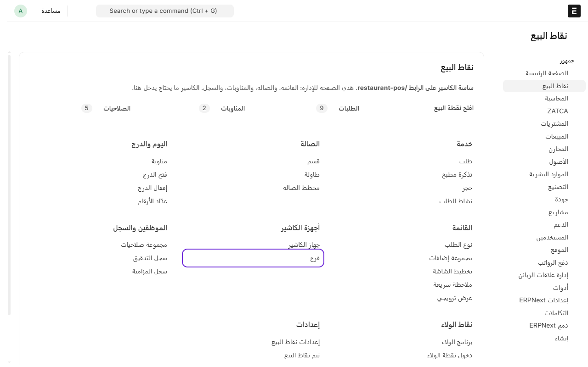
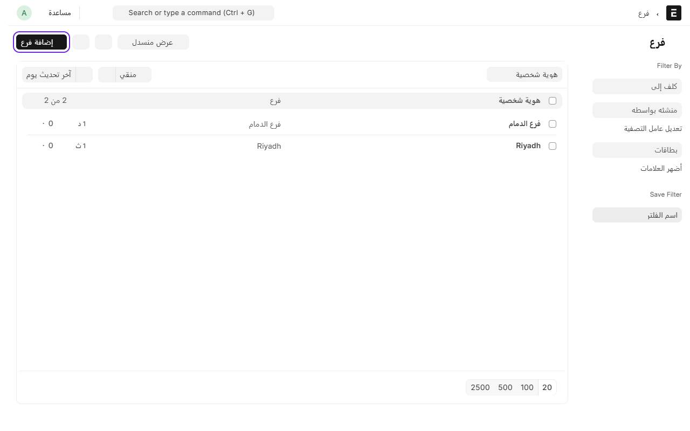
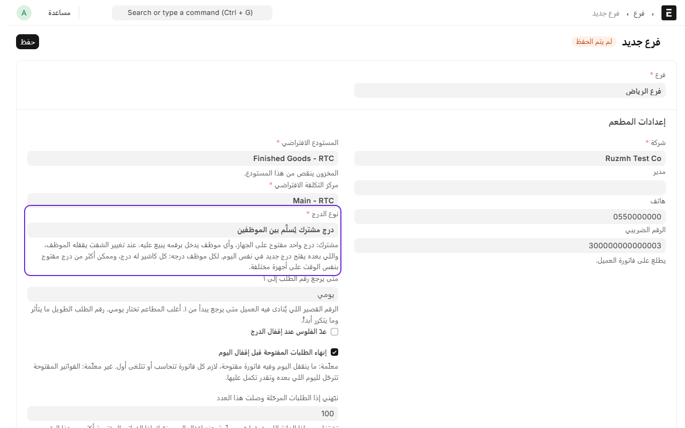
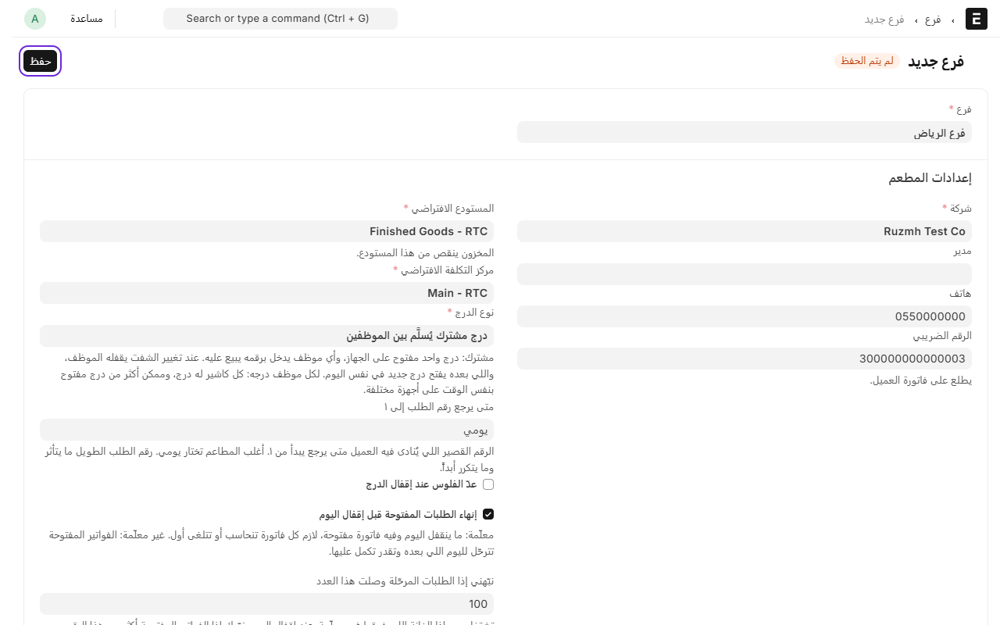

# إضافة فرع

الفرع هو أول شي تسويه في النظام، لأن الطابعات وأجهزة الكاشير والطاولات كلها تنربط فيه. إذا عندك محل واحد يكفيك فرع واحد.

## الطريقة الأسرع: الإعداد السريع

من **نقاط البيع**، تحت **الأجهزة والفروع**، اضغط **الإعداد السريع**. تكتب:

- **اسم الفرع**، مثل فرع العليا.
- **وش فيه الفرع:** صالة (وعدد طاولاتها)، سفري، توصيل.
- **اسم جهاز الكاشير**، وقائمة الأسعار وقالب الضريبة (لو تركتها فاضية ياخذ الافتراضي).

واضغط **إنشاء**. يتسوّى الفرع على مستودع ومركز تكلفة شركتك، والأقسام، والطاولات، وجهاز الكاشير بطريقة الدفع النقدي. **ويطلع لك رمز ربط الجهاز** على طول، فتربط جهاز الكاشير وتكمل الأصناف والموظفين. وتقدر تعدّل أي شي بعدين من شاشته.

## الطريقة اليدوية

لإضافة فرع جديد، اتبع الخطوات التالية:

1. من المكتب، ادخل على **نقاط البيع**.
2. تحت **الأجهزة والفروع**، اضغط على **الفروع**.

3. اضغط على **إضافة فرع**.

4. اكتب اسم الفرع، مثلاً «فرع الرياض».
5. اختر **الشركة**.
6. اكتب **رقم الهاتف** و**الرقم الضريبي**. الرقم الضريبي يطلع على فاتورة العميل، فتأكد إنه صحيح.
7. اختر **المستودع الافتراضي**، وهو المستودع اللي ينقص منه المخزون لما تبيع.
8. اختر **مركز التكلفة الافتراضي**.
9. اختر **نوع الدرج**:
   - **درج مشترك يُسلَّم بين الموظفين**: إذا الموظفين يتبادلون على نفس جهاز الكاشير. هذا الأنسب لأغلب المطاعم.
   - **لكل موظف درجه**: إذا كل كاشير له جهاز وصندوق فلوس خاص فيه.

10. اضغط على **حفظ**.

باقي الخانات في الصفحة جاهزة بقيم تناسب أغلب المطاعم، وتقدر تتركها مثل ما هي. وإذا حاب تغيّر شي، تحت كل خانة سطر يشرح وش تسوي.

---

التالي: [إضافة قسم وطاولات](add-section-and-tables.md)

الرجوع لـ[صفحة البداية](README.md)
