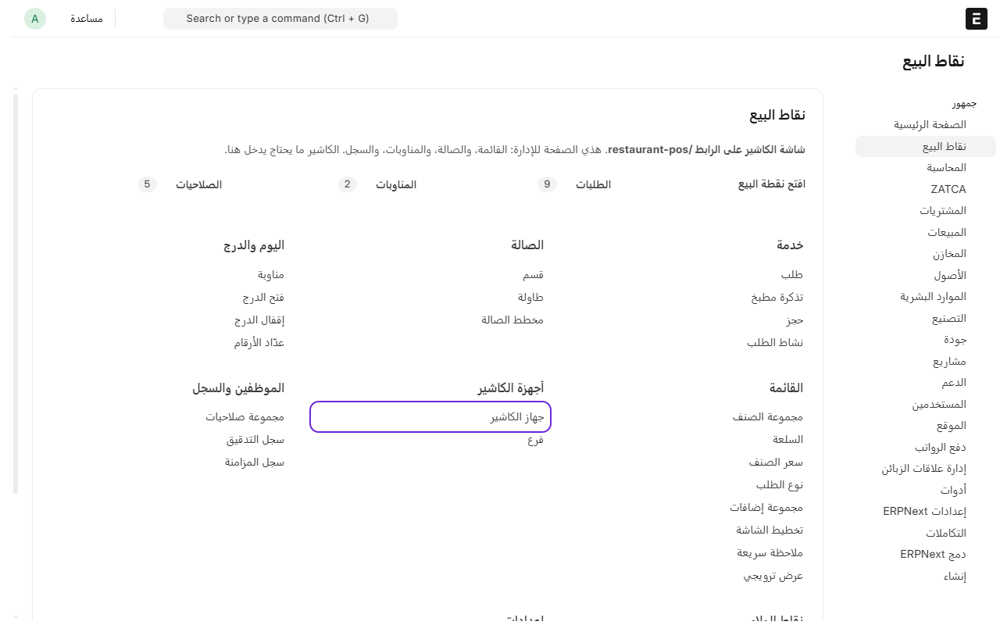
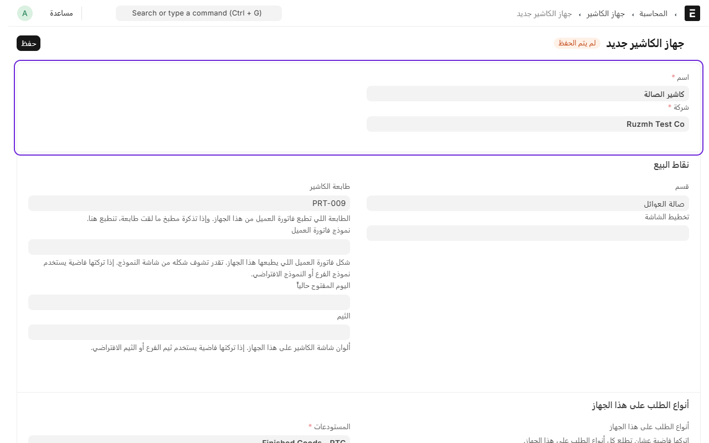
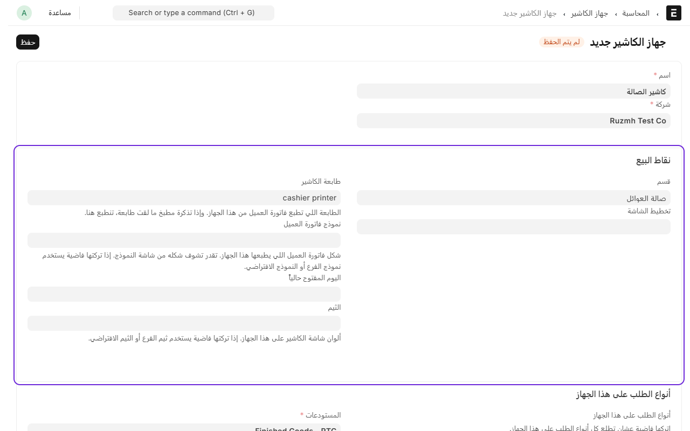
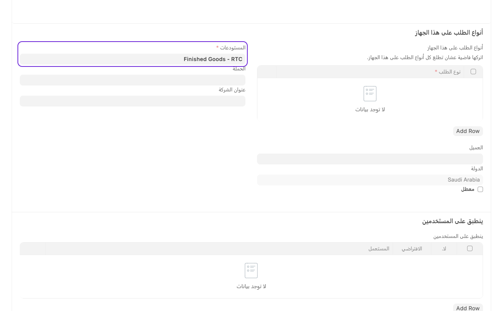
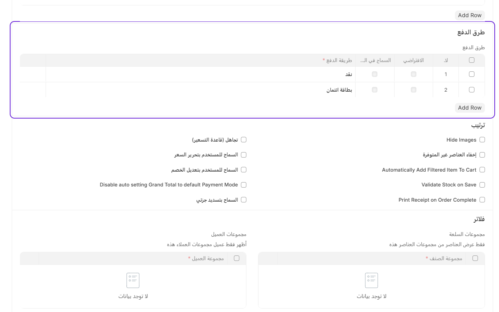
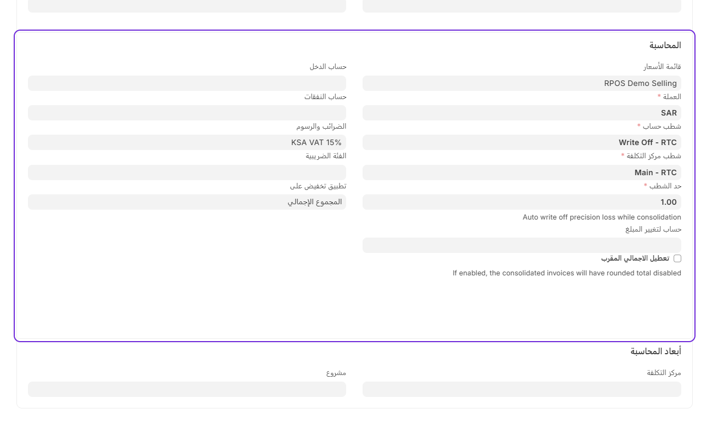
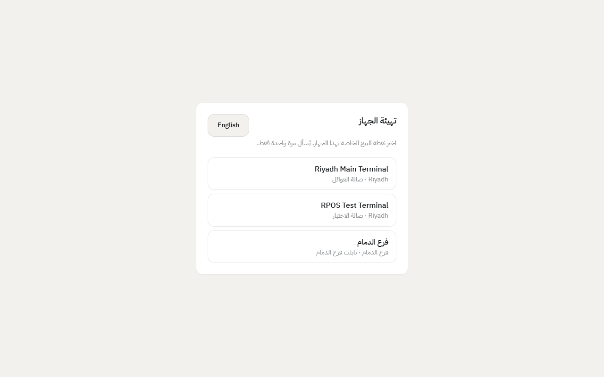

# إضافة جهاز كاشير

كل جهاز يشتغل عليه الكاشير (كمبيوتر أو تابلت) له ملف في النظام. الملف يحدد القسم اللي يبيع فيه الجهاز، والطابعة اللي تطبع فاتورة العميل، وطرق الدفع، وقائمة الأسعار والضريبة.

إذا عندك جهازين كاشير، تسوي ملفين.

## إضافة الجهاز في النظام

1. من المكتب، ادخل على **نقاط البيع**.
2. تحت **الأجهزة والفروع**، اضغط على **أجهزة الكاشير**.

3. اضغط على **إضافة جهاز الكاشير**.
4. اكتب **اسم** للجهاز، مثل «كاشير الصالة»، واختر **الشركة**.

5. تحت **نقاط البيع**:
   - اختر **القسم** اللي يبيع فيه الجهاز.
   - اختر **طابعة الكاشير**، وهي الطابعة اللي تطبع فاتورة العميل.
   - **نموذج فاتورة العميل** اختياري. إذا تركته فاضي يطبع بالنموذج الافتراضي.

6. اختر **المستودعات**، واختر **العميل**.

   **العميل إجباري.** كل بيع على هذا الجهاز ينسجل على هذا العميل إلا إذا اختار الكاشير عميل ثاني في الطلب. وبدونه شاشة الدفع ترفض وتقول لك «اختر العميل الافتراضي في ملف جهاز الكاشير قبل الدفع». وإذا ما عندك عميل جاهز، سوِّ عميل باسم «زبون» أو «Walk-in» واستخدمه.

7. تحت **طرق الدفع**، اضغط **Add Row** وأضف كل طريقة يقبلها الكاشير، مثل «نقد» و«بطاقة ائتمان». شاشة الدفع تعرض هذي الطرق بس.

8. تحت **المحاسبة**:
   - اختر **قائمة الأسعار**. لازم تكون نفس القائمة اللي حطيت فيها أسعار الأصناف.
   - اختر **الضرائب والرسوم**، مثل ضريبة القيمة المضافة 15%.
   - اختر **شطب حساب** و**شطب مركز التكلفة**. هذي خانات إجبارية من النظام المحاسبي، ويحددها المحاسب.
9. اضغط على **حفظ**.

## ربط الجهاز

كل ملف جهاز يرتبط بجهاز واحد بس، عن طريق **رمز ربط** زي ما تسوي بالضبط في التطبيقات الثانية. والرمز يشتغل مرة وحدة ولمدة ١٠ دقائق.

1. في المكتب، افتح ملف الجهاز اللي أضفته، واضغط زر **ربط جهاز كاشير** فوق. يطلع لك رمز من ٨ أرقام.
2. على جهاز الكاشير، افتح المتصفح وادخل على رابط النظام وبعده `/restaurant-pos`.
3. سجّل الدخول.
4. النظام يطلب منك **رمز الربط**. اكتب الرمز، واكتب **اسم هذا الجهاز** عشان تعرفه بعدين، مثل «كاشير الباب».
5. اضغط **اربط هذا الجهاز**.

الجهاز يحفظ ارتباطه، وما يسألك مرة ثانية. ولو فتحت نفس الملف من جهاز ثاني، النظام يرفض ويقول إنه مرتبط بجهاز غيره.

## تغيير الجهاز أو استبداله

إذا خرب الجهاز أو تبي تنقل الملف لجهاز ثاني:

- **افتح ملف الجهاز في المكتب واضغط ربط جهاز كاشير** واستخدم الرمز على الجهاز الجديد. الجهاز القديم يفقد ارتباطه تلقائياً.
- أو اضغط **فك ارتباط الجهاز** إذا تبي تخلي الملف متاح بدون ما تربط أحد الحين.

وتقدر تشوف في الملف اسم الجهاز المرتبط ووقت الربط ومين ربطه. وكل ربط وفك ارتباط ينكتب في **سجل العمليات**.

---

السابق: [مراكز التحضير: أي صنف يطبع في أي مطبخ](production-centers.md)

التالي: [إضافة أنواع الطلب: محلي، سفري، توصيل](add-order-types.md)

الرجوع لـ[صفحة البداية](README.md)
