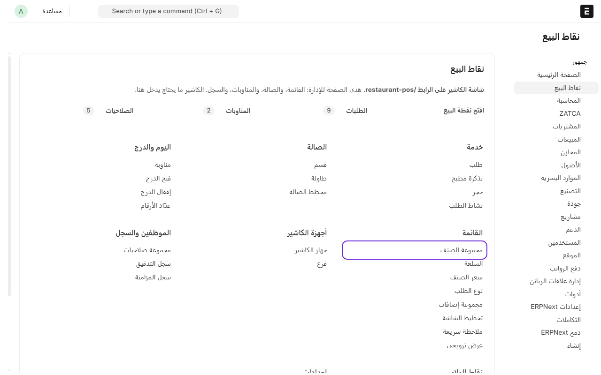
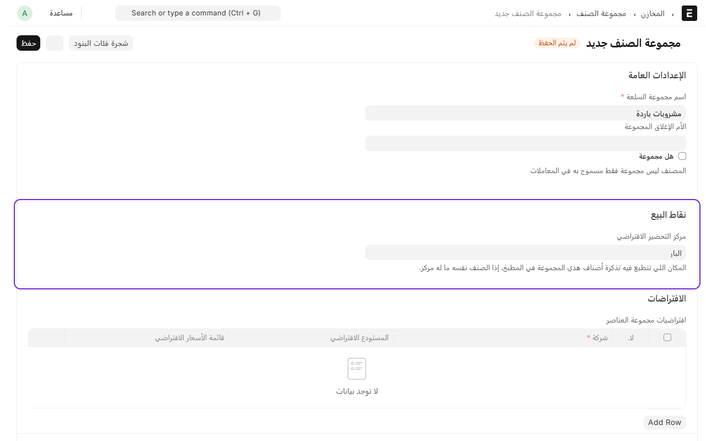
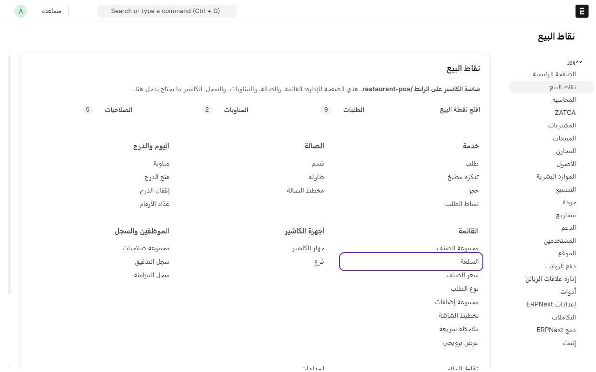
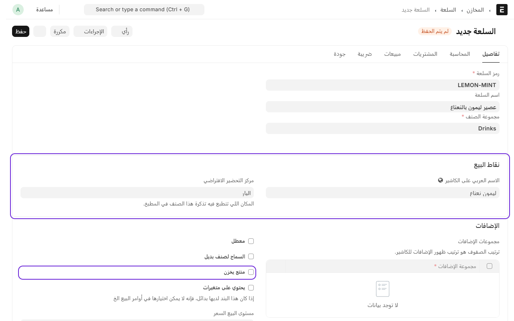
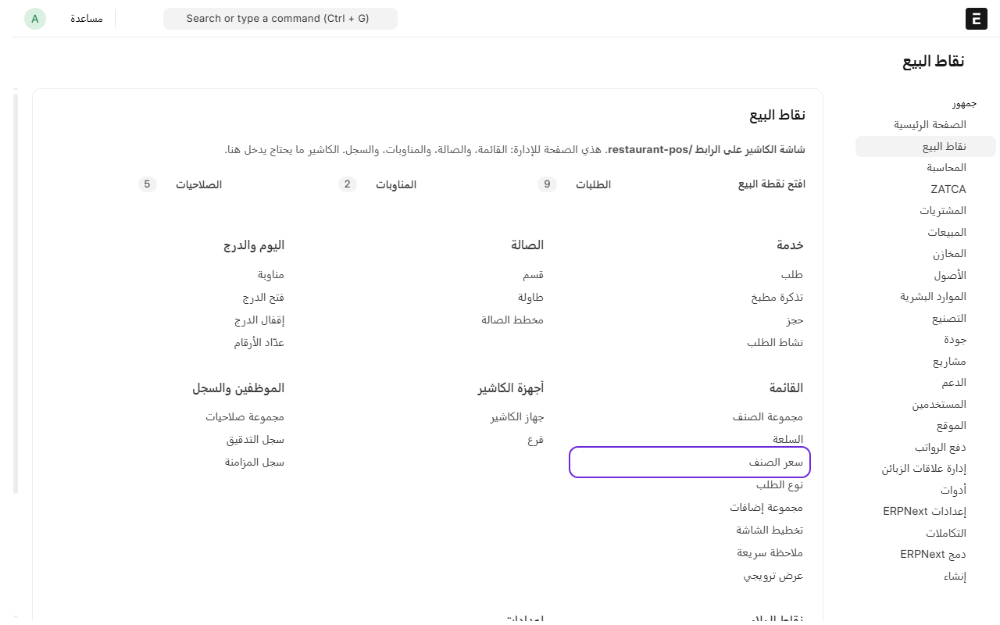
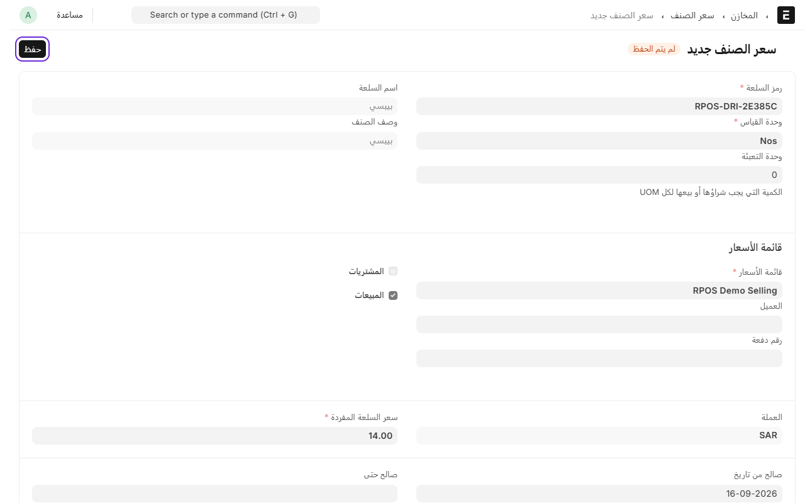
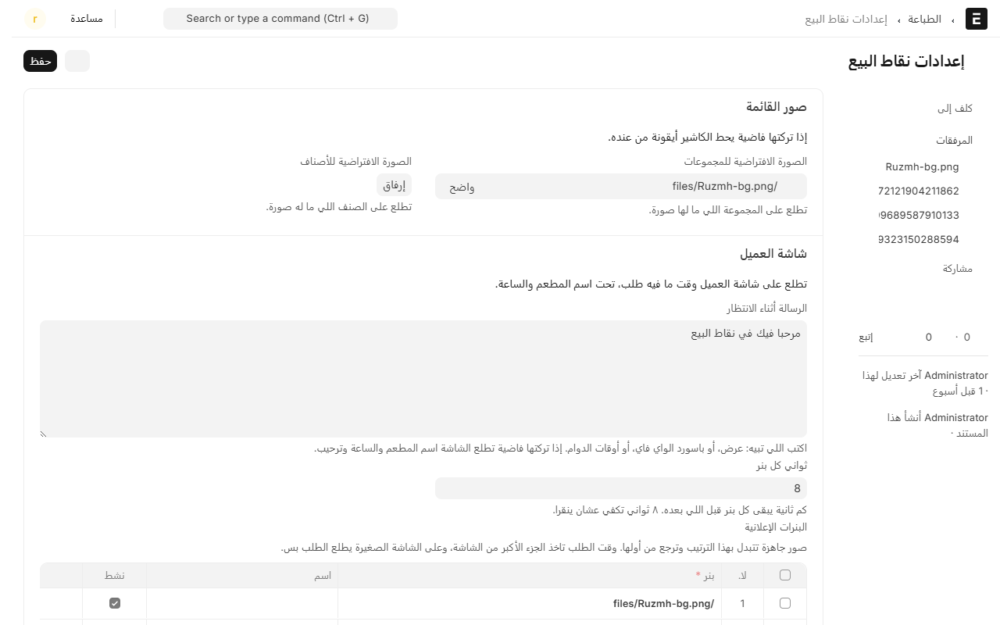

# إضافة الأصناف والأسعار

الأصناف هي اللي تطلع للكاشير في شاشة البيع. كل صنف يكون داخل مجموعة، مثل «مشروبات» أو «مشاوي»، وله سعر.

الترتيب: تضيف المجموعة، بعدها الصنف، بعدها السعر.

## إضافة مجموعة

1. من المكتب، ادخل على **نقاط البيع**.
2. تحت **القائمة**، اضغط على **مجموعات الأصناف**.

3. اضغط على **إضافة مجموعة الصنف**.
4. اكتب اسم المجموعة، مثلاً «مشروبات باردة».
5. تحت **نقاط البيع**، اختر **مركز التحضير الافتراضي**، وهو المكان اللي تنطبع فيه تذاكر أصناف هذي المجموعة في المطبخ، مثل «البار».
6. اضغط على **حفظ**.

## إضافة صنف

1. من **نقاط البيع**، تحت **القائمة**، اضغط على **الأصناف**.

2. اضغط على **إضافة السلعة**.
3. اكتب **رمز السلعة**، وهو رمز قصير بالإنجليزي ما يتكرر، مثل LEMON-MINT.
4. اكتب **اسم السلعة**.
5. اختر **مجموعة الصنف**.
6. **اختياري:** إذا كتبت اسم الصنف بالإنجليزي، اكتب الاسم بالعربي تحت **نقاط البيع** في خانة **الاسم العربي على الكاشير**. إذا تركتها فاضية، الكاشير يعرض اسم الصنف اللي كتبته فوق.
7. إذا الصنف ينطبع في مكان غير مكان مجموعته، اختر له **مركز التحضير الافتراضي**.
8. **قرّر هل الصنف له مخزون أو لا:**

   - **صنف تشتريه وتعدّه** (علب مياه، مشروبات جاهزة، أكياس قهوة): خلّ **منتج يخزن** معلّمة. بكذا يكون له سعر شراء وتكلفة وحركة مخزنية وتقارير أرباح.
   - **صنف يتجهّز في المطبخ وما تعدّه** (طبق، عصير طازج): شيل **منتج يخزن**. المطبخ يستهلك المواد الخام، وهي اللي تتراقب، مو الطبق نفسه.

9. **إذا الصنف مخزني وتبيع منه بسرعة أكثر من إدخال المشتريات**، علّم عليه **السماح بالمخزون السالب** (Allow Negative Stock) في بطاقة الصنف نفسها.

   بكذا الكاشير ما يتوقف أبداً حتى لو رصيد النظام صفر والبضاعة قدامك على الرف، والرصيد ينزل تحت الصفر لين تدخل فاتورة الشراء فيتصحّح. وإذا ما علّمتها ورصيده صفر، شاشة الدفع تنبهك قبل ما تستلم الفلوس وتقول لك اسم الصنف والمستودع.

   **ولازم تكتب «معدل التقييم»** في بطاقة الصنف، وهو **تكلفة الوحدة** عليك. أي صنف مخزني بدون تكلفة يرفض النظام إصدار فاتورته، لأنه ما يعرف كم يسجّل في تكلفة البضاعة المباعة.

   اكتب سعر الشراء التقريبي ولا تتردد. لو بعت والتكلفة عندك 5 ثم اشتريت فعلياً بـ10، النظام يحسب الفرق ويسجّله وقت ما تدخل فاتورة الشراء، فما يضيع عليك شي. وإذا أدخلت فاتورة الشراء بتاريخ **قبل** البيع، يصحّح تكلفة البيع نفسها ويطلع كل شي مضبوط بدون أي فرق.
10. اضغط على **حفظ**.

خانة **الاسم العربي على الكاشير** موجودة عشان بعض المطاعم تكتب أسماء الأصناف بالإنجليزي في النظام، لأجل المخزون والتقارير والمحاسب، وتبغى الكاشير يشوفها بالعربي. فإذا أسماء أصنافك عربية من البداية، ما تحتاجها.

بعد الحفظ تقدر تضيف صورة للصنف، وتطلع الصورة على زره في شاشة الكاشير.

## إضافة سعر

1. من **نقاط البيع**، تحت **القائمة**، اضغط على **أسعار الأصناف**.

2. اضغط على **إضافة سعر الصنف**.
3. اختر **رمز السلعة**.
4. اختر **قائمة الأسعار**. لازم تكون نفس قائمة الأسعار اللي على جهاز الكاشير.
5. اكتب السعر في **سعر السلعة المفردة**.
6. اضغط على **حفظ**.

> الصنف اللي ما له سعر يطلع للكاشير بلون باهت ومكتوب تحته «بلا سعر»، وما ينباع.

## صور الأصناف والمجموعات

صورة الصنف تطلع على زره في شاشة الكاشير، وتخلي الكاشير يلقاه بالعين بدل ما يقرا. تضيفها من بطاقة الصنف بعد الحفظ.

**وإذا ما عندك صور لكل الأصناف**، حط صورة افتراضية وحدة تطلع على كل اللي ما له صورة، بدل الأيقونة الرمادية:

1. من المكتب، افتح **نقاط البيع** ثم **إعدادات**، واضغط **إعدادات نقاط البيع**.
2. تحت **صور القائمة** تلقى خانتين:
   - **الصورة الافتراضية للمجموعات**
   - **الصورة الافتراضية للأصناف**
3. ارفع الصورة واحفظ.

الترتيب: صورة الصنف نفسه أولاً، وإن ما كان له صورة تطلع الافتراضية، وإن ما حطيت افتراضية يرسم الكاشير أيقونة من عنده.

**نصيحة:** خلّ الصور مربعة وصغيرة (٥٠٠×٥٠٠ بكسل تكفي). الصور الكبيرة تثقّل شاشة الكاشير بلا فايدة.

> نفس الصفحة فيها إعدادات **شاشة العميل** — الرسالة والبنرات. شرحها في [تشغيل شاشة العميل](customer-display.md).

---

السابق: [إضافة طابعة](add-printer.md)

التالي: [مراكز التحضير: أي صنف يطبع في أي مطبخ](production-centers.md)

الرجوع لـ[صفحة البداية](README.md)
