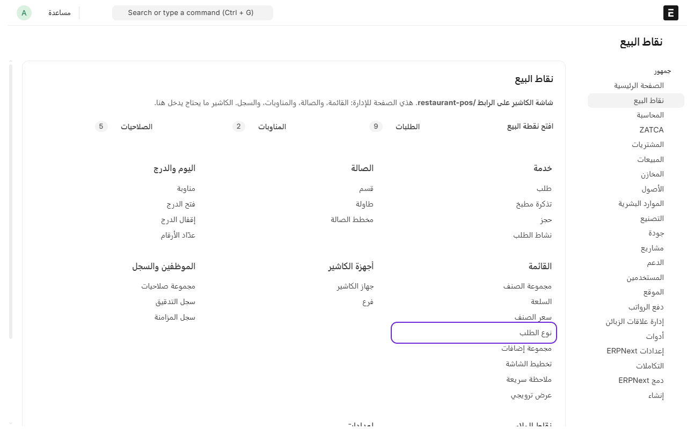
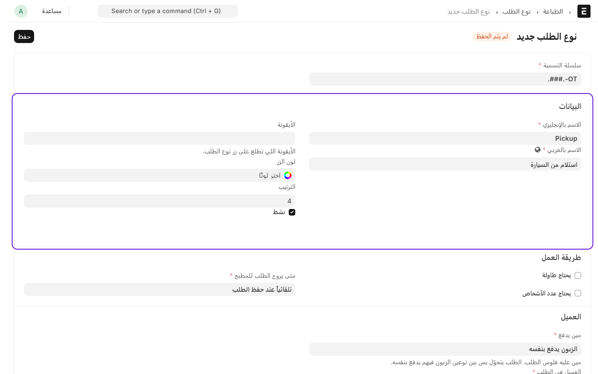
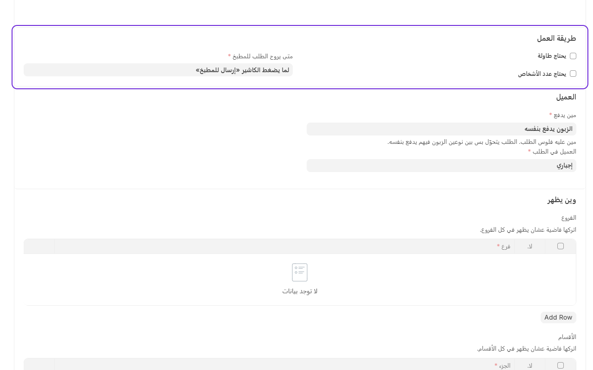
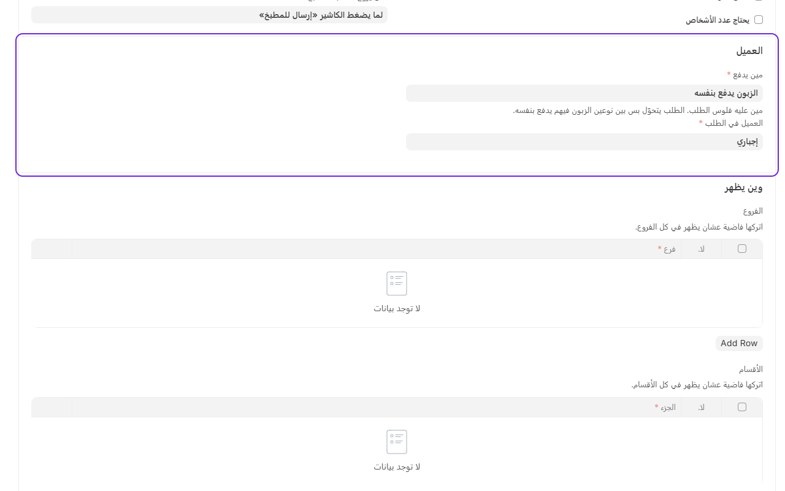
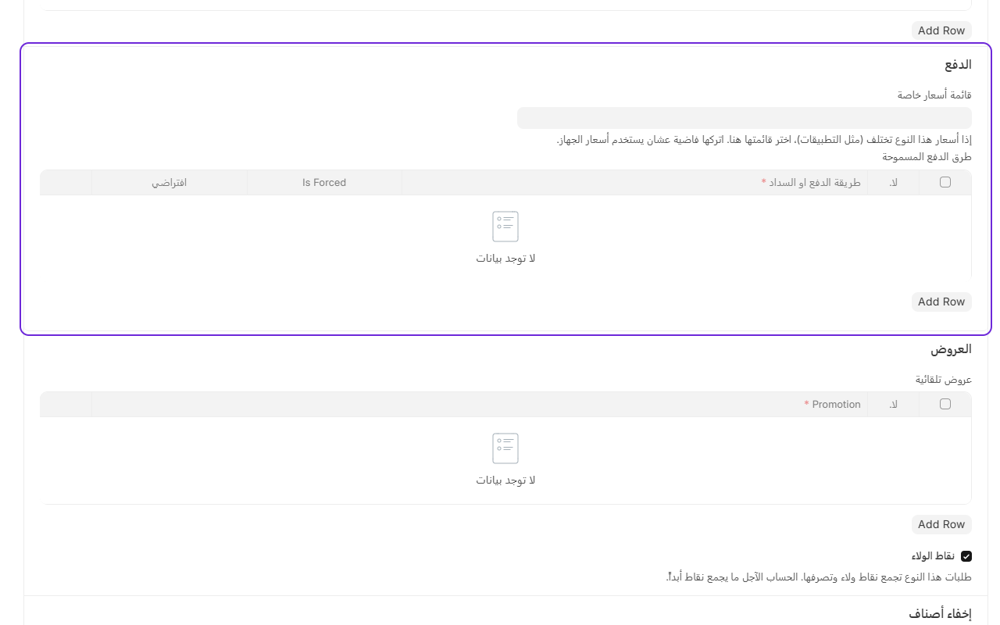
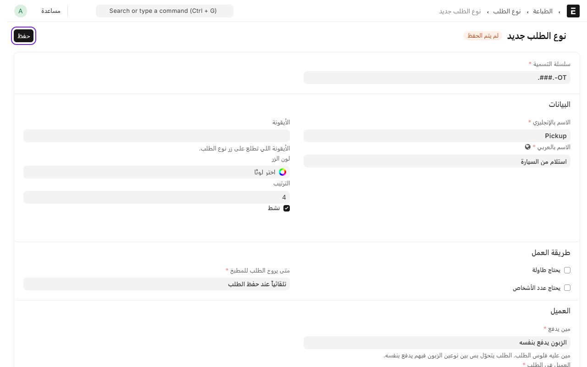

# إضافة أنواع الطلب

نوع الطلب هو الزر اللي يختاره الكاشير أول ما يفتح طلب جديد، مثل **محلي** أو **سفري** أو **توصيل** أو **جاهز**. كل نوع له طريقة شغل: هل يحتاج طاولة، ومتى يروح للمطبخ، ومين يدفع.

النظام يجي معه أنواع جاهزة، وتقدر تعدّلها أو تضيف نوع جديد.

## الخطوات

1. من المكتب، ادخل على **نقاط البيع**.
2. تحت **القائمة**، اضغط على **أنواع الطلب**.

3. اضغط على **إضافة نوع الطلب**.
4. اكتب **الاسم بالإنجليزي** و**الاسم بالعربي**، مثل «استلام من السيارة».
5. **الترتيب** يحدد مكان الزر بين أنواع الطلب في شاشة الكاشير.

6. تحت **طريقة العمل**:
   - علّم **يحتاج طاولة** إذا الطلب داخل المطعم. وعلّم **يحتاج عدد الأشخاص** إذا تبغى الكاشير يكتب كم شخص على الطاولة.
   - اختر **متى يروح الطلب للمطبخ**:
     - **لما يضغط الكاشير «إرسال للمطبخ»**: الكاشير يقرر متى يرسل. مناسب للمحلي.
     - **تلقائياً عند حفظ الطلب**: يروح للمطبخ لما يخلص الكاشير من الطلب ويفتح طلب ثاني أو يبدأ طلب جديد، أو لما يدفع. مناسب للتوصيل.
     - **عند الدفع**: ما يروح للمطبخ إلا بعد ما يدفع الزبون. مناسب للسفري.

7. تحت **العميل**:
   - اختر **مين يدفع**:
     - **الزبون يدفع بنفسه**: للمحلي والسفري والتوصيل حقك.
     - **حساب آجل على جهة**: لتطبيقات التوصيل مثل جاهز وهنقرستيشن، أو شركة تحاسبها آخر الشهر.
   - اختر **العميل في الطلب**: **اختياري**، أو **إجباري** إذا لازم الكاشير يكتب اسم العميل ورقمه، أو **عميل ثابت** إذا الطلبات كلها لجهة وحدة، مثل «جاهز»، وتختار العميل تحتها.

8. تحت **الدفع**:
   - **قائمة أسعار خاصة**: إذا أسعار هذا النوع غير أسعار المحل، مثل أسعار التطبيقات، اختر قائمتها هنا. إذا نفس الأسعار اتركها فاضية.
   - **طرق الدفع المسموحة**: إذا تبغى هذا النوع يقبل طرق معينة بس، أضفها هنا.
   - **نقاط الولاء**: شيل العلامة إذا ما تبغى هذا النوع يجمع نقاط.

9. اضغط على **حفظ**.

## تبغى النوع يظهر في مكان معين بس؟

تحت **وين يظهر** تقدر تحدد **الفروع** أو **الأقسام** أو **أجهزة الكاشير** أو **الأدوار** اللي يظهر لها هذا النوع. إذا تركتها فاضية، يظهر في كل مكان.

---

السابق: [إضافة جهاز كاشير](add-device.md)

التالي: [إضافة موظف ورقمه السري](add-staff.md)

الرجوع لـ[صفحة البداية](README.md)
