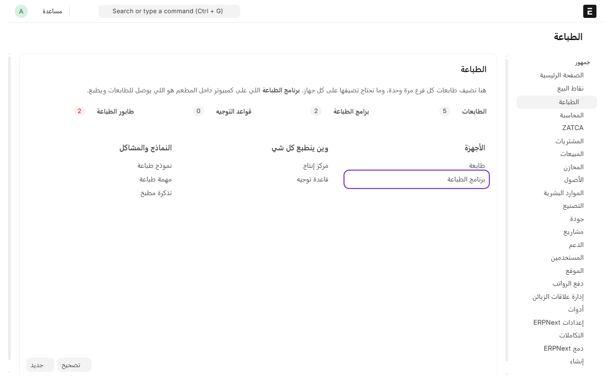
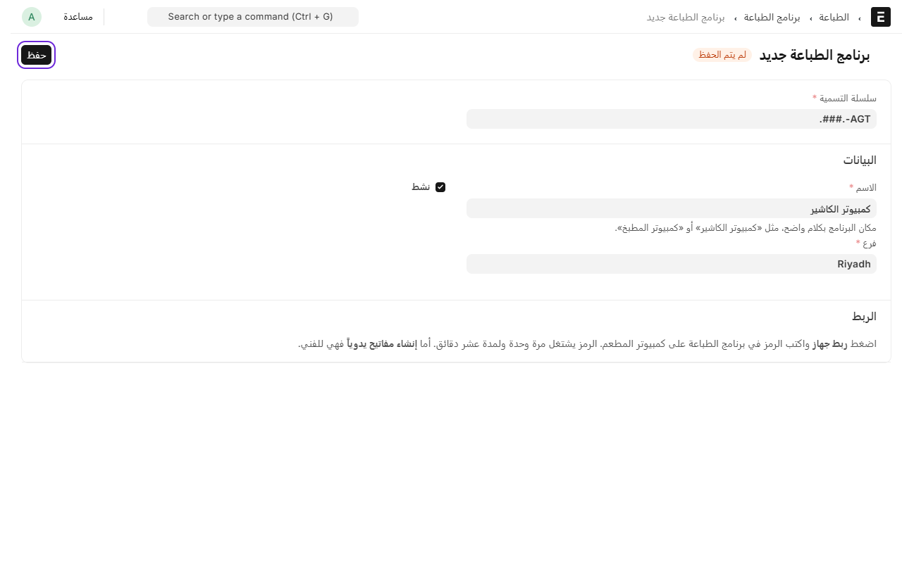
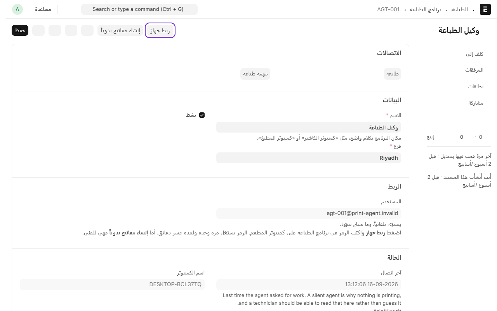
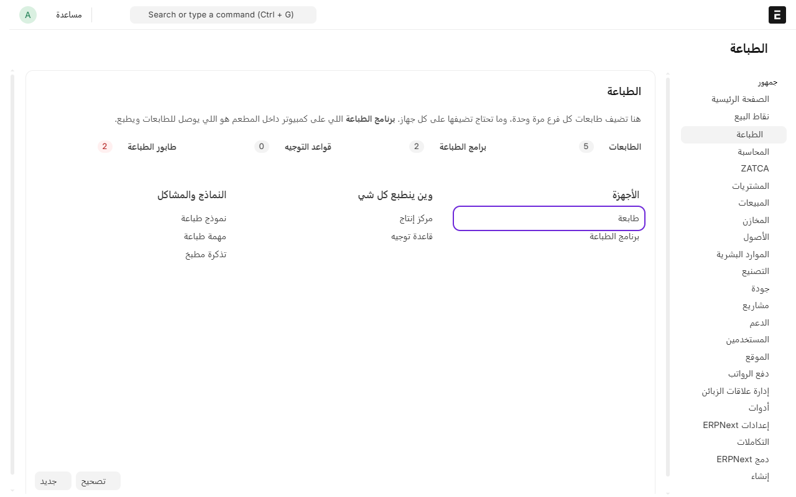
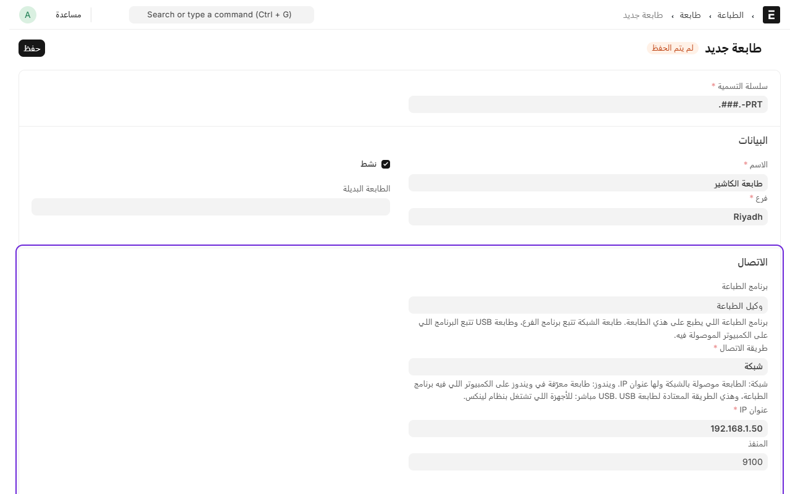
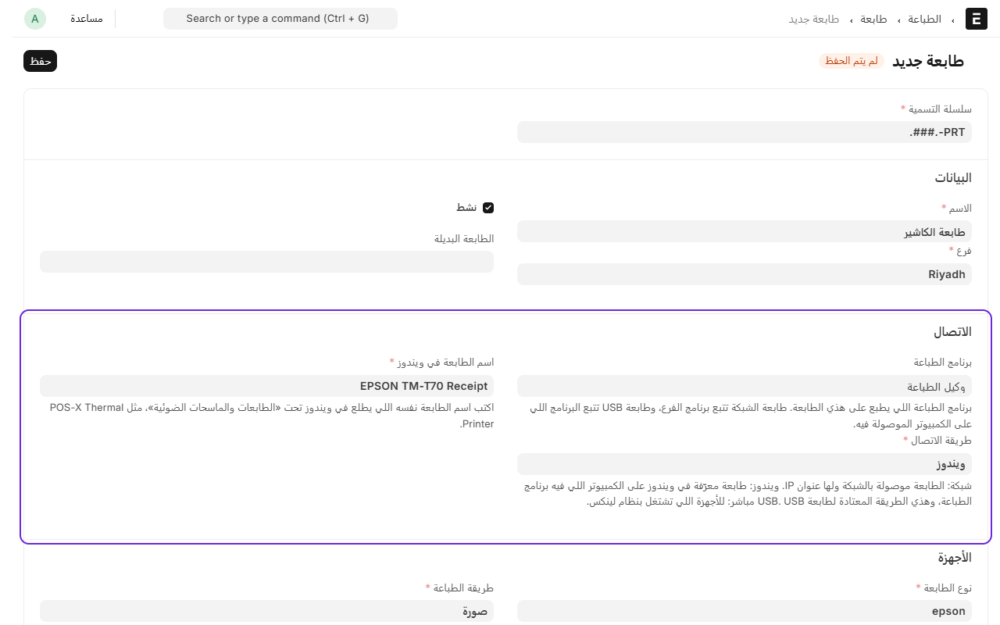
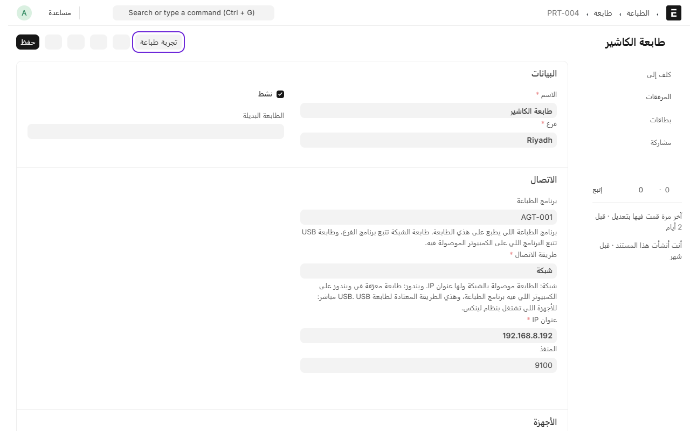

# إضافة طابعة

عشان النظام يطبع فواتير العملاء وتذاكر المطبخ، تحتاج شيئين:

- **برنامج الطباعة**: برنامج صغير يشتغل على كمبيوتر داخل المطعم، وهو اللي يوصل للطابعات. يكفي برنامج واحد للفرع.
- **الطابعة**: تضيفها في النظام وتربطها بالبرنامج.

## أولاً: تشغيل برنامج الطباعة

هذي الخطوة تسويها مرة وحدة لكل فرع.

1. من المكتب، افتح **نقاط البيع** ثم **الطباعة**.
2. تحت **الأجهزة**، اضغط على **برنامج الطباعة**.

3. اضغط على **إضافة برنامج الطباعة**.
4. اكتب اسم يوضح مكان الكمبيوتر، مثل «كمبيوتر الكاشير»، واختر **الفرع**.
5. اضغط على **حفظ**.

6. بعد الحفظ، اضغط على **ربط جهاز**. بيطلع لك **عنوان الموقع** و**رمز الربط**.

7. على كمبيوتر المطعم، شغّل برنامج **RPOS Print Agent**.
8. اكتب عنوان الموقع ورمز الربط، واضغط **اربط**.

لما يتم الربط، تطلع أيقونة البرنامج خضراء جنب الساعة في ويندوز. والبرنامج يشتغل تلقائياً كل ما يشتغل الكمبيوتر.

> الرمز يشتغل مرة وحدة ولمدة عشر دقائق. إذا انتهى، اضغط **ربط جهاز** مرة ثانية.

## ثانياً: إضافة الطابعة

1. من **الطباعة**، تحت **الأجهزة**، اضغط على **طابعة**.

2. اضغط على **إضافة طابعة**.
3. اكتب اسم الطابعة، مثل «طابعة الكاشير» أو «طابعة المطبخ»، واختر **الفرع**.
4. اختر **برنامج الطباعة** اللي أضفته.
5. اختر **طريقة الاتصال**:

**إذا الطابعة موصولة بالشبكة**، اختر **شبكة** واكتب **عنوان IP** حقها. تلقى العنوان مطبوع في ورقة إعدادات الطابعة.

**إذا الطابعة موصولة بالكمبيوتر بسلك USB**، اختر **ويندوز** واكتب **اسم الطابعة في ويندوز** بالضبط مثل ما يطلع في إعدادات ويندوز تحت «الطابعات والماسحات الضوئية».

6. اختر **عرض الورق**، غالباً 80mm.
7. اضغط على **حفظ**.

## جرّب الطابعة

بعد الحفظ، اضغط على **تجربة طباعة**. بتطلع ورقة تجربة من الطابعة.

إذا ما طلعت الورقة خلال 30 ثانية:

- تأكد إن الطابعة شغالة وفيها ورق.
- افتح **برنامج الطباعة** في النظام وشوف **آخر اتصال**. إذا صار له وقت طويل، فالبرنامج مطفي على الكمبيوتر أو الكمبيوتر ما فيه إنترنت.
- تأكد من عنوان IP أو اسم الطابعة في ويندوز.

إذا الورقة طلعت ناقصة من الجنب، اكتب **512** في خانة **عرض الطباعة (بالنقاط)** وجرّب مرة ثانية.

وإذا وقفت الطباعة بعدين وأنت شغّال، شوف [الطباعة ما اشتغلت؟](printing-problems.md).

---

السابق: [إضافة قسم وطاولات](add-section-and-tables.md)

التالي: [مراكز التحضير: أي صنف يطبع في أي مطبخ](production-centers.md)

الرجوع لـ[صفحة البداية](README.md)
