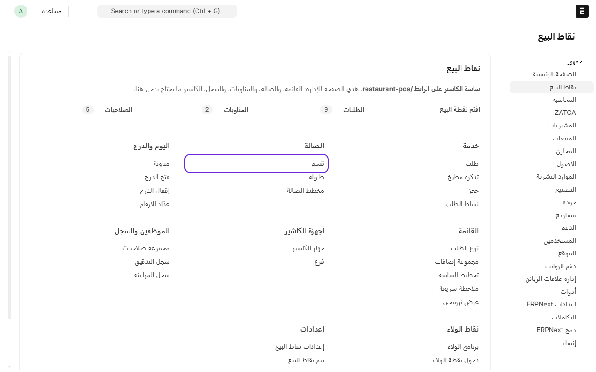
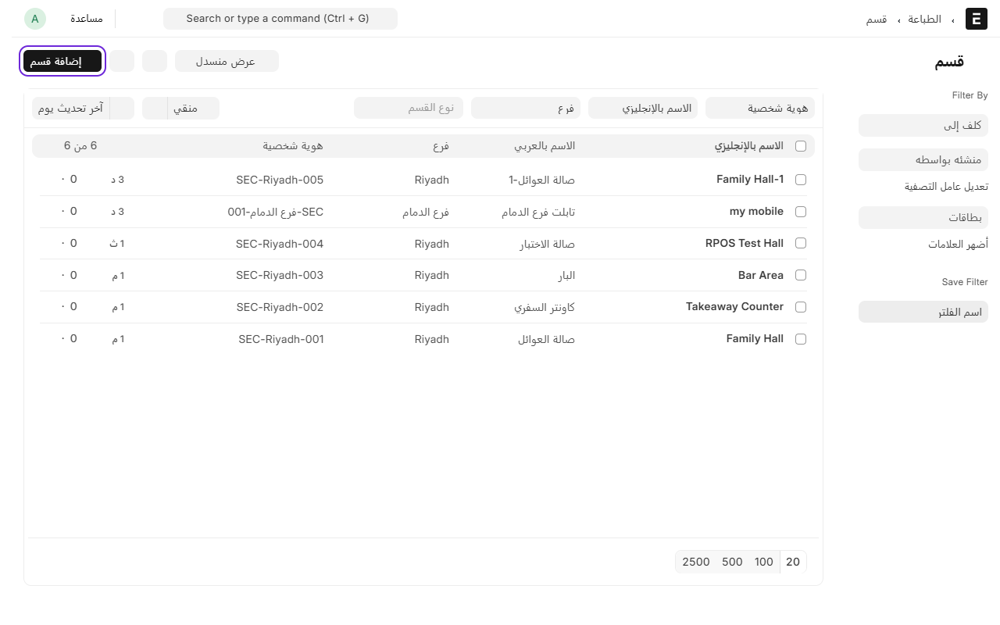
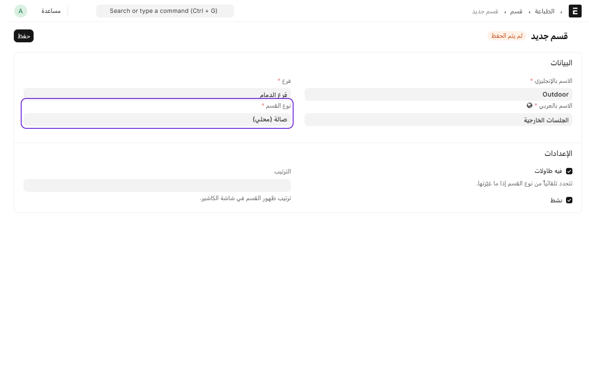
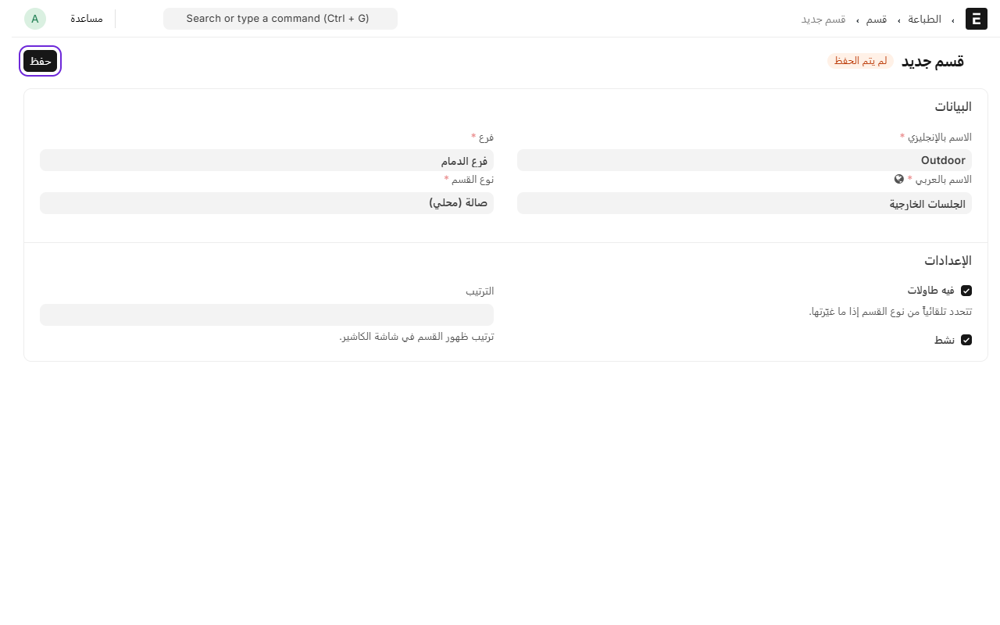
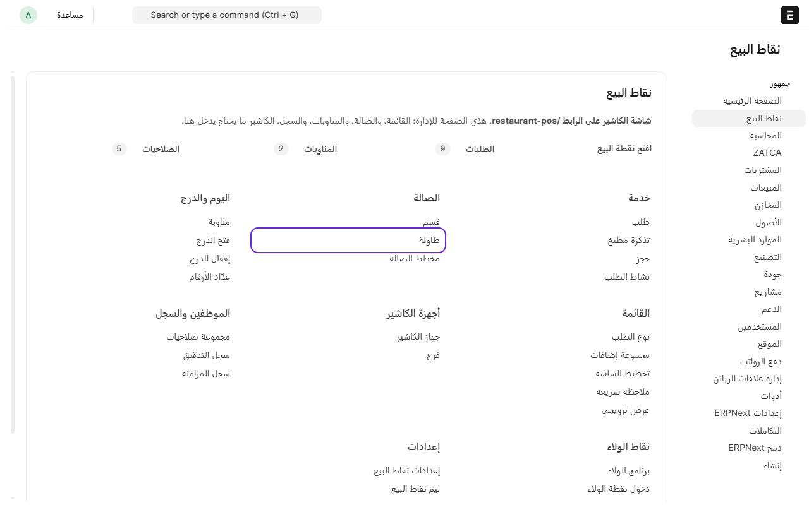
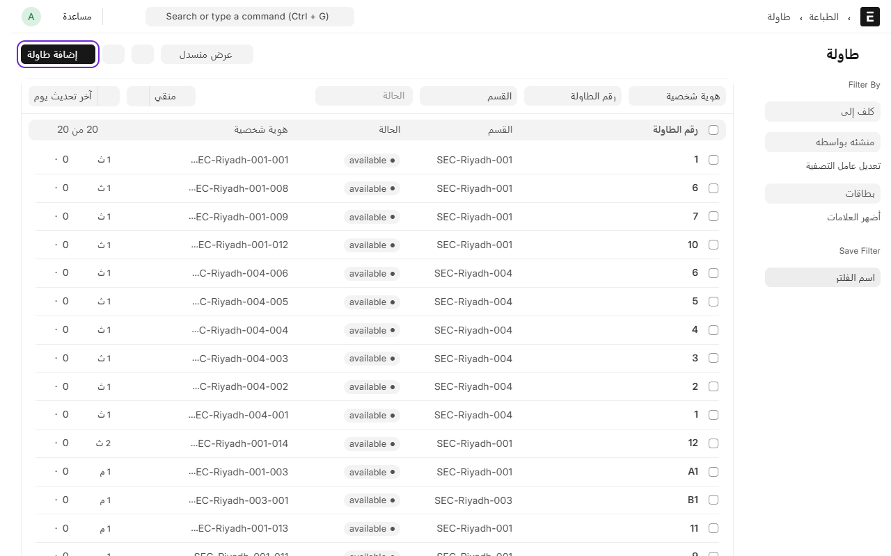
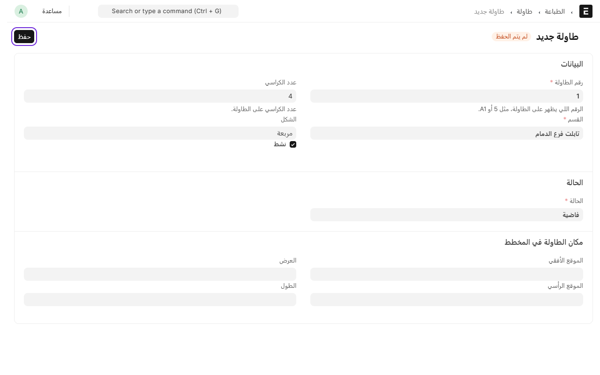

# إضافة قسم وطاولات

القسم هو جزء من الفرع، مثل «صالة العوائل» أو «الجلسات الخارجية» أو «كاونتر السفري». والطاولات تنضاف داخل القسم.

الترتيب دايماً: **الفرع**، ثم **قسم الفرع**، ثم **الجهاز**. الجهاز ما له خانة فرع، هو يعرف فرعه من قسمه. فحتى لو محلك سفري أو سوبر ماركت بدون صالة، تحتاج قسم واحد على الأقل تربط فيه الأجهزة.

## إضافة قسم

1. من المكتب، ادخل على **نقاط البيع**.
2. افتح **الفروع والأجهزة**، واضغط على **أقسام الفروع**.

3. اضغط على **إضافة قسم**.

4. اكتب **الاسم بالإنجليزي** و**الاسم بالعربي**.
5. اختر **الفرع**.
6. اختر **نوع القسم**:
   - **صالة (محلي)** أو **بار**: القسم فيه طاولات.
   - **كاونتر** أو **سفري** أو **توصيل**: القسم بدون طاولات.

7. اضغط على **حفظ**.

خانة **فيه طاولات** تتعلّم لحالها على حسب نوع القسم، فما تحتاج تغيّرها.
وإذا عندك أكثر من قسم، خانة **الترتيب** تحدد مين يطلع أول في شاشة الكاشير.

## إضافة طاولة

1. من **نقاط البيع**، تحت **الصالة**، اضغط على **الطاولات**.

2. اضغط على **إضافة طاولة**.

3. اكتب **رقم الطاولة**، مثل 1 أو A1. هذا الرقم اللي يشوفه الكاشير.
4. اختر **القسم** اللي فيه الطاولة.
5. اكتب **عدد الكراسي**.
6. اضغط على **حفظ**.

كرر الخطوات لكل طاولة. الطاولات تطلع في شاشة الكاشير تحت **الطاولات**، مرتبة حسب القسم.

---

السابق: [فتح الكاشير من اختصار خاص](till-shortcut.md)

التالي: [إضافة طابعة](add-printer.md)

الرجوع لـ[صفحة البداية](README.md)
