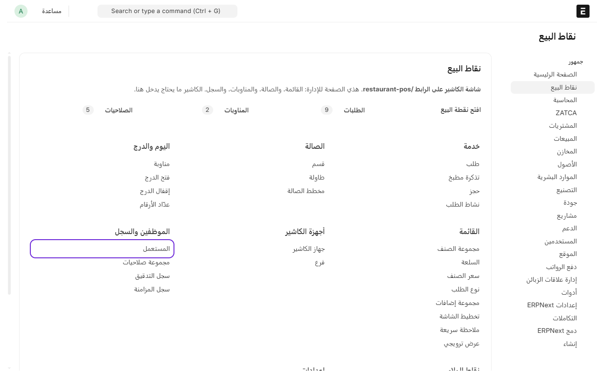
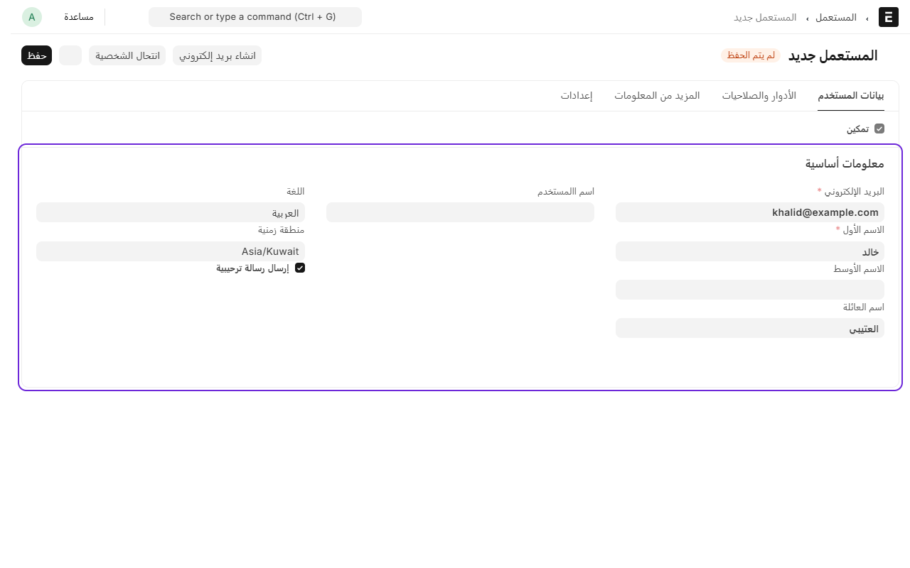
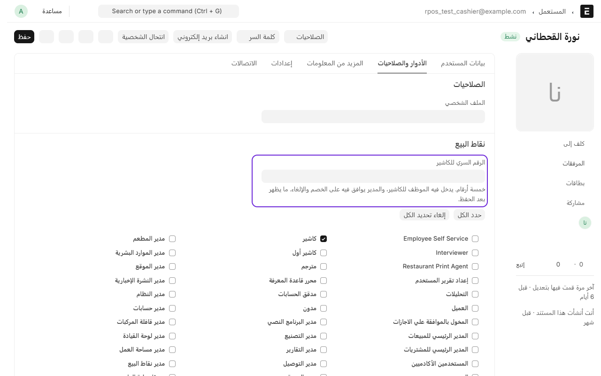
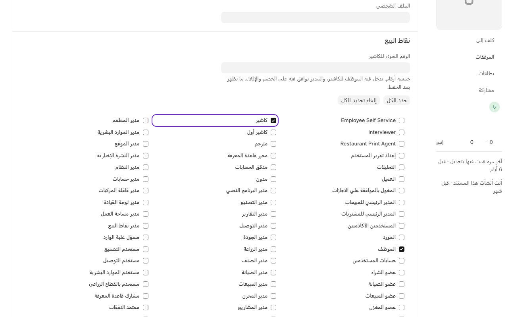
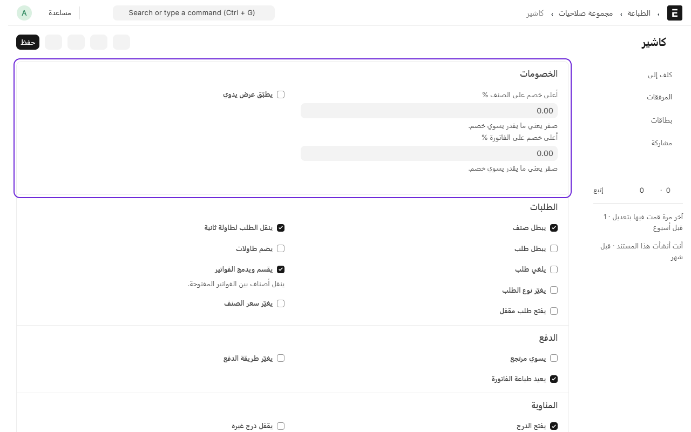

# إضافة موظف ورقمه السري

كل موظف يشتغل على الكاشير يحتاج ثلاث أشياء: حساب في النظام، ودور يحدد وش يقدر يسوي، ورقم سري من خمس أرقام يدخل فيه.

الرقم السري نفسه يستخدمه المدير لما يوافق على خصم أو إلغاء من جهاز الكاشير.

## إضافة الموظف

1. من المكتب، ادخل على **نقاط البيع**.
2. تحت **الموظفين والسجلات**، اضغط على **المستخدمين**.

3. اضغط على **إضافة المستخدم**.
4. اكتب **البريد الإلكتروني** و**الاسم الأول** و**اسم العائلة**.
5. اضغط على **حفظ**.

## الرقم السري والدور

بعد الحفظ، افتح تبويب **الأدوار والصلاحيات**:

1. تحت **نقاط البيع**، اكتب **الرقم السري للكاشير**: خمس أرقام، وما يتكرر بين موظفين.

2. تحت الأدوار، علّم دور الموظف:
   - **كاشير**: يبيع ويفتح الدرج ويقفله، بدون خصم ولا مرتجع.
   - **كاشير أول**: مثل الكاشير، ويقدر يسوي خصم لين 10% ومرتجع ويغيّر نوع الطلب.
   - **مدير نقاط البيع**: خصم لين 50%، ويلغي الطلبات، ويقفل درج غيره، ويشوف التقارير، ويوافق للكاشير على اللي ما يقدر يسويه.
3. اضغط على **حفظ**.

> الرقم السري ما يظهر بعد الحفظ. إذا نساه الموظف، اكتب له رقم جديد.

## وش يقدر يسوي كل دور؟

كل دور له صلاحيات جاهزة. تقدر تشوفها وتعدّلها من **نقاط البيع** تحت **الموظفين والسجلات** ثم **مجموعات الصلاحيات**، وتختار الدور.

مثلاً تقدر تحدد أعلى نسبة خصم يسويها الكاشير بدون موافقة المدير، وهل يقدر يسوي مرتجع أو يقفل الدرج.

---

السابق: [إضافة أنواع الطلب: محلي، سفري، توصيل](add-order-types.md)

التالي: [فتح الكاشير من اختصار خاص](till-shortcut.md)

الرجوع لـ[صفحة البداية](README.md)
