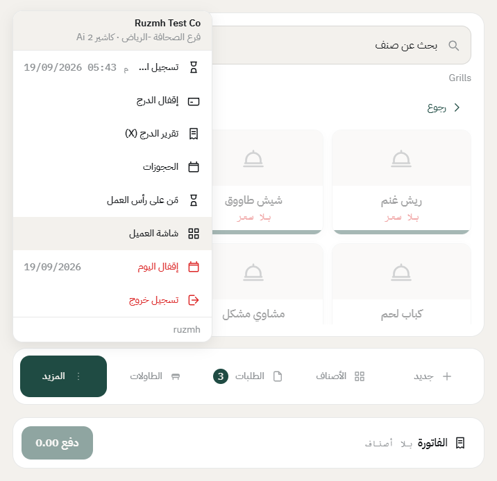
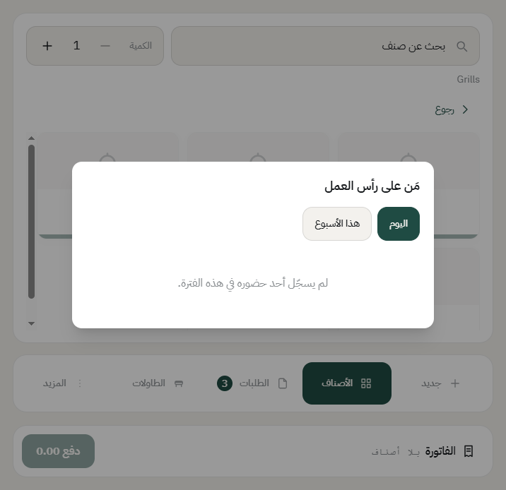

# الحضور والانصراف وتبديل الكاشير

النظام يفرّق بين شيئين: **دوام الموظف** (حضور وانصراف)، و**درج الكاشير** (يُفتح ويُقفل ويُعدّ). موظف ممكن يسجّل حضوره وما يفتح درج، ودرج ممكن يتسلّمه أكثر من موظف في نفس اليوم.

## تسجيل الحضور

1. على جهاز الكاشير، اكتب رقمك السري.
2. تطلع لك شاشة الترحيب باسمك، وفيها زر **تسجيل حضور**.
3. اضغطه، ويدخل بك النظام للكاشير مباشرة.

إذا ما ضغطته ودخلت للكاشير، النظام يرجّعك لهذي الشاشة، لأن الحضور يسبق البيع.

**وإذا حسابك مو مربوط بموظف**، ما يظهر لك زر الحضور أصلاً، وتقدر تدخل للكاشير على طول. الربط يصير من المكتب في بطاقة الموظف.

## تسجيل الانصراف

1. اضغط **المزيد** في الشريط اللي تحت.
2. أول سطر فوق هو **تسجيل انصراف**، وجنبه وقت حضورك.

3. اضغطه.

**بس فيه شرط:** إذا عندك درج مفتوح، النظام ما يخليك تنصرف قبل ما [تقفل الدرج](close-drawer.md) وتعدّه. وهذا مقصود: الفلوس أمانة باسمك، وما تنتقل لغيرك بدون عدّ.

## تبديل الكاشير على نفس الجهاز

- **إذا الفرع على «درج مشترك»**: الموظف الأول يسجّل انصرافه، والثاني يدخل برقمه ويكمل على نفس الدرج. وتقرير الدرج يعرض مبيعات كل واحد منهما بالاسم.
- **إذا الفرع على «لكل موظف درجه»**: الأول يقفل درجه ويعدّه، والثاني يفتح درجاً جديداً.

الفرق بينهما تختاره من إعداد الفرع، خانة **نوع الدرج**. شوف [إضافة فرع](add-branch.md).

## مين على رأس العمل الحين

من **المزيد** ← **مَن على رأس العمل** تشوف قائمة الموظفين اللي سجّلوا حضورهم، اليوم أو هذا الأسبوع.

## إقفال اليوم ينهي الدوام

إذا أقفلت يوم العمل وفيه موظفون ما سجّلوا انصرافهم، النظام يسجّل انصرافهم تلقائياً بوقت إقفال اليوم، **ويعلّم القيد** إنه من النظام مو من الموظف. فالمحاسب يعرف الفرق ويقدر يصحّحه.

---

السابق: [فتح الدرج](open-drawer.md)

التالي: [إنشاء طلب محلي على طاولة](dine-in-order.md)

الرجوع لـ[صفحة البداية](README.md)
