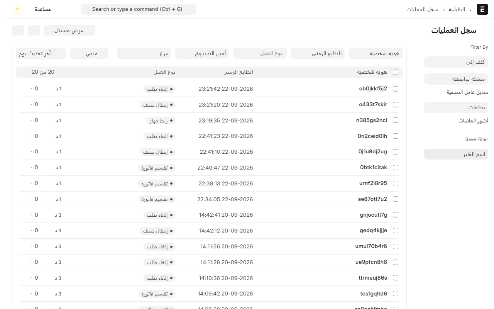
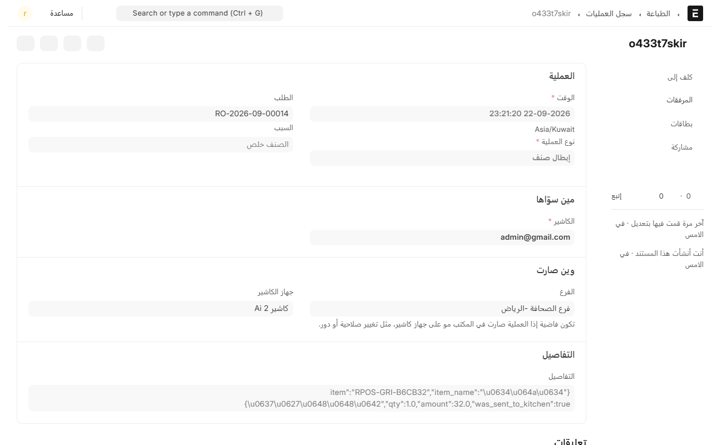

# سجل العمليات: كل إجراء حساس مكتوب

سجل العمليات هو دفتر الفرع. كل ما صار شي حساس على الكاشير — إلغاء، خصم، مرتجع، فتح درج، تفويض مدير — ينكتب فيه سطر: **وش صار، ومين سوّاه، ومين وافق، ومتى، وعلى أي جهاز**.

**وما ينمسح ولا يتعدّل.** حتى مسؤول النظام ما يقدر يغيّر سطراً فيه.

## وين تلقاه

من المكتب، افتح **نقاط البيع** ثم **الموظفين والسجلات**، واضغط **سجل العمليات**.

الأحدث فوق. وفوق القائمة تلقى فلاتر: **نوع العملية**، و**الكاشير**، و**الفرع**.

## وش ينكتب فيه

| نوع العملية | متى |
|---|---|
| إبطال صنف · إبطال طلب · إلغاء طلب | كل إلغاء، مع السبب |
| خصم · تفويض خصم · عرض | كل تنزيل في السعر |
| تغيير سعر | الكاشير كتب سعراً غير سعر القائمة |
| تفويض مدير | المدير وافق على إجراء ما يملكه الكاشير |
| تغيير طريقة الدفع | انحاسب بطريقة غير المسموحة |
| إنشاء مرتجع · إعادة فتح طلب · إعادة طباعة فاتورة | |
| فتح درج · إقفال درج | كل مناوبة |
| تسجيل حضور · تسجيل انصراف | |
| رقم سري خاطئ | محاولة دخول فاشلة — **بدون الرقم طبعاً** |
| تقسيم فاتورة · دمج فواتير · دمج طاولات · تغيير الطاولة · تغيير نوع الطلب | |
| صرف نقاط ولاء | |
| تغيير صلاحية · تغيير دور | تعديل في المكتب على صلاحيات موظف |
| ربط جهاز · فك ارتباط جهاز | |

## قراءة سطر واحد

افتح أي سطر تشوف تفاصيله كاملة.

- **العملية**: الوقت، ونوعها، ورقم الطلب، والسبب المكتوب.
- **مين سوّاها**: الكاشير، و**وافق عليها** إذا الإجراء احتاج تفويض مدير.
- **وين صارت**: الفرع وجهاز الكاشير. وتكون فاضية إذا العملية صارت في المكتب مو على جهاز.
- **التفاصيل**: بيانات إضافية حسب نوع العملية — الصنف والكمية والمبلغ في الإبطال، والقيمة قبل وبعد في تغيير الصلاحية.

## كيف تستخدمه فعلياً

- **فرق في الدرج؟** فلتر على الكاشير وعلى تاريخ اليوم، وشوف الإلغاءات والخصومات في وقته.
- **الزبون يقول انحسب عليه غلط؟** ادخل برقم الطلب، وتلقى كل شي صار على فاتورته.
- **إلغاءات كثيرة من موظف واحد؟** فلتر على **إبطال صنف** وشوف الأسباب. لو كلها «الصنف خلص»، المشكلة في المخزون مو في الموظف.
- **مين وافق على هذا الخصم؟** الجواب في خانة **وافق عليها**.

## الفرق بينه وبين سجل الطلب

- **سجل الطلب** يشوفه الكاشير من شاشته، وهو قصة فاتورة وحدة من أول ما فتحت لين انقفلت. شوف [سجل الطلب](order-log.md).
- **سجل العمليات** (هذي الصفحة) للمدير في المكتب، وهو كل الإجراءات الحساسة في الفرع كله عبر كل الفواتير والموظفين.

## مين يشوفه

يحتاج دخول للمكتب وصلاحية عليه. **الكاشير العادي ما يشوفه**، وهذا مقصود: السجل عليه، مو له.

---

السابق: [الصلاحيات: مين يقدر يسوي وش](permissions.md)

التالي: [إضافة عرض أو خصم](promotions.md)

الرجوع لـ[صفحة البداية](README.md)
