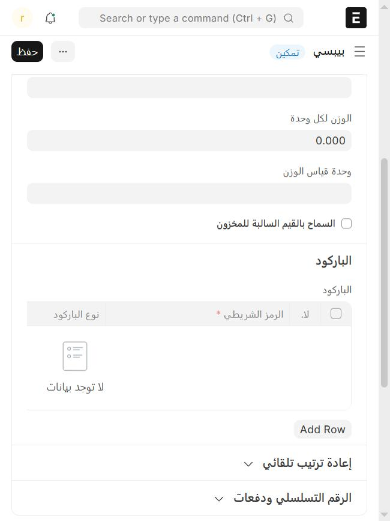

# البيع بقارئ الباركود

القارورة والعلبة تنمسح بدل ما تدوّر عليها. القارئ يشتغل على طول، وما يحتاج إعداد في الكاشير.

## تحط الباركود على الصنف

1. من **نقاط البيع**، تحت **القائمة**، اضغط **الأصناف** وافتح الصنف.
2. افتح تبويب **جرد**، وانزل لقسم **الباركود**.
3. اضغط **Add Row**، واكتب الرقم في خانة **الرمز الشريطي**، أو امسحه بالقارئ وأنت واقف عليها.
4. اضغط **حفظ**.

الكاشير يشوف الباركود الجديد بعد ما يسجّل خروج ودخول.

## تبيع فيه

في شاشة الطلب، **امسح الصنف**. ينضاف على الفاتورة، وما يحتاج تضغط على شي قبل.

- تبي ستة؟ اختر الكمية 6 ثم امسح.
- لو أنت واقف على خانة البحث، امسح عادي؛ ينضاف وتتفرغ الخانة.

## لو ما انضاف

الكاشير يقول لك السبب في إشعار:

- **«ما فيه صنف بهذا الباركود»**: الرقم مو مسجّل على أي صنف، أو الكاشير ما سجّل خروج ودخول بعد ما أضفته.
- **الصنف «خلص»** أو **«بدون سعر»**: ما ينباع لين يتوفر أو تحط له سعر.

والقارئ ما يشتغل وفيه نافذة مفتوحة (دفع، كوبون، إضافات)؛ قفّلها أول.

## وش ما يدعمه

ملصقات الميزان (اللي فيها الوزن أو السعر داخل الباركود) ما تنقرأ.

---

السابق: [تطبيقات التوصيل: هنقرستيشن وجاهز وغيرها](delivery-apps.md)

التالي: [فتح الدرج](open-drawer.md)

الرجوع لـ[صفحة البداية](README.md)
