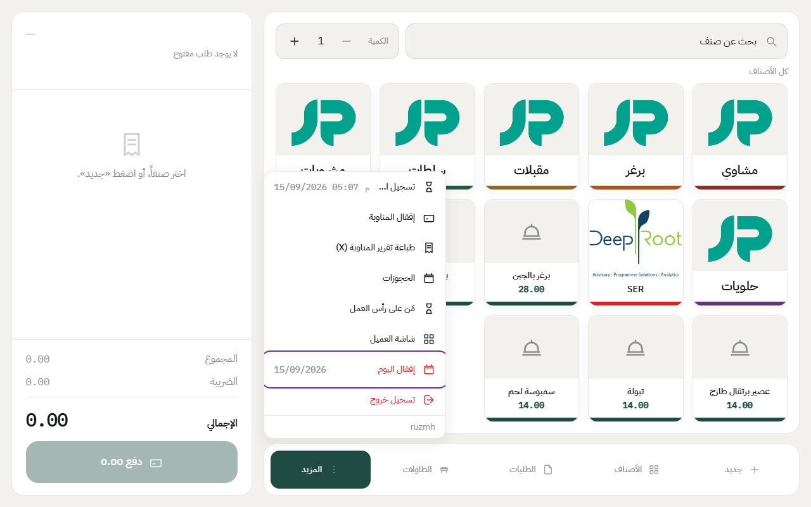
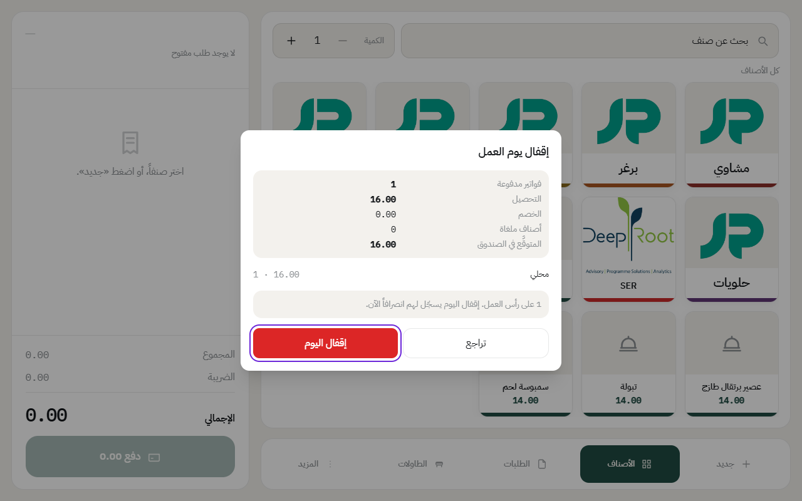
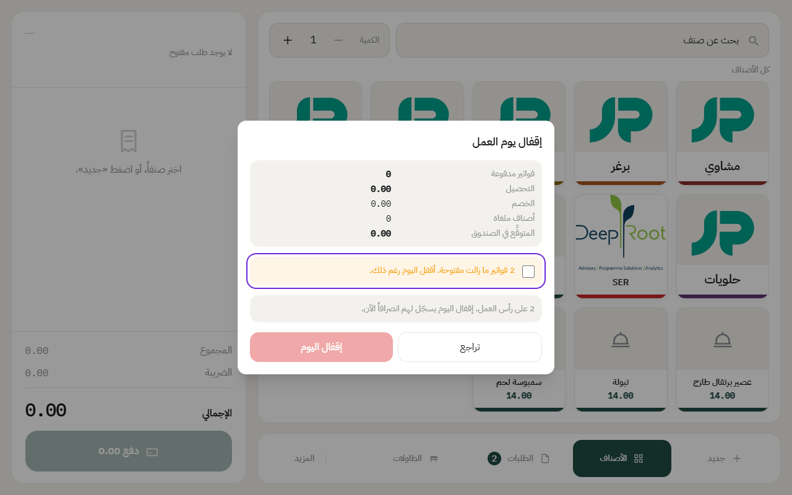

# إقفال اليوم

آخر يوم العمل، بعد ما تخلص كل الشفتات، تقفل اليوم. إقفال اليوم يجمع كل مبيعات اليوم في تقرير واحد، ويبدأ اليوم اللي بعده من الصفر.

يوم العمل ما يتقيد بالتاريخ. لو المطعم يسكّر بعد منتصف الليل، أقفل اليوم وقت ما تسكّر، والمبيعات كلها تنحسب على نفس اليوم.

## الخطوات

1. اضغط على **المزيد**، بعدها **إقفال اليوم**. التاريخ اللي جنبه هو تاريخ فتح اليوم.

2. بتطلع نافذة فيها ملخص اليوم: الفواتير المدفوعة، والتحصيل، والخصم، والأصناف الملغاة، والمتوقَّع في الصندوق، ومبيعات كل نوع طلب.

3. اضغط على **إقفال اليوم**.

بعد الإقفال:

- ينطبع تقرير اليوم على طابعة الكاشير.
- إذا فيه درج لسا مفتوح، ينقفل مع اليوم.
- الموظفين اللي لسا مسجّلين حضور، يتسجل لهم **انصراف**.
- الحجوزات اللي ما حضر أصحابها تتسجل «لم يحضر».
- علامات «خلص اليوم» تنشال عن الأصناف.
- **مبيعات اليوم تترحّل للحسابات والمخزون** بقيود مجمّعة. الشرح في [ترحيل المبيعات للحسابات](posting.md).

## إذا فيه طلبات لسا مفتوحة

على حسب إعداد الفرع، خانة **إنهاء الطلبات المفتوحة قبل إقفال اليوم**:

- **إذا معلّمة**: لازم تدفع كل الطلبات المفتوحة أو تلغيها قبل الإقفال. والمدير بس يقدر يعلّم **أقفل اليوم رغم ذلك**، والطلبات تترحّل لليوم اللي بعده.

- **إذا مو معلّمة**: اليوم ينقفل عادي، والطلبات المفتوحة تترحّل لليوم اللي بعده وتكمل عليها. وإذا صارت كثيرة، النظام ينبّهك بعددها.

---

السابق: [إقفال الدرج وتسليمه للموظف اللي بعدك](close-drawer.md)

التالي: [ترحيل المبيعات للحسابات](posting.md)

الرجوع لـ[صفحة البداية](README.md)
