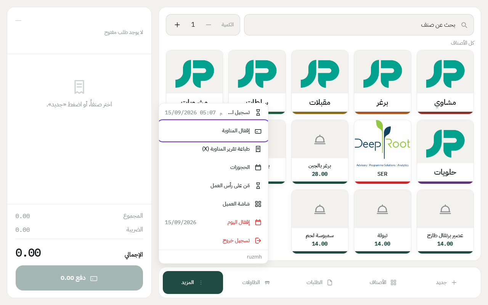
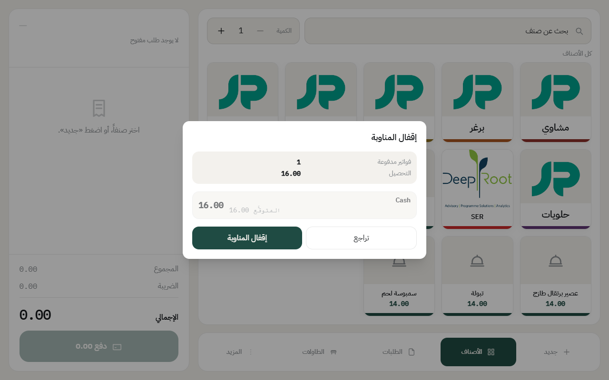
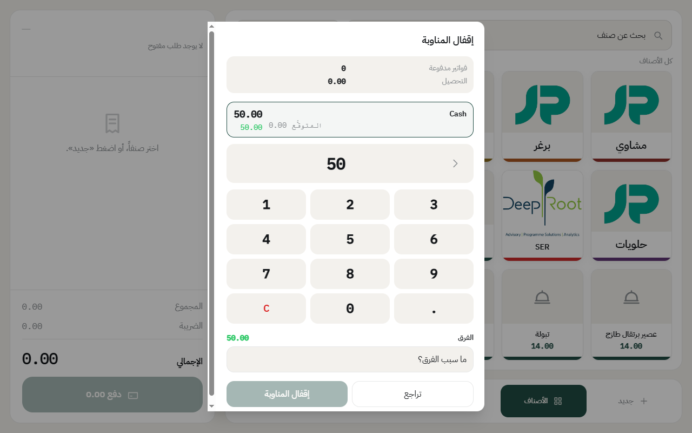
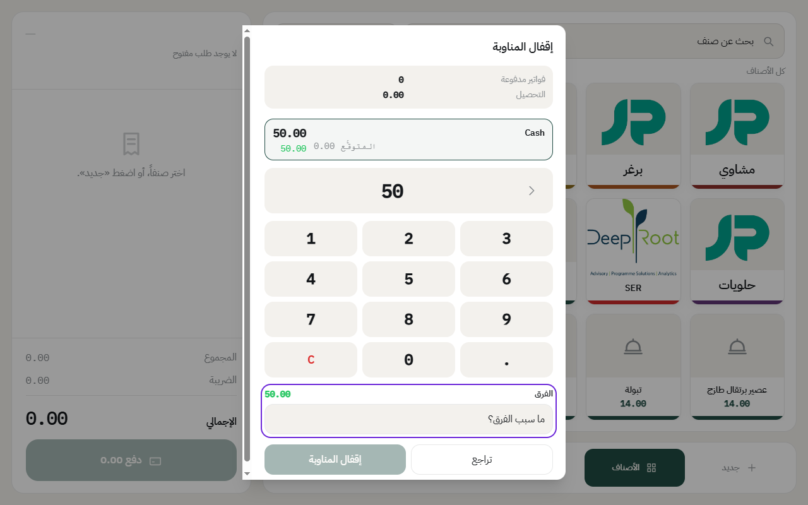
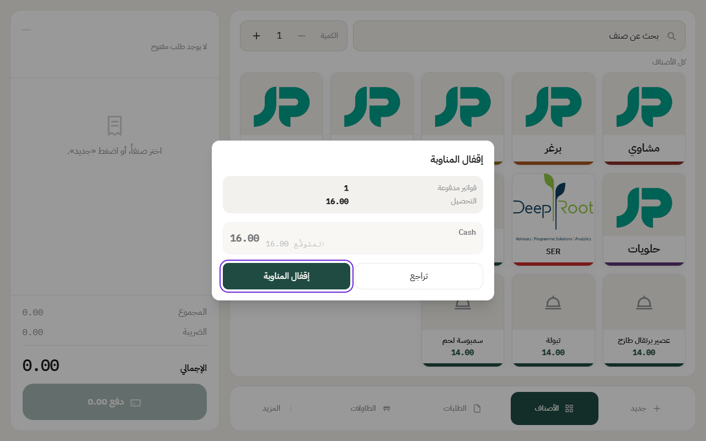

# إقفال الدرج

آخر الشفت، الكاشير يقفل الدرج. النظام يطلّع كم المفروض يكون في الصندوق، وإذا الفرع مطلوب فيه العدّ، الكاشير يعدّ الفلوس ويكتبها. بعدها ينطبع تقرير Z.

إذا الدرج مشترك، الموظف اللي بعدك يفتح درج جديد بنفس اليوم بعد ما تقفل. شوف [فتح الدرج](open-drawer.md).

## الخطوات

1. اضغط على **المزيد**، بعدها **إقفال الدرج**.

2. بتطلع نافذة فيها عدد الفواتير المدفوعة، وكم التحصيل، وكم **المتوقَّع** لكل طريقة دفع.

3. **إذا الفرع مطلوب فيه عدّ الفلوس**، اكتب المبلغ اللي عديته في الصندوق.

4. إذا المبلغ اللي عديته يختلف عن المتوقَّع، يطلع لك **الفرق**، ولازم تكتب سببه.

5. اضغط على **إقفال الدرج**.

بعد الإقفال:

- ينطبع **تقرير Z** على طابعة الكاشير، وفيه المبيعات والمبلغ اللي عديته والفرق. نفس أقسام [تقرير X](x-report.md).
- الموظف يقدر يسجّل **انصراف**. وإذا نوع الدرج في الفرع «لكل موظف درجه»، النظام ما يسمح بالانصراف قبل ما يقفل الموظف درجه.

## العدّ مطلوب ولا لا؟

هذا يتحدد من إعداد الفرع، خانة **عدّ الفلوس عند إقفال الدرج**. شوف [إضافة فرع](add-branch.md).

---

السابق: [تقرير الدرج (X) لمعرفة اللي في الصندوق](x-report.md)

التالي: [إقفال اليوم](close-day.md)

الرجوع لـ[صفحة البداية](README.md)
