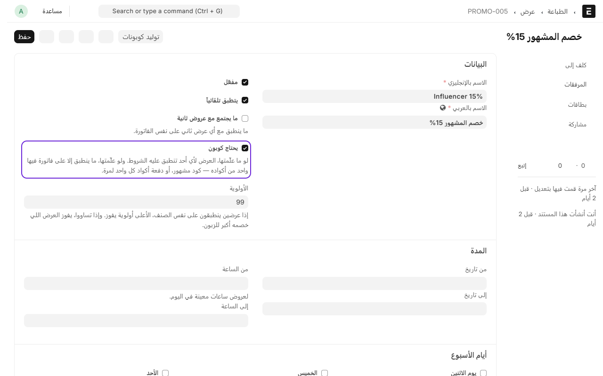
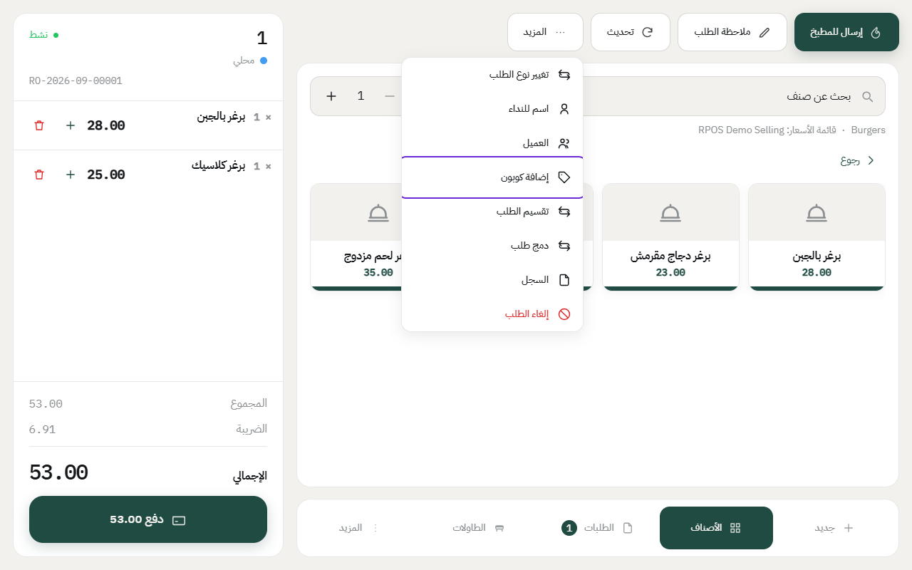
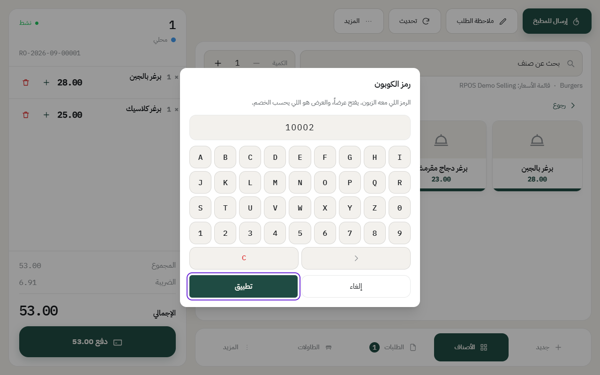
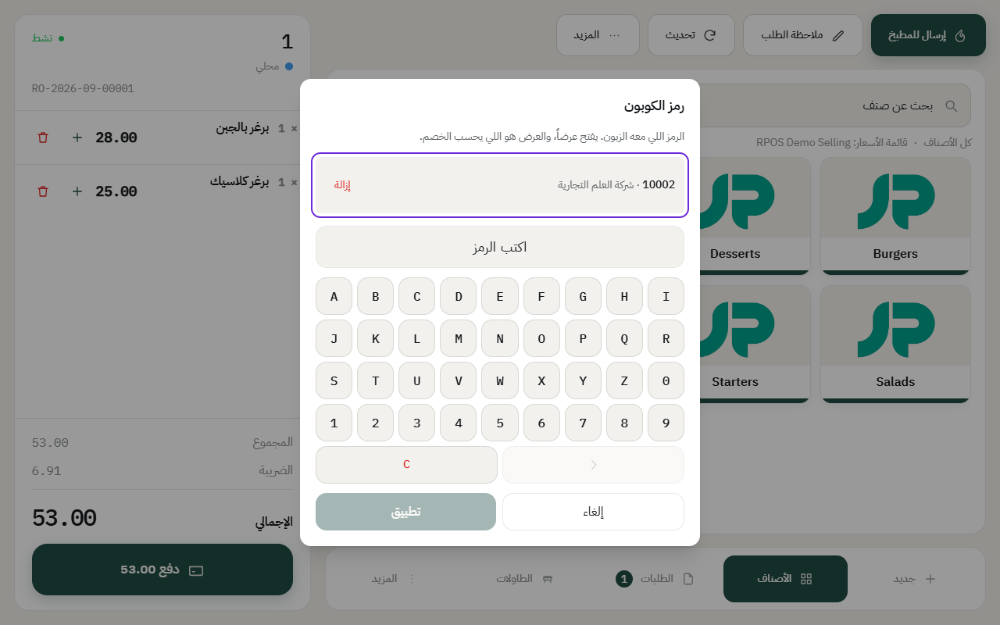
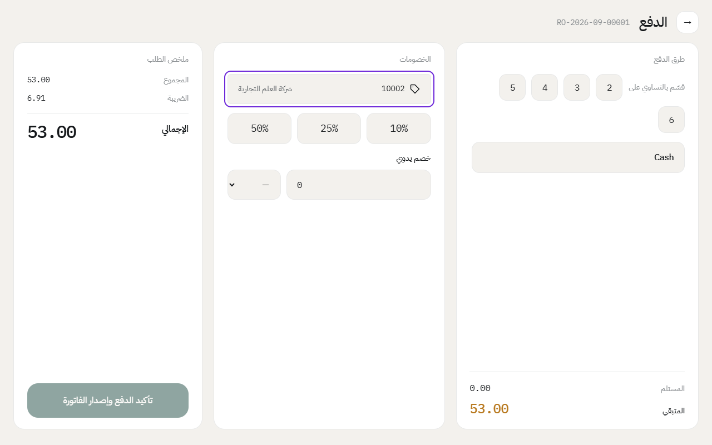
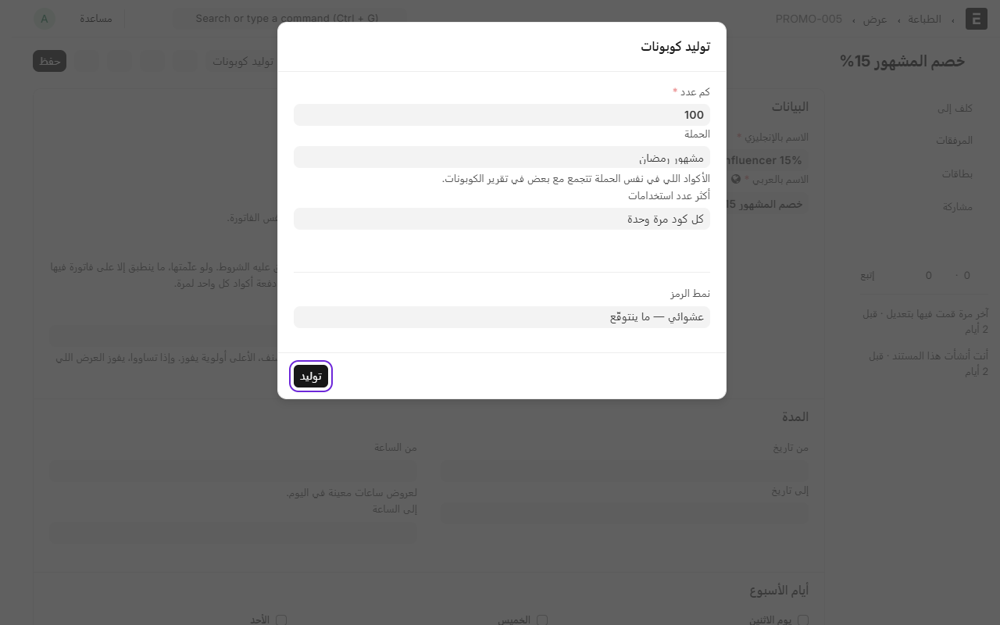
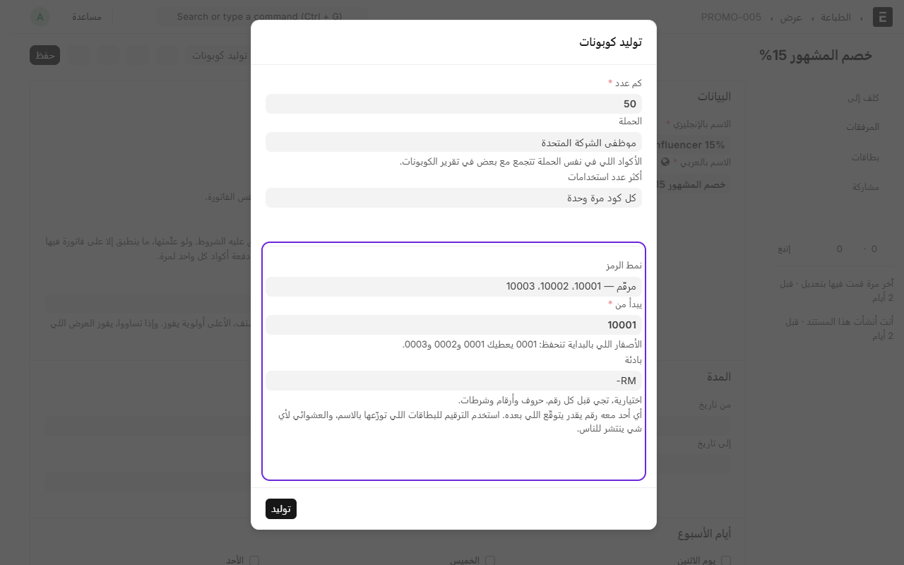
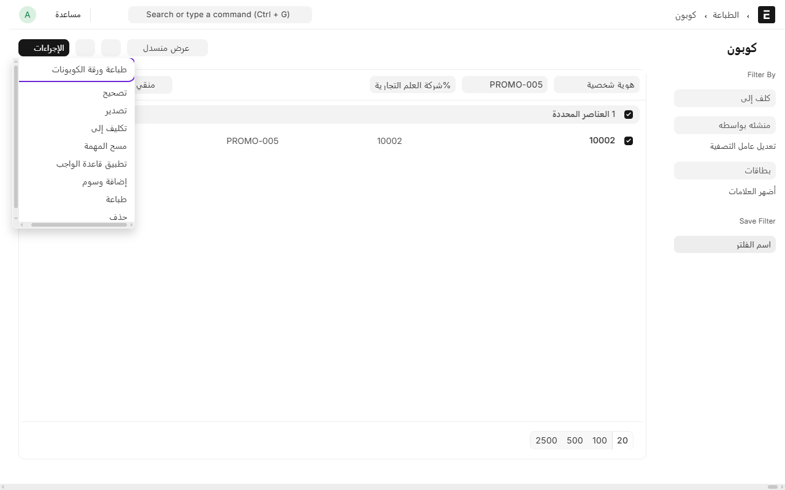
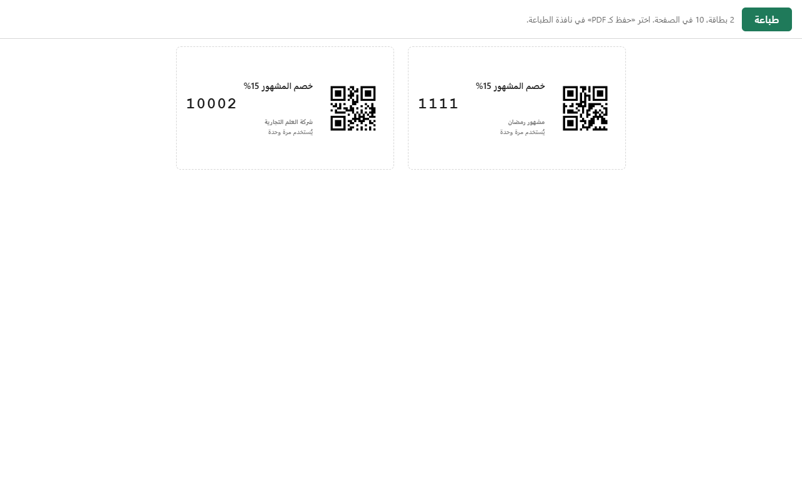

# الكوبونات: رمز يفتح عرضاً

الكوبون **مفتاح، مو خصم**. الرمز يسمّي عرضاً، والعرض هو اللي يحسب التخفيض — نفس الأولوية ونفس الأصناف المشمولة ونفس الوسم على الفاتورة.

يعني: **تسوي العرض أولاً، وبعدها تسوي الكود اللي يفتحه.**

## متى تستخدمها

- **حملة مع مشهور**: تعطيه كوداً، وأي أحد يجي عن طريقه يستخدمه — وتقيس بعدين كم طلب جاء منه.
- **أكواد لمرة واحدة**: كل زبون له كود ما ينفع مرتين.
- **حملة موسمية**: كود ينتهي بتاريخ.

## الخطوات

### ١. سوّ العرض وعلّم إنه يحتاج كوبون

من **نقاط البيع** ← **القائمة** ← **العروض والخصومات**، سوّ عرضاً عادياً (نسبة، أو مبلغ، أو صنف مجاني — أي نوع)، **وعلّم خانة «يحتاج كوبون»**.

من دون هذي العلامة العرض ينطبق على أي فاتورة تتأهل، والكود ما له معنى.

### ٢. سوّ الكوبون

من **نقاط البيع** ← **القائمة** ← **الكوبونات** ← **إضافة**:

- **رمز الكوبون**: اللي يقوله الزبون. الحروف الكبيرة والصغيرة سواء.
- **العرض**: اللي يفتحه هذا الرمز.
- **الحملة**: اسم المشهور أو الحملة. **الأكواد اللي تشترك في نفس الحملة تُجمع في التقرير** — فاكتبه بنفس الطريقة في كل الأكواد.
- **أكثر عدد استخدامات**:
  - **0** = بلا حد ← **الكود المشترك**، المشهور ينشره وأي أحد يستخدمه
  - **1** = مرة واحدة ← لكود يخص زبوناً واحداً
- **من تاريخ / إلى تاريخ**: اتركهما فاضيين وتواريخ العرض هي اللي تحكم.

### ٣. الكاشير يستخدمه

من مكانين، ونفس الشاشة:

- **وقت الطلب**: **المزيد** ← **إضافة كوبون**
- **وقت الحساب**: شاشة الدفع، الزر جنب العروض

يكتب الرمز ويضغط **تطبيق**، والخصم ينزل.

ولو فتح الشاشة مرة ثانية، يلقى الرمز فوق باسم حملته، وجنبه **إزالة** لو كان غلط.

وفي **شاشة الدفع** يظهر الرمز مكان زر الكوبون.

> **ما نزل خصم؟** لو العرض اللي وراء الكود **صنف مجاني**، ما ينزل شي لين الزبون يطلب الصنف المجاني نفسه — والكود محفوظ على الطلب.

**وفيه لوحة حروف وأرقام على الشاشة** تحت المربّع — لأن شاشة الكاشير ما تطلّع كيبورد، فبدونها ما يقدر يكتب شي. وفيها **كل الحروف وكل الأرقام**، لأن الكود ممكن يكون أي شي: مولَّد، أو مرقّم، أو كتبته بيدك، أو رفعته من إكسل.

**ولو عندك قارئ باركود**، ما يحتاج أي إعداد: افتح الشاشة واقرأ الكيو آر من البطاقة — المربّع جاهز مستنّي، فينكتب الرمز لحاله.

## دفعة أكواد لمرة واحدة

لو تبي ١٠٠ كود كل واحد يُستخدم مرة، ما تسويها بيدك:

١. افتح **العرض** نفسه (نقاط البيع ← القائمة ← العروض والخصومات).
٢. فوق على اليسار، زر **«توليد كوبونات»**. *(ما يطلع إلا إذا العرض معلَّم «يحتاج كوبون».)*
٣. اكتب **كم عدد**، واسم **الحملة**، واختر **«كل كود مرة وحدة»**.
٤. اختر **نمط الرمز** (تحت) — عشوائي أو مرقّم.
٥. اضغط **توليد** — ويوديك على طول لقائمة الأكواد اللي انولدت.

### النمط: عشوائي ولا مرقّم؟

| | **عشوائي** | **مرقّم** |
|---|---|---|
| الشكل | `K7RQ4WMZ` | `10001` · `10002` · `10003` |
| ينتوقّع؟ | لا | **نعم — اللي معه 10001 يجرّب 10002** |
| متى تستخدمه | كود ينتشر للناس: مشهور، سوشال ميديا، إعلان | بطاقات توزّعها **بالاسم**: موظفي شركة، عملاء مسجّلين، كروت مرقّمة عندك بدفتر |

**والعشوائي ما فيه `0` ولا `O` ولا `1` ولا `I` ولا `L`** — لأن الكود يُقرأ بالتلفون ويُكتب على كرت، وهذي الحروف اللي يغلط فيها الناس.

**والمرقّم فيه شيئين:**

- **يبدأ من**: اكتب `10001` يعطيك 10001 و10002 و10003. واكتب `0001` يعطيك 0001 و0002 — **الأصفار اللي بالبداية تنحفظ زي ما كتبتها**.
- **بادئة** (اختيارية): اكتب `RM-` يعطيك `RM-10001`. حروف وأرقام وشرطات بس.

**ولو رقم من الأرقام موجود من قبل، النظام يرفض الدفعة كلها** ويقول لك أي رقم — ما يتخطّاه. لأن سلسلة فيها فجوة ما تنفع: اللي يطابق الكروت بالدفتر يلقى رقماً ناقصاً وما يدري ضاع ولا ما انطبع أصلاً.

## الرفع من إكسل

لو الأكواد عندك جاهزة في ملف — مثلاً كروت مطبوعة من قبل، أو قائمة جاتك من شركة — ارفعها بدل ما تكتبها:

**الكوبونات** ← قائمة **···** اللي فوق ← **استيراد**.

الملف يكون **CSV أو Excel**، وأعمدته بأسماء الحقول نفسها:

| Coupon Code | Promotion | Campaign | Maximum Uses |
|---|---|---|---|
| 10001 | PROMO-0007 | موظفي الشركة المتحدة | 1 |
| 10002 | PROMO-0007 | موظفي الشركة المتحدة | 1 |

- **Promotion** = رقم العرض (تلقاه فوق شاشة العرض، مثل `PROMO-0007`).
- **Maximum Uses**: `1` مرة وحدة · `0` بلا حد.
- وتقدر **تنزّل نموذج الملف** («تحميل الوثيقة») من نفس الشاشة فيجيك بالأعمدة جاهزة.

وهذي شاشة فريب نفسها — تعرض لك الصفوف قبل ما تحفظ، وتقول لك أي صف ما انقبل وليش.

**ونفس الشاشة تعدّل الموجود:** اختر **«تحديث سجلات موجودة»** وارفع ملفاً فيه عمود `ID` بالأكواد والعمود اللي تبي تغيّره — مثلاً `Is Active` بصفر لتوقف دفعة كاملة مرة وحدة.

## طباعة الأكواد على ورق

من قائمة **الكوبونات**: **علّم** الأكواد اللي تبي تطبعها ← قائمة **إجراءات** ← **طباعة ورقة الكوبونات**.

تفتح لك ورقة **A4 فيها ١٠ بطاقات**، كل بطاقة فيها:

- اسم العرض بالعربي
- **الكود بخط كبير** يُقرأ من بعيد
- **كيو آر كود** فيه الرمز نفسه
- اسم الحملة، ومدة الصلاحية، و«يُستخدم مرة وحدة» إذا كان كذلك

اضغط **طباعة** ← ومن نافذة الطباعة اختر **«حفظ كـ PDF»** أو اطبعها على الطابعة، وبعدين قصّها على الخطوط المتقطّعة.

> **ليش تختار الأكواد بنفسك ومو يطبع الكل؟** لأن الكود اللي يُستخدم مرة وحدة، لو انطبع مرتين، صار عند شخصين — والثاني بيتردّ عليه عند الكاشير. فأنت تشوف بعينك وش بتوزّع.

**والكيو آر فيه الرمز بس، مو رابط.** يعني لو عند الكاشير قارئ باركود، يقرأ البطاقة وهو واقف على مربّع الكوبون فينكتب الرمز لحاله ويتطبّق. ولو الزبون صوّره بجواله، يطلع له الرمز مكتوباً.

## متى يُحسب الاستخدام

- **لما يكتب الكاشير الرمز**: النظام يتحقق منه بس — ما يحسبه.
- **لما تُدفع الفاتورة**: هنا يُحسب.

يعني **كود على فاتورة انلغت ما انستخدم**. والدفع مرتين (لو الطابور أعاد الإرسال) يحسبه مرة وحدة.

## الرفض وأسبابه

كل رفض له رسالة تقول السبب بالضبط:

| الرسالة | وش تسوي |
|---|---|
| ما فيه كوبون بهذا الرمز | تأكد من الكتابة |
| هذا الكوبون موقوف | افتح الكوبون وعلّم **مفعّل** |
| هذا الكوبون يبدأ من … | ما بدأ بعد |
| هذا الكوبون انتهى في … | مدته خلصت |
| هذا الكوبون استُخدم من قبل | كود لمرة واحدة، وانستخدم |
| العرض اللي وراء هذا الكوبون موقوف | العرض نفسه موقوف — افتحه وفعّله |

## قياس الحملة

**التقارير** ← **مبيعات الكوبونات**.

مجمّع **بالحملة** افتراضياً — لأن القرار يُتخذ على المشهور مو على كل كود. والأعمدة: **الفواتير · المبيعات · اللي انعطى · متوسط الفاتورة · النسبة من المبيعات**.

وفيه مفتاح **«صف لكل رمز»** لما تشك إن كوداً لمرة واحدة ينتشر بين الناس.

---

السابق: [إضافة عرض أو خصم](promotions.md)

التالي: [بطاقة الهدايا: فلوس مدفوعة مقدّماً](gift-cards.md)

الرجوع لـ[صفحة البداية](README.md)
