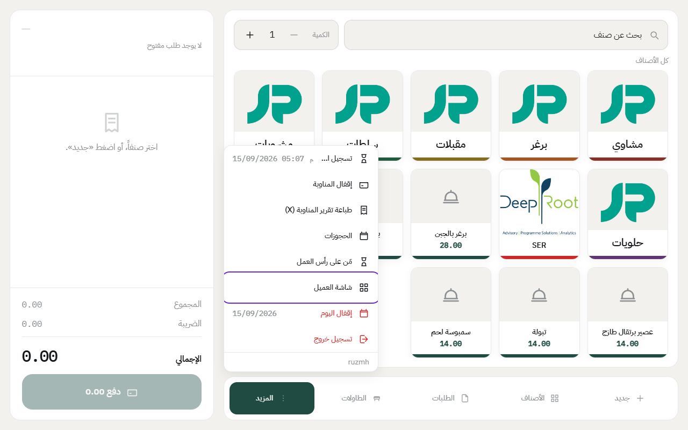
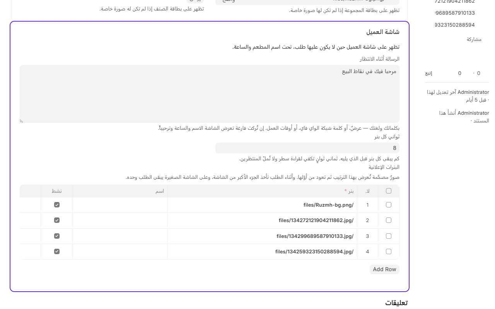

# تشغيل شاشة العميل

شاشة العميل شاشة ثانية مقابل الزبون، تعرض له طلبه والأسعار وهو يطلب. ولما ما فيه طلب، تعرض اسم المطعم والساعة ورسالة ترحيب أو صور إعلانية.

## تشغيل الشاشة

1. وصّل شاشة ثانية بجهاز الكاشير.
2. في شاشة الكاشير، اضغط على **المزيد**، بعدها **شاشة العميل**.

3. بتنفتح نافذة جديدة. اسحبها للشاشة الثانية وخلها بكامل الشاشة.

لازم تنفتح من قائمة الكاشير نفسها وفي نفس المتصفح، لأن الكاشير هو اللي يرسل لها الطلب أول بأول. وتشتغل حتى لو انقطع الإنترنت.

## الرسالة والصور الإعلانية

1. من المكتب، ادخل على **نقاط البيع**، وتحت **إعدادات** اضغط على **الإعدادات العامة**.
2. تحت **شاشة العميل**:
   - **الرسالة أثناء الانتظار**: مثل عرض اليوم، أو كلمة سر الواي فاي، أو أوقات العمل.
   - **البنرات الإعلانية**: أضف صور جاهزة التصميم، وتتبدل بالترتيب.
   - **ثواني كل بنر**: كم ثانية تبقى كل صورة. 8 ثواني مناسبة.
3. اضغط على **حفظ**.

لما يكون فيه طلب، الصور تاخذ الجزء الأكبر من الشاشة والطلب جنبها. وعلى الشاشة الصغيرة يطلع الطلب لحاله.

وشعار المطعم يطلع على شاشة العميل إذا أضفته في [ألوان شاشة الكاشير](theme.md).

---

السابق: [تغيير ألوان شاشة الكاشير](theme.md)

التالي: [إعلان للكاشيرية](announcements.md)

الرجوع لـ[صفحة البداية](README.md)
