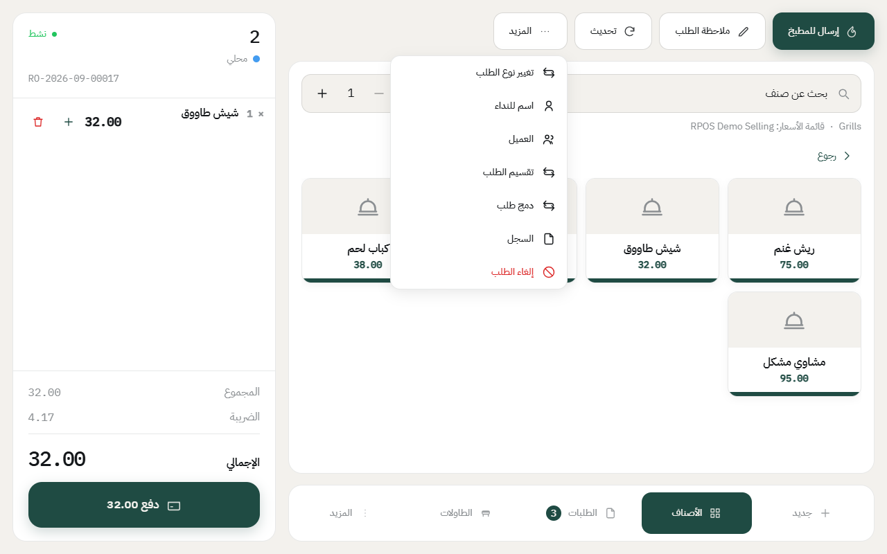
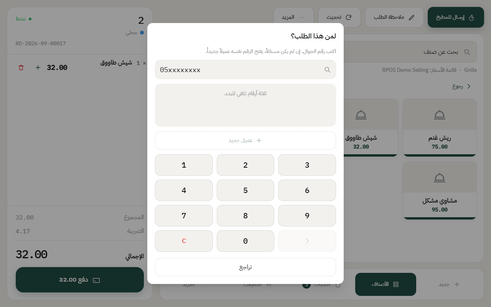
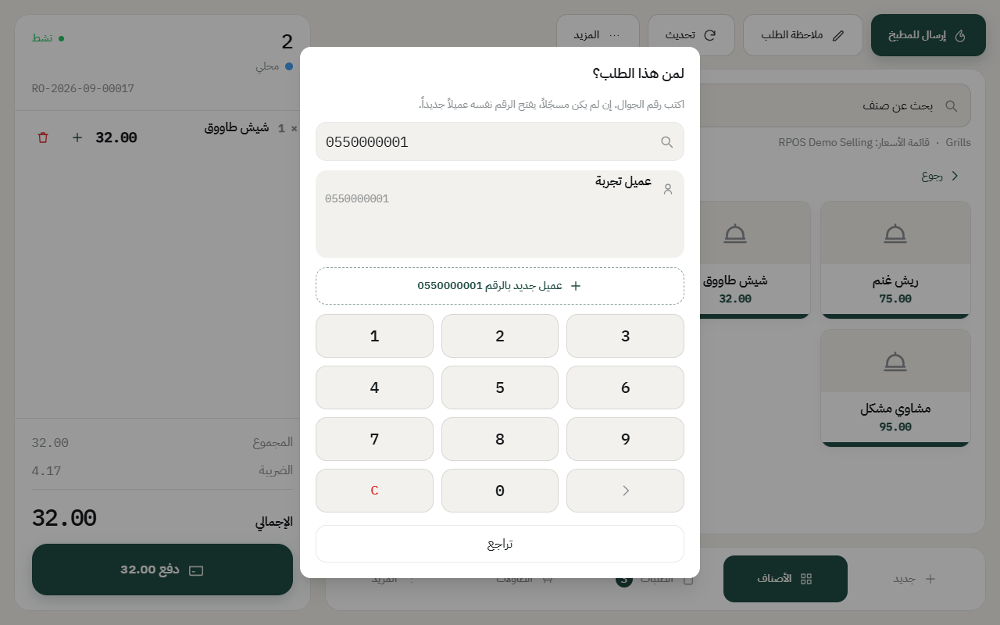
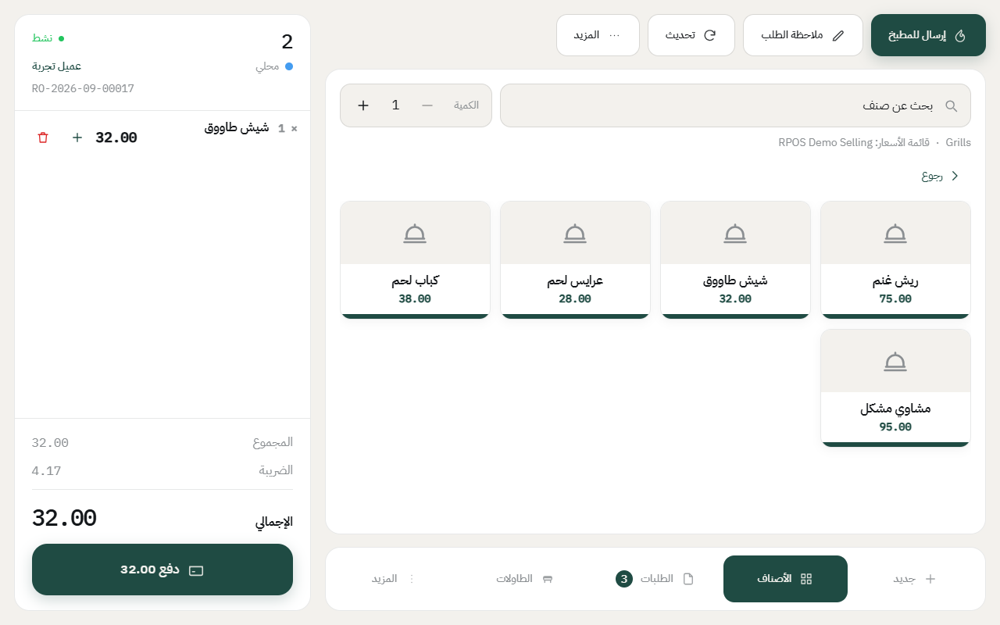
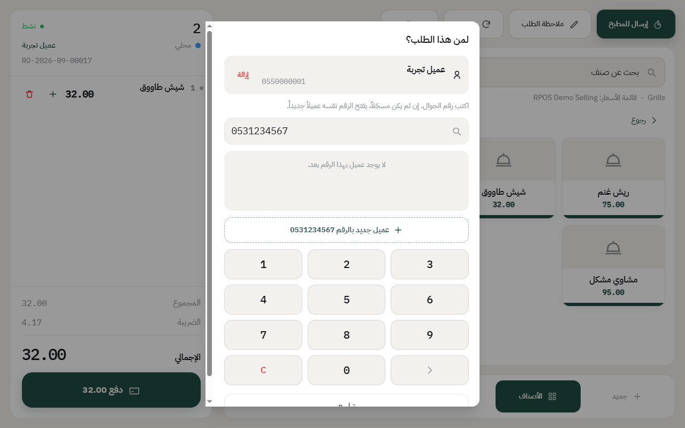

# ربط الطلب بعميل

العميل يُربط بالفاتورة عشان تلاحقه بعدين: نقاط الولاء، وطلبات التوصيل، وسجل مشترياته، وفاتورة ضريبية باسمه. والربط يصير **برقم الجوال** — رقم واحد يكفي، ما تحتاج تكتب بيانات.

**والرقم هو المفتاح**، فرقم واحد = عميل واحد، ولو انكتب من عشرة أجهزة.

## متى تحتاجه

- **التوصيل**: إجباري، لأن الطلب يحتاج عنواناً ورقماً.
- **نقاط الولاء**: بدون عميل ما تنحسب نقاط ولا تنصرف.
- **فاتورة باسم العميل**: الشركات تطلبها.
- **المحلي والسفري العادي**: اختياري. الزبون الماشي ما يحتاج.

**والطلب اللي بلا عميل ما يوقف** — ينحفظ على العميل الافتراضي للجهاز. شوف [إضافة جهاز كاشير](add-device.md).

## الخطوات

1. افتح الطلب، واضغط **المزيد** من الشريط اللي فوق.

2. اضغط **العميل**.

3. اكتب رقم الجوال من لوحة الأرقام. **من ثلاثة أرقام يبدأ البحث**، فما تحتاج تكمل الرقم كله.

4. اضغط على اسم العميل من النتائج. يظهر اسمه فوق في رأس الفاتورة، وينحفظ معها.

## الرقم مو مسجّل؟

يقول لك **«لا يوجد عميل بهذا الرقم بعد»**، وتحته زر **«عميل جديد بالرقم …»**. اضغطه فيتفتح لك العميل بنفس الرقم على طول.

يعني ما تحتاج تروح المكتب ولا تعبّي نموذجاً — الرقم يكفي، والاسم تعدّله بعدين إذا حبيت.

## تغيير العميل أو إزالته

بعد ما تربط عميلاً، يصير اسم الزر **تغيير العميل** بدل **العميل**. تضغطه فيفتح نفس الشاشة، وفوق تلقى العميل الحالي وجنبه **إزالة**.

- **تغيير**: ابحث برقم ثاني واختره.
- **إزالة**: الفاتورة ترجع للعميل الافتراضي.

**وبعد الدفع ما يتغيّر العميل** — الفاتورة صارت مستنداً ضريبياً. الطريق الوحيد [المرتجع](return-order.md) وإعادة البيع.

## اسم النداء مو عميل

في نفس قائمة **المزيد** تلقى **اسم للنداء**. هذا اسم مؤقت تنادي فيه على الزبون لما يجهز طلبه، **وما ينحفظ كعميل ولا يجمع نقاط**. للسفري المستعجل استخدمه، وللي تبي تلاحقه استخدم **العميل**. شوف [تعديل الطلب](edit-order.md).

## أشياء تنتبه لها

- **الشاشة ما تهتز وأنت تكتب.** النتائج تتحدث بهدوء بعد ما توقف، فما ينقفز تحت إصبعك شي.
- **التوصيل يسأل عن العميل من نفسه** قبل ما تكمل الطلب. شوف [إنشاء طلب توصيل](delivery-order.md).
- **بيانات العميل الكاملة** (الاسم، العنوان، الإيميل) تعدّلها من المكتب: **المخازن** ← **العميل**.
- **العميل ينفع في كل الفروع** — مو محصوراً بفرع واحد.

---

السابق: [تعديل الطلب: الكمية والملاحظات والنوع](edit-order.md)

التالي: [«متبقي» و«خلص» و«خلص اليوم»](sold-out.md)

الرجوع لـ[صفحة البداية](README.md)
