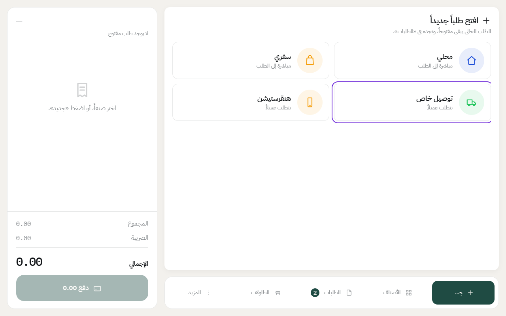
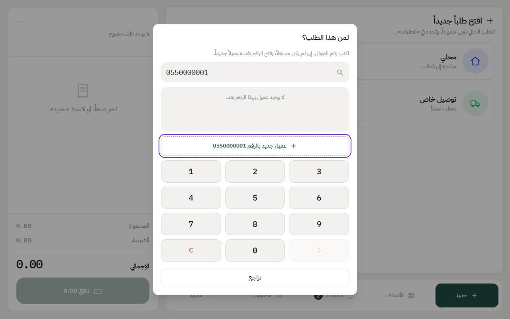
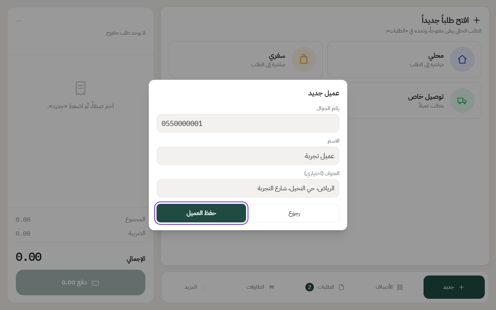
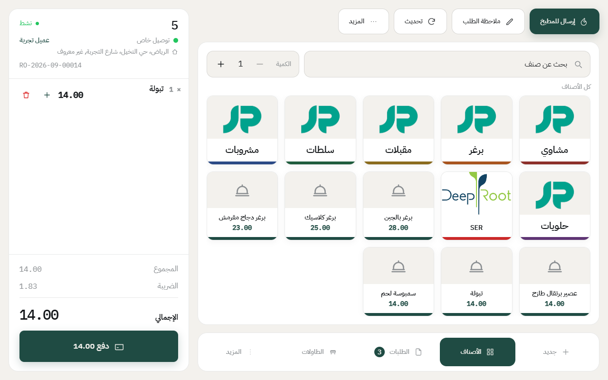

# إنشاء طلب توصيل

طلب التوصيل يحتاج عميل، عشان يوصل الطلب لرقمه وعنوانه. وفيه نوعين:

- **توصيل خاص**: التوصيل حق المطعم نفسه، والزبون يدفع.
- **تطبيقات التوصيل**، مثل هنقرستيشن وجاهز: العميل هو التطبيق نفسه، والفلوس تنحسب على حسابه.

قبل ما تبدأ، لازم يكون [الدرج مفتوح](open-drawer.md).

## توصيل خاص

1. اضغط على **جديد**، واختر **توصيل خاص**.

2. اكتب رقم جوال الزبون.
   - إذا الزبون مسجّل من قبل، يطلع اسمه. اضغط عليه.
   - إذا جديد، اضغط **عميل جديد بالرقم**.

3. للعميل الجديد، اكتب **الاسم** و**العنوان**، واضغط **حفظ العميل**.

4. أضف الأصناف بنفس طريقة [الطلب المحلي](dine-in-order.md). اسم العميل وعنوانه يطلعون فوق الفاتورة.

5. اضغط على **دفع** وكمّل الدفع، أو خل الطلب مفتوح لين يرجع السائق بالفلوس.

في الإعداد الجاهز، طلب التوصيل الخاص يروح للمطبخ تلقائياً لما تخلص منه، يعني لما تفتح طلب جديد أو تدفع، فما تحتاج تضغط **إرسال للمطبخ**.

## تطبيقات التوصيل

1. اضغط على **جديد**، واختر التطبيق، مثل **هنقرستيشن**.
2. أضف الأصناف. الأسعار تكون أسعار التطبيق إذا المطعم محدد لها قائمة أسعار.
3. اضغط على **دفع**. الفلوس تنحسب على حساب التطبيق، والتطبيق يحوّلها للمطعم بعدين.

---

السابق: [إنشاء طلب سفري](takeaway-order.md)

التالي: [تعديل الطلب: الكمية والملاحظات والنوع](edit-order.md)

الرجوع لـ[صفحة البداية](README.md)
