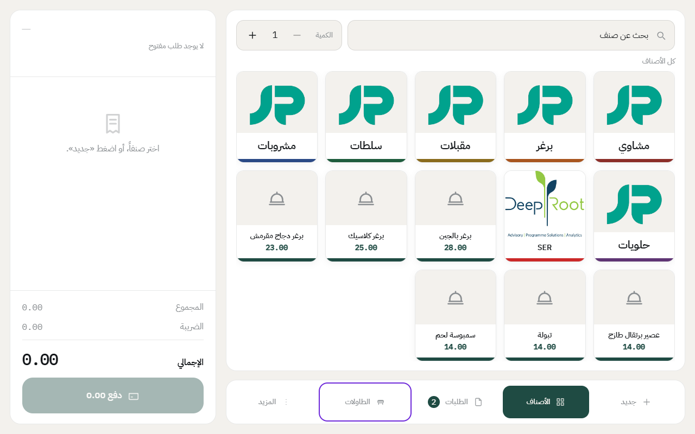
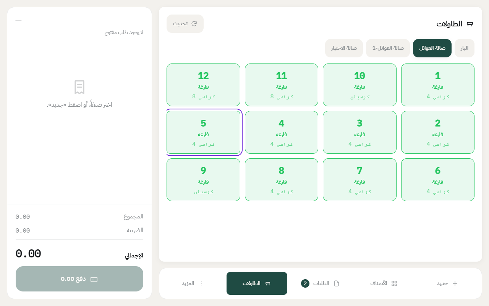
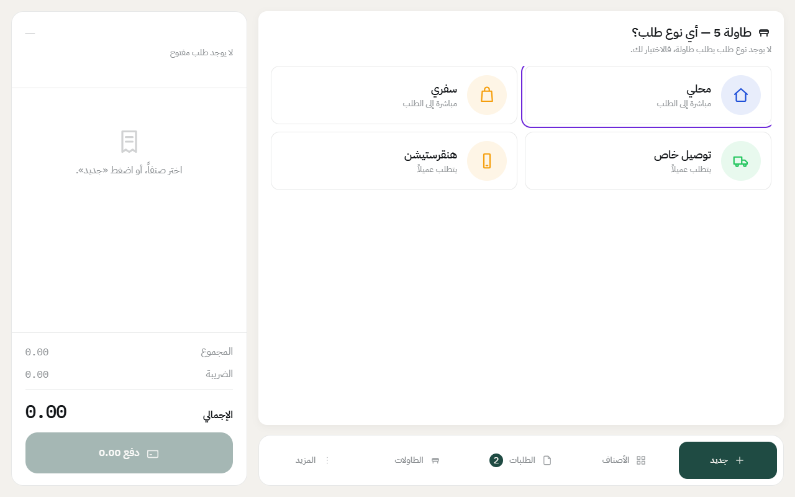
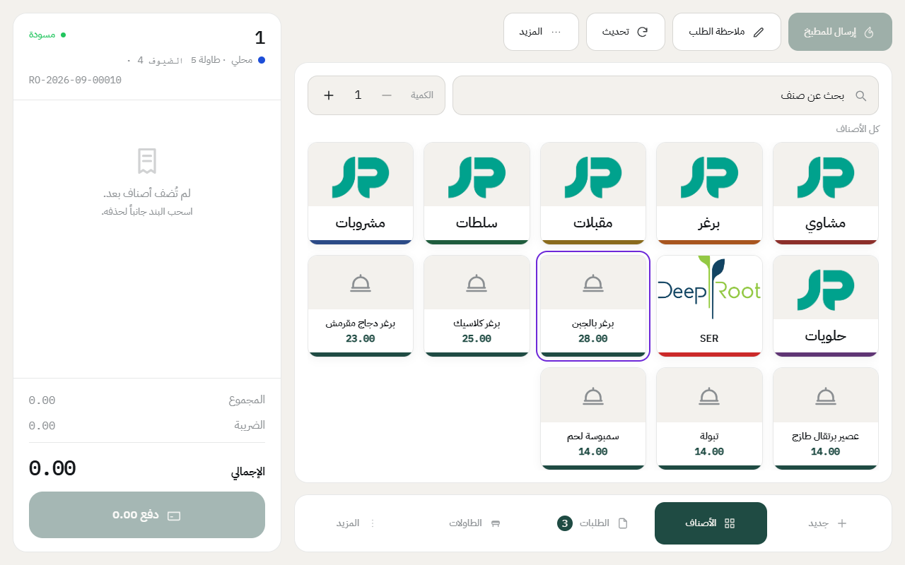
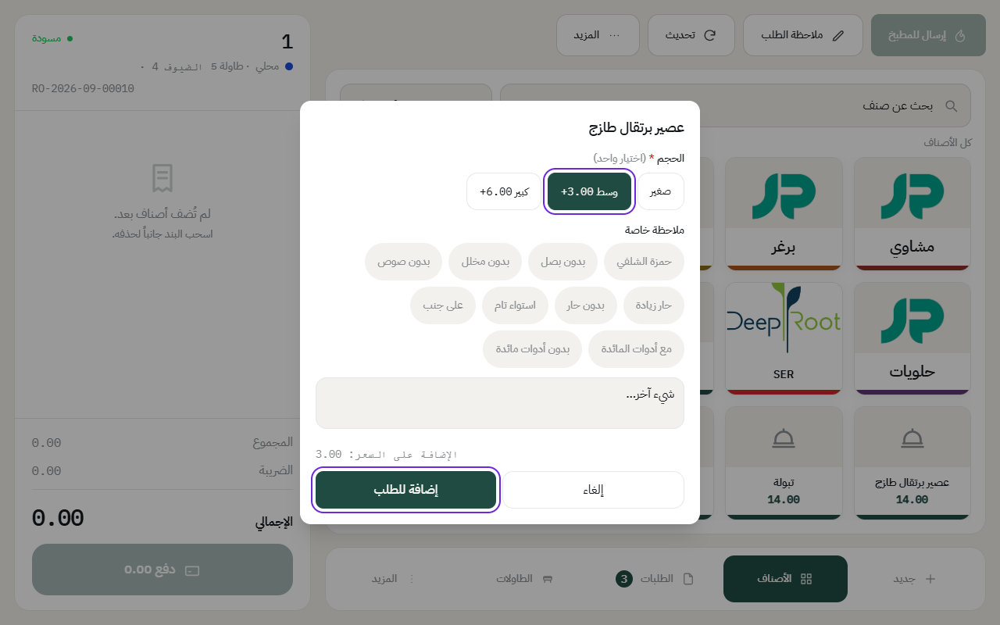
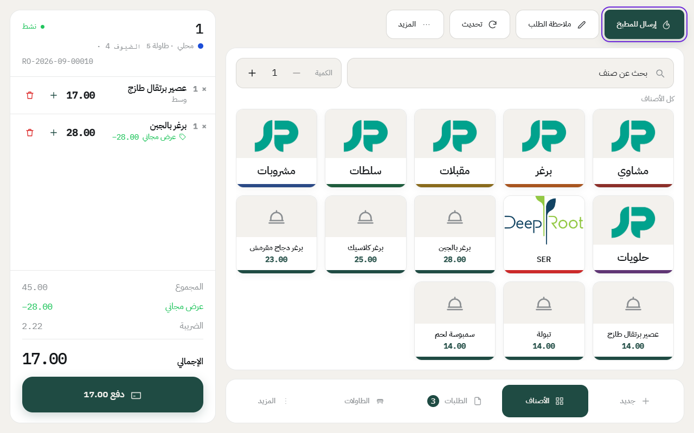

# إنشاء طلب محلي على طاولة

الطلب المحلي يبدأ من الطاولة. الكاشير يختار الطاولة، ويضيف الأصناف، ويرسلها للمطبخ، والطلب يبقى مفتوح على الطاولة لين يدفع الزبون.

قبل ما تبدأ، لازم يكون [الدرج مفتوح](open-drawer.md).

## الخطوات

1. اضغط على **الطاولات** في الشريط اللي تحت.

2. اختر القسم من فوق، واضغط على طاولة **فارغة**.

3. إذا سألك النظام عن نوع الطلب، اختر **محلي**.

4. اضغط على المجموعة، وبعدها على الصنف عشان تضيفه للطلب.

5. إذا الصنف له خيارات، مثل الحجم، بتطلع لك نافذة. اختر الخيار، وتقدر تضيف ملاحظة مثل «بدون بصل»، وبعدها اضغط **إضافة للطلب**.

6. لما تخلص الأصناف، اضغط على **إرسال للمطبخ**. كل صنف ينطبع في المطبخ حقه، مثل المشاوي أو البار.

## أشياء تحتاجها أثناء الطلب

- **تغيير الكمية**: اضغط **+** جنب الصنف في الفاتورة.
- **حذف صنف لسا ما انرسل للمطبخ**: اضغط على أيقونة الحذف جنبه، أو اسحبه جانباً.
- **كمية كبيرة من نفس الصنف**: غيّر **الكمية** فوق قبل ما تضغط الصنف، مثلاً 6 عصيرات بنقرة وحدة.
- **ملاحظة على الطلب كامل**: اضغط **ملاحظة الطلب**.
- **الزبون طلب زيادة بعد الإرسال**: افتح الطلب من الطاولة، وأضف الأصناف، واضغط **إرسال للمطبخ** مرة ثانية. ينطبع اللي انضاف بس.

## حالات الطاولة

| الحالة | معناها |
|---|---|
| **فارغة** | جاهزة، اضغطها وابدأ طلباً. |
| **مشغولة** | عليها فاتورة مفتوحة، اضغطها تفتح لك الفاتورة. |
| **محجوزة** | مربوطة بحجز قريب. شوف [حجز طاولة](reservations.md). |
| **تنظيف** | انحاسبت آخر فاتورة عليها، وتنتظر أحداً يقول إنها انظّفت. |
| **موقوفة** | مقفلة من المكتب ولا تُستخدم. |

**والتنظيف ما يروح لحاله.** لما تخلص الطاولة، اضغط عليها من شاشة الطاولات، ويسألك النظام **«الطاولة كذا جاهزة؟»** — اضغط **جاهزة** وترجع فارغة على طول. وهذا مقصود: النظام ما يدري متى انمسحت الطاولة، والشخص هو اللي يدري.

**وإذا رفض:** معناها لسا عليها فاتورة مفتوحة. حاسبها أو ألغها أولاً.

---

السابق: [الحضور والانصراف وتبديل الكاشير](attendance.md)

التالي: [إنشاء طلب سفري](takeaway-order.md)

الرجوع لـ[صفحة البداية](README.md)
