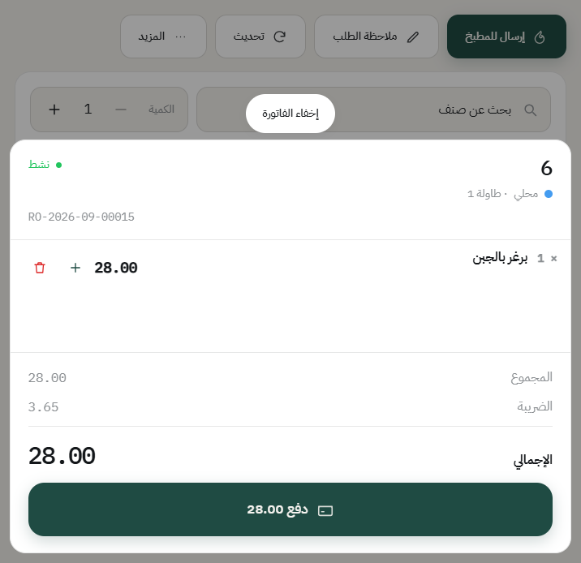
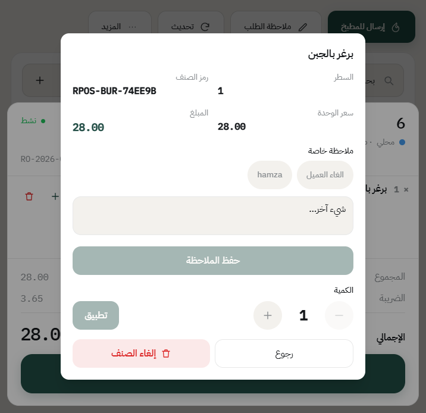
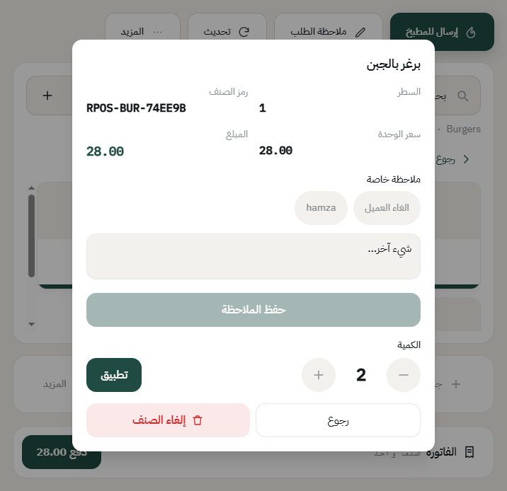
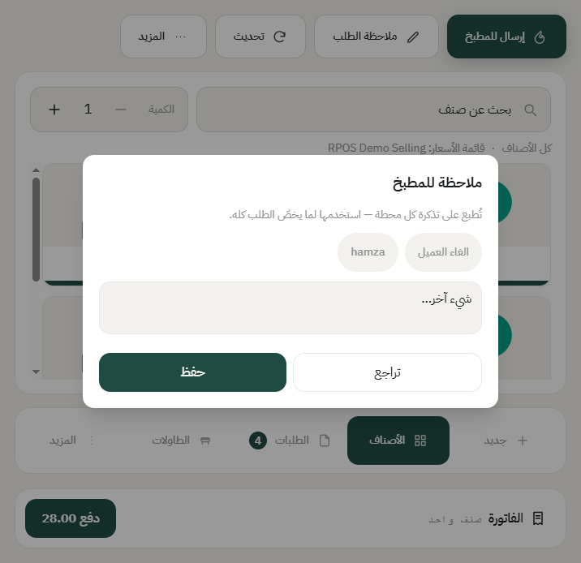
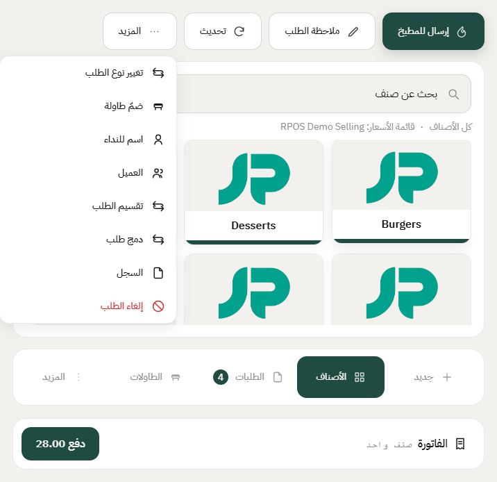
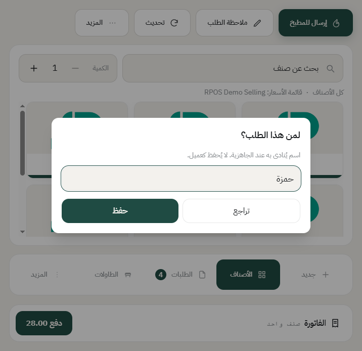
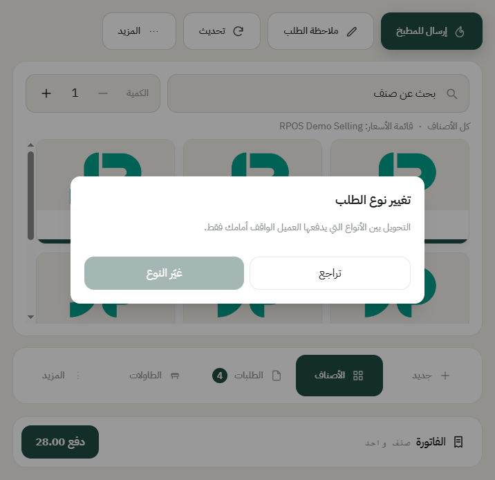

# تعديل الطلب: الكمية والملاحظات والنوع

بعد ما تضيف الأصناف، تقدر تعدّل عليها قبل الدفع: تغيّر الكمية، تضيف ملاحظة لصنف أو للطلب كله، تكتب اسم للنداء، أو تغيّر نوع الطلب.

## فتح سطر الصنف

اضغط **الفاتورة** عشان تشوف الأصناف، وبعدها اضغط على السطر اللي تبي تعدّله.

تفتح لك شاشة السطر، وفيها كل شي عنه: رقم السطر، ورمز الصنف، وسعر الوحدة، والمبلغ.

## تغيير الكمية

من نفس الشاشة، استخدم **+** و**−** تحت **الكمية**، وبعدها اضغط **تطبيق**. المبلغ يتحدث على طول.

**والصنف اللي راح للمطبخ:** تقدر تزيد كميته وينرسل الفرق للمطبخ، لكن ما تقدر تنقصه — النقص إلغاء، ويحتاج سبب. شوف [إلغاء صنف أو إلغاء طلب](void-and-cancel.md).

## ملاحظة على صنف

في نفس شاشة السطر، خانة **ملاحظة خاصة**. تقدر تنقر ملاحظة جاهزة مثل «بدون بصل»، أو تكتب اللي تبي، وبعدها **حفظ الملاحظة**.

الملاحظة هذي تطلع على تذكرة المحطة اللي تجهّز هذا الصنف بس.

## ملاحظة على الطلب كله

من الشريط فوق، اضغط **ملاحظة الطلب**.

هذي **تُطبع على تذكرة كل محطة**، فاستخدمها للي يخصّ الطلب كله، مثل «حساسية» أو «الطلب مستعجل».

**الملاحظات الجاهزة** في الشاشتين تعدّلها من المكتب: **نقاط البيع** ← **القائمة** ← **الملاحظات السريعة**. وكل ملاحظة تختار لها النوع: على صنف، أو على الطلب، أو على الاثنين. شوف [الملاحظات السريعة والأسباب الجاهزة](quick-notes.md).

## اسم للنداء

للطلبات السفري: اضغط **المزيد**.

بعدها **اسم للنداء**، واكتب اسم الزبون.

الاسم يطلع على الفاتورة وتذكرة المطبخ عشان تنادي عليه لما يجهز. **وما ينحفظ كعميل** — إذا تبي تحفظ الزبون برقمه، استخدم **العميل** من نفس القائمة.

## تغيير نوع الطلب

من **المزيد** ← **تغيير نوع الطلب**.

مثلاً زبون طلب سفري وقرر يقعد. النظام يحوّل الطلب ويطبّق أسعار النوع الجديد إذا كانت مختلفة.

**بس فيه حد:** التحويل بين الأنواع اللي **يدفعها الزبون الواقف قدامك** فقط. طلبات التطبيقات (اللي على حساب آجل) ما تتحوّل، لأن الفلوس على جهة ثانية أصلاً.

---

السابق: [إنشاء طلب توصيل](delivery-order.md)

التالي: [ربط الطلب بعميل](customer.md)

الرجوع لـ[صفحة البداية](README.md)
