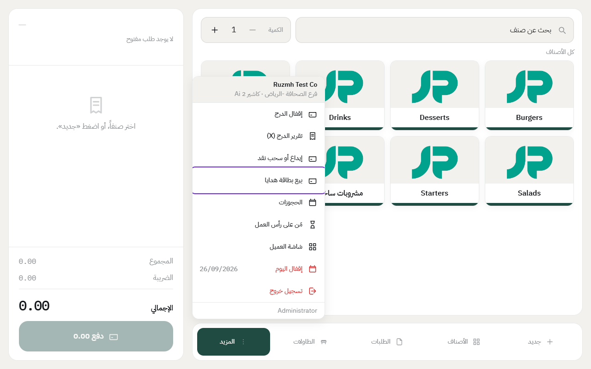
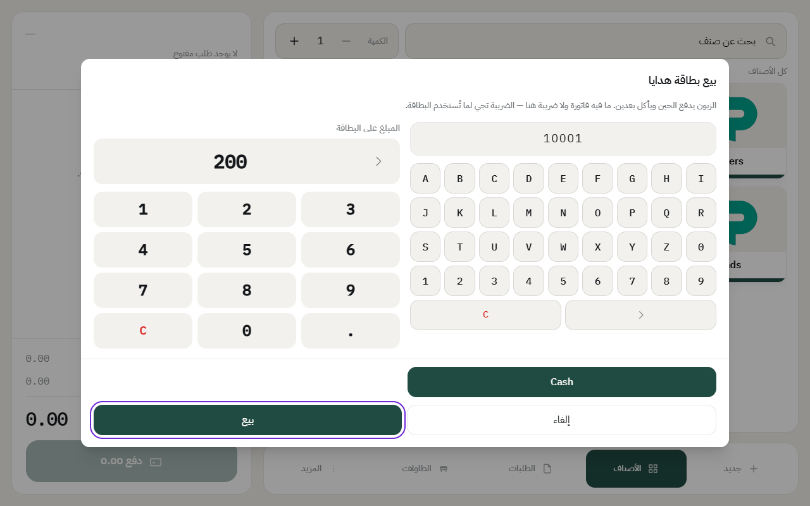
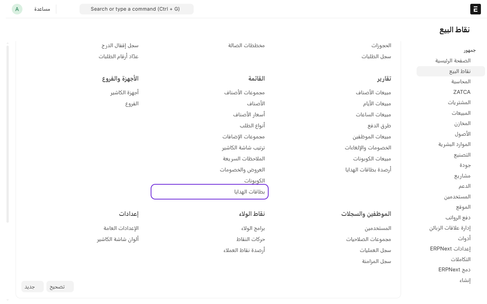
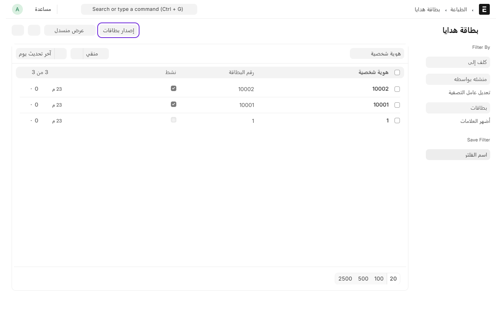
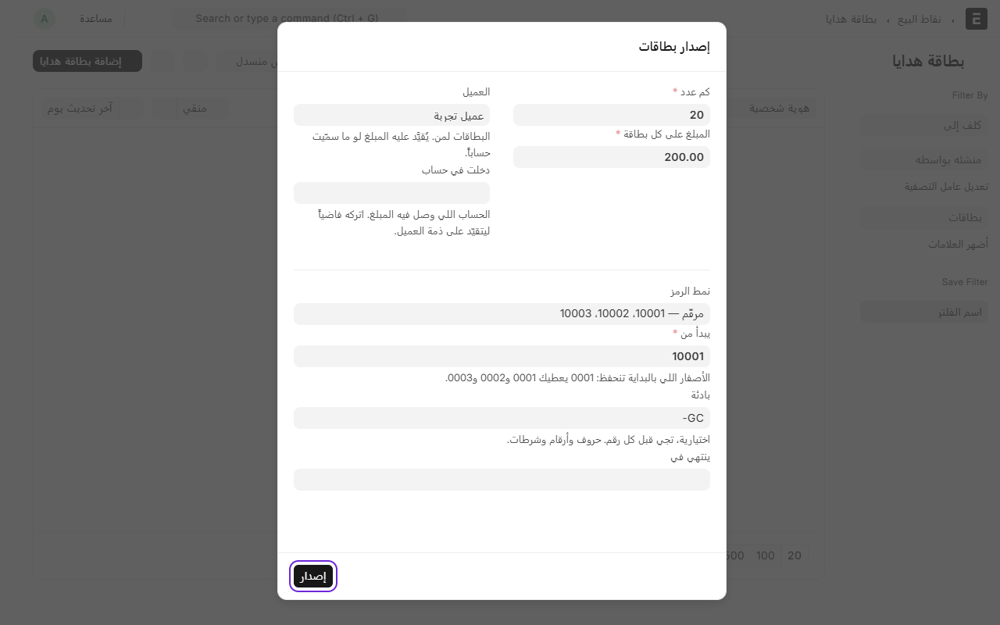
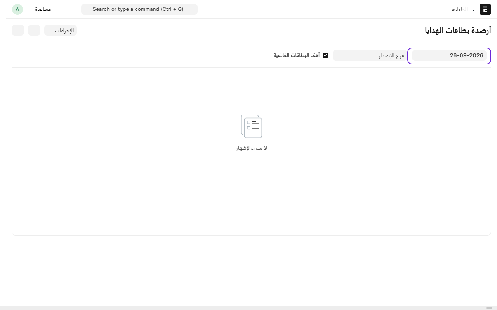

# بطاقة الهدايا: فلوس مدفوعة مقدّماً

**البطاقة مو خصم — هي دفع.** الزبون يدفع لك ٢٠٠ اليوم، ويأكل بها بعدين. الفاتورة تتحسب كاملة بضريبتها، والبطاقة تسدّدها زي ما يسدّدها النقد.

## قبل أول بيع: إعداد مرة وحدة

**١. الحساب وطريقة الدفع.** النظام ينشئ لك:
- حساب **«بطاقات هدايا غير مستخدمة»** تحت الالتزامات المتداولة.
- طريقة دفع اسمها **«بطاقة هدايا»** مربوطة بنفس الحساب.

> **النظام يعرف طريقة البطاقة من علامة، مو من اسمها.** في شاشة طريقة الدفع خانة **«بطاقة هدايا»** — الطريقة اللي عليها هذي العلامة هي اللي يطلب الكاشير فيها رقم البطاقة ويخصم من رصيدها. فسمّها اللي تبي، بأي لغة. ويُسمح بطريقة وحدة بس عليها العلامة، وما تنفع تكون «على الحساب» بنفس الوقت.

> **ما لقيت طريقة الدفع؟** إذا عندك تطبيق الفوترة الإلكترونية لزاتكا، فهو يطلب **رمز وسيلة الدفع** في كل طريقة دفع، والنظام ما يعرف وش الرمز الصحيح لبطاقة الهدايا — هذا يحدده محاسبك. أنشئها بيدك: ابحث فوق عن **طريقة الدفع** ← **إضافة**، سمّها، ونوعها **General**، واكتب الرمز، **وعلّم «بطاقة هدايا»**. وفي جدول **الحسابات** أضف سطراً: شركتك، والحساب **«بطاقات هدايا غير مستخدمة»**، ثم **حفظ**.

**٢. تضيف الطريقة لجهاز الكاشير.** من المكتب، ادخل على **نقاط البيع**، وتحت **الأجهزة والفروع** اضغط على **أجهزة الكاشير**، وافتح الجهاز. تحت **طرق الدفع** اضغط **Add Row** واختر طريقة البطاقة (اللي عليها علامة «بطاقة هدايا»)، ثم **حفظ**.

> **لا تخلط بينها وبين «بطاقات الهدايا» تحت «القائمة».** هذيك قائمة البطاقات نفسها — تصدرها وتشوف أرصدتها وتطبعها. أما هنا فأنت تضيف **طريقة دفع** للجهاز، عشان يقدر الكاشير يستقبل البطاقة.

> **ليش ما تنضاف للجهاز لحالها؟** لأنك قلت سابقاً: «اللي أختاره بس يظهر». فما نضيف طريقة دفع لجهازك بدون علمك.

## طريقتان لإصدار البطاقة

| | **من الكاشير** | **من المكتب** |
|---|---|---|
| متى | زبون واقف عندك يشتري بطاقة | شركة تطلب دفعة، أو بطاقة تعويض لزبون منزعج |
| الفلوس | تدخل الدرج | تحويل بنكي، أو **على ذمة الشركة** لين تدفع |
| وين | المزيد ← بيع بطاقة هدايا | نقاط البيع ← القائمة ← بطاقات الهدايا ← **إصدار بطاقات** |

## بيع بطاقة من الكاشير

من **المزيد** (تحت) ← **بيع بطاقة هدايا**. *(ما يطلع إلا والدرج مفتوح.)*

١. اكتب **رقم البطاقة** — اللي مطبوع عليها. (وفيه لوحة حروف وأرقام، والقارئ يشتغل لو عندك واحد.)
٢. اكتب **المبلغ**.
٣. اختر **كيف دفع الزبون** — نقد أو شبكة.
٤. **بيع** — ويطلع لك الرقم والرصيد تقرأهما للزبون.

**ما يطلع فاتورة ولا ضريبة.** وهذا مو نسيان — **نظام الضريبة السعودي يقول كذا**: بيع القسيمة بقيمتها ليس بيعاً، والضريبة تجي لما يأكل الزبون. المادة ١٩ من اللائحة التنفيذية.

**بس الفلوس تدخل الدرج**، فالمبلغ المتوقَّع في الإقفال يزيد بمقدارها. عادي — أنت أخذت المال فعلاً.

## إصدار بطاقات من المكتب

١. من المكتب، ادخل على **نقاط البيع**، وتحت **القائمة** اضغط على **بطاقات الهدايا**.

٢. اضغط على **إصدار بطاقات**.

٣. عبّي الخانات:

- **كم عدد** و**المبلغ على كل بطاقة**.
- **العميل**: الشركة أو الزبون اللي البطاقات له.
- **دخلت في حساب**: لو التحويل وصل، اختر حساب البنك. **واتركه فاضياً لو ما دفعوا بعد** — وقتها المبلغ **يتقيّد على ذمة العميل**، ومحاسبك يسدّده بسند قبض لما يجي التحويل، زي أي فاتورة.
- **نمط الرمز**: عشوائي، أو مرقّم (`10001`، `10002`…) — نفس خيارات الكوبونات.

٤. اضغط **إصدار**.

**وما تدخل درج أحد.** مافيش كاشير في العملية أصلاً، فالمبلغ المتوقَّع في الإقفال ما يتأثر.

> **ليش ما فيه زر «إضافة»؟** لأن الرصيد يُحسب من قيود الدفتر، مو من خانة تُكتب. بطاقة تنضاف بيدك ما لها قيد، فرصيدها صفر والكاشير يرفضها. فالبطاقة تنشأ من طريقين بس، والاثنين يسجّلون القيد: **إصدار بطاقات** هنا، أو **البيع من الكاشير**.

## الدفع ببطاقة

في شاشة الدفع، اختر **«بطاقة هدايا»**:

١. يطلب منك **رقم البطاقة**.
٢. اضغط **تحقّق** — **يظهر لك الرصيد قبل ما يُخصم شي**.
٣. **تم** — ويفتح لك مبلغ الدفع، **محدوداً برصيد البطاقة**.

لو الفاتورة ١٢٠ والبطاقة فيها ٤٠، تاخذ ٤٠ من البطاقة والباقي بطريقة ثانية. عادي.

**وبطاقتان على فاتورة وحدة؟** ينفع — كل وحدة سطر مستقل.

## الأسئلة اللي تجيك

| السؤال | الجواب |
|---|---|
| ينتهي رصيد البطاقة؟ | لا، إلا لو حطيت تاريخ انتهاء بنفسك. الافتراضي: ما تنتهي |
| أصرف الباقي نقداً؟ | لا. الرصيد يُؤكل ما يُسحب — وهذا المعتاد في كل الأنظمة |
| البطاقة تشتغل في كل الفروع؟ | نعم، رصيد واحد |
| ضاعت البطاقة؟ | افتح **بطاقات الهدايا** في المكتب، وشِل علامة **مفعّل**. الرقم يوقف فوراً والرصيد يبقى محفوظاً |
| أعرف كم علينا من بطاقات؟ | رصيد حساب **«بطاقات هدايا غير مستخدمة»** في دفترك = مجموع أرصدة كل البطاقات. يطابق نفسه تلقائياً |

## طباعة البطاقات

من قائمة **بطاقات الهدايا**: **علّم** اللي تبي تطبعها ← قائمة **إجراءات** ← **طباعة ورقة البطاقات**.

نفس ورقة الكوبونات: **A4 فيها ١٠ بطاقات**، كل وحدة فيها الرقم بخط كبير وكيو آر ورصيدها. اضغط **طباعة** واختر **«حفظ كـ PDF»**، وبعدين قصّها على الخطوط المتقطّعة.

**والمطبوع هو الرصيد الحالي مو المبلغ اللي انباعت فيه** — فلو طبعتها بعد ما استخدم جزءاً، تطلع بالباقي. وهذا مقصود: بطاقة تقول ٢٠٠ وفيها ٨٠ نقاش عند الكاشير أنت خاسره.

## تقرير الأرصدة (للمحاسب)

**نقاط البيع ← التقارير ← أرصدة بطاقات الهدايا**.

يعطيك كل بطاقة ورصيدها **بتاريخ تختاره** — مو رصيد اليوم. وهذا المهم: قيد آخر الشهر يتسوّى غالباً في الأسبوع الثاني من الشهر اللي بعده، ولو قرأت رصيد اليوم بتحسب بطاقات انباعت بعد التاريخ.

**وفايدته:** مجموع التقرير **لازم يساوي رصيد حساب «بطاقات هدايا غير مستخدمة»** في دفترك. لو اختلفا، عندك سؤال تلاحقه.

والبطاقات الموقوفة والمنتهية **تظهر ومعلَّمة** — تبقى مستحقة إلا إذا قرر محاسبك غير ذلك، وهذا قراره مو قرار تقرير.

## المرتجع على فاتورة دُفعت ببطاقة

**المال يرجع على البطاقة نفسها** — مو نقداً. وهذا اللي تسويه كل الأنظمة (Square وToast)، والسبب مو شكلي:

> ردّ فلوس البطاقة نقداً يحوّل رصيداً مدفوعاً مقدّماً إلى كاش. وهذي طريقة الاحتيال المعروفة: يشتري بطاقة ببطاقة ائتمان مسروقة، يأكل، ويسترد نقداً.

**فلو حاولت ترد نقداً، النظام يرفض** ويقول لك كم دفعت البطاقة على هذي الفاتورة.

**وفاتورة مقسومة؟** كل طريقة ترجع بحدّ ما دفعت. فاتورة ١٠٠ (٤٠ بطاقة + ٦٠ نقد) ← ٤٠ للبطاقة و٦٠ نقداً.

**والرصيد يرجع فوراً** على نفس البطاقة اللي خرج منها.

## الرفض وأسبابه

| الرسالة | وش تسوي |
|---|---|
| ما فيه بطاقة بهذا الرقم | تأكد من الكتابة |
| هذي البطاقة موقوفة | افتحها في المكتب وعلّم **مفعّل** |
| هذي البطاقة انتهت في … | مدتها خلصت |
| البطاقة فيها … بس | الرصيد أقل من المطلوب — خذ الباقي بطريقة ثانية |

---

السابق: [الكوبونات: رمز يفتح عرضاً](coupons.md)

التالي: [مجموعات الإضافات: خيارات الصنف](modifiers.md)

الرجوع لـ[صفحة البداية](README.md)
