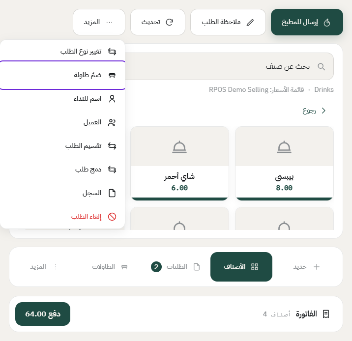
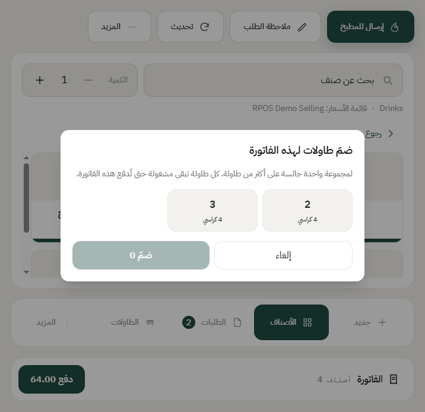
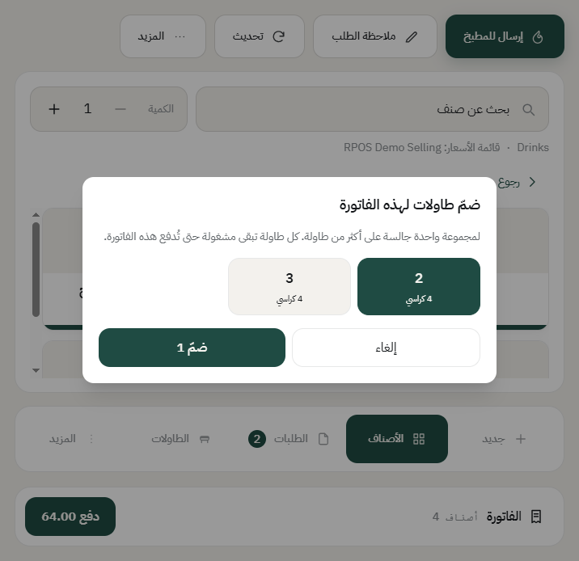
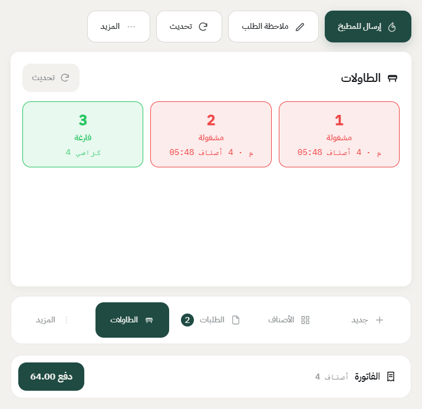

# ضمّ طاولات لفاتورة وحدة

مجموعة كبيرة جت وقعدت على طاولتين أو ثلاث، وتبي تحاسبهم مرة وحدة. تضمّ الطاولات للفاتورة، فتصير كلها مشغولة بنفس الفاتورة، والحساب واحد.

## الخطوات

1. افتح الفاتورة اللي على الطاولة الأولى، واضغط **المزيد**، بعدها **ضمّ طاولة**.

2. تطلع لك الطاولات الفاضية في نفس الصالة.

3. اضغط على الطاولة أو الطاولات اللي تبي تضمّها، وبعدها اضغط **ضمّ**.

4. الطاولات كلها تصير **مشغولة** بنفس الفاتورة، وأي وحدة تضغط عليها تفتح لك نفس الفاتورة.

## أشياء تنتبه لها

- **الضمّ للطلب الجالس على طاولة فقط.** الطلب السفري أو التوصيل ما له طاولة أصلاً، فالخيار ما يظهر له.
- **الطاولة المضمومة لازم تكون فاضية.** إذا عليها فاتورة، النظام يقول لك ذلك، والحل إنك تدمج الفاتورتين، شوف [تقسيم فاتورة ودمج فاتورتين](split-and-join-bills.md).
- **فكّ الضمّ يصير لحاله.** أول ما تدفع الفاتورة أو تلغيها، كل الطاولات تتحرر مرة وحدة وتروح لحالة التنظيف.
- **الصلاحية**: يحتاج الموظف صلاحية **«يضم طاولات»** من مجموعة الصلاحيات، وإلا ما يظهر له الخيار.

---

السابق: [تقسيم فاتورة ودمج فاتورتين](split-and-join-bills.md)

التالي: [إلغاء صنف أو إلغاء طلب](void-and-cancel.md)

الرجوع لـ[صفحة البداية](README.md)
