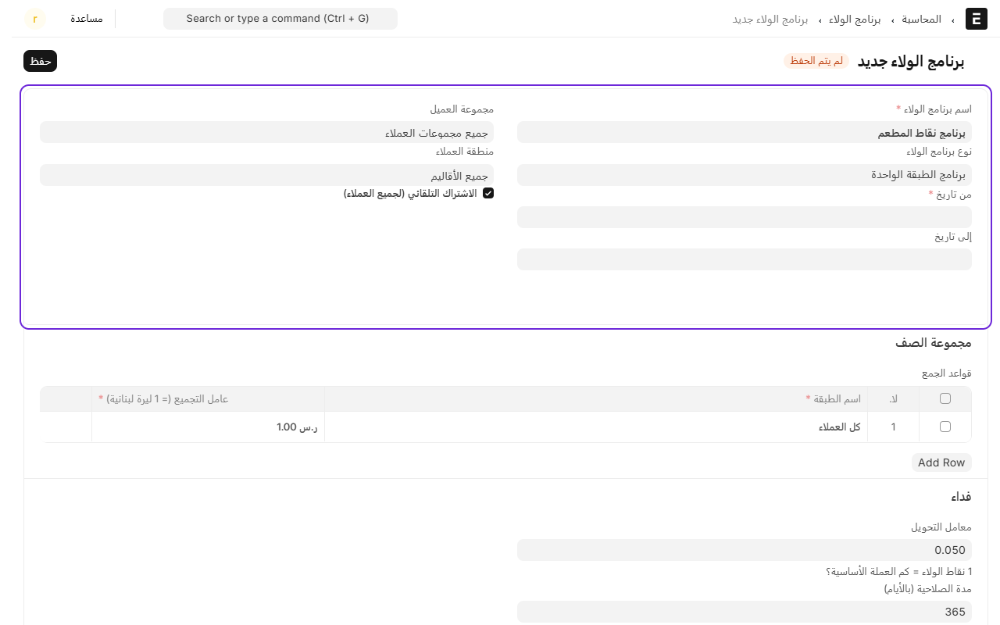
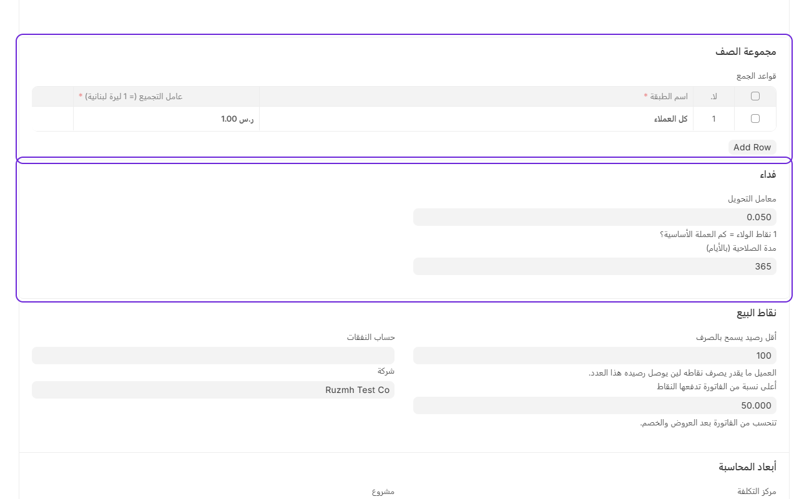
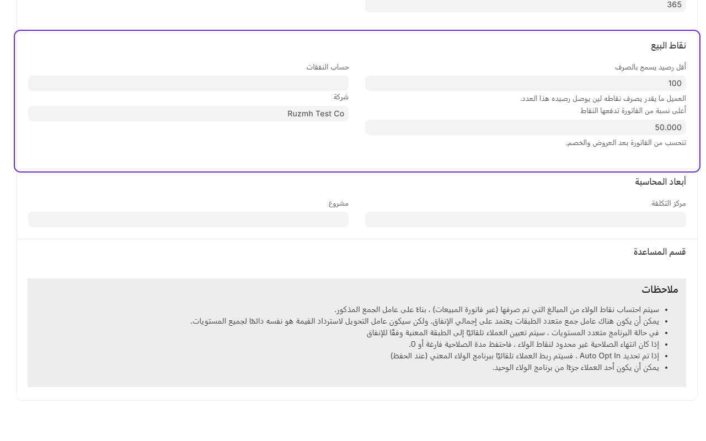

# تفعيل نقاط الولاء

نقاط الولاء تخلي الزبون يجمع نقاط مع كل فاتورة، ويصرفها بعدين خصم على فاتورته. العميل يتعرّف برقم جواله.

إذا ما تبغى نقاط، لا تسوي شي. النقاط ما تشتغل إلا إذا فيه برنامج ولاء.

## إنشاء البرنامج

1. من المكتب، ادخل على **نقاط البيع**.
2. تحت **نقاط الولاء**، اضغط على **برامج الولاء**.

3. اضغط على **إضافة برنامج الولاء**.
4. اكتب **اسم البرنامج**، واختر **نوع البرنامج**: **برنامج الطبقة الواحدة**.
5. اختر **من تاريخ**، وخل **الاشتراك التلقائي** معلّم عشان كل زبون يدخل البرنامج من أول فاتورة.

6. تحت **قواعد الجمع**، أضف صف واحد، واكتب في **عامل التجميع** كم ريال يعطي نقطة. مثلاً 1 يعني كل ريال بنقطة.
7. تحت **فداء**:
   - **معامل التحويل**: قيمة النقطة بالريال لما تنصرف. مثلاً 0.05 يعني كل 100 نقطة بـ5 ريال.
   - **مدة الصلاحية**: كم يوم تبقى النقاط قبل ما تنتهي. مثلاً 365.

8. تحت **نقاط البيع**:
   - **أقل رصيد يسمح بالصرف**: مثلاً 100 نقطة.
   - **أعلى نسبة من الفاتورة تدفعها النقاط**: مثلاً 50%.
9. اختر **الشركة**، واضغط **حفظ**.

بهذي الأرقام، الزبون يرجع له 5% من اللي يصرفه.

## على الكاشير

- **جمع النقاط**: أضف العميل على الطلب برقم جواله من **المزيد** ← **العميل**. بعد الدفع، النقاط تنضاف لرصيده تلقائياً.
- **صرف النقاط**: في شاشة الدفع، إذا العميل عنده رصيد كافي، يطلع قسم **نقاط الولاء** فيه رصيده وقيمته، واضغط **استخدم … نقطة** عشان تنخصم من الفاتورة.

## أنواع الطلب اللي ما تجمع نقاط

طلبات التطبيقات والحسابات الآجلة ما تجمع نقاط أبداً. وإذا تبغى توقف النقاط عن نوع طلب معيّن، شيل علامة **نقاط الولاء** من إعداده. شوف [أنواع الطلب](add-order-types.md).

للتفاصيل الكاملة والحسابات، شوف [مرجع نقاط الولاء](../12_Loyalty_Points.md).

---

السابق: [إقفال اليوم](close-day.md)

التالي: [إضافة عرض أو خصم](promotions.md)

الرجوع لـ[صفحة البداية](README.md)
