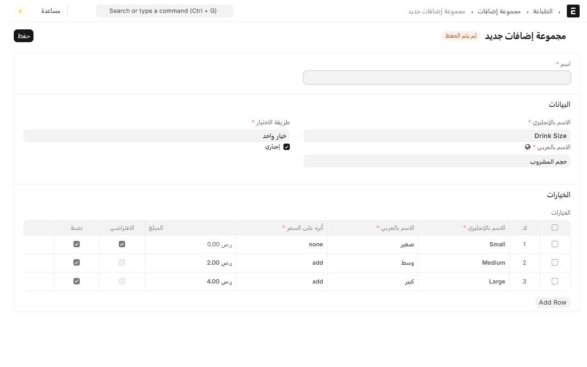
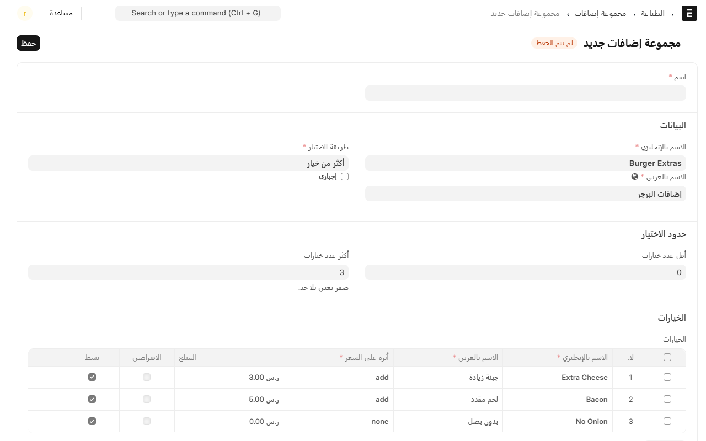
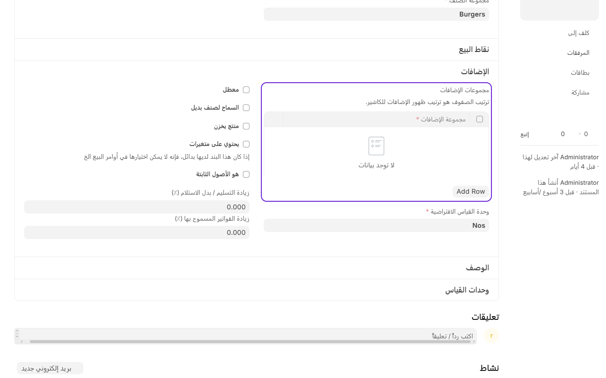

# مجموعات الإضافات: خيارات الصنف قبل ما يروح للمطبخ

الإضافات هي الأسئلة اللي يسألها الكاشير عن الصنف: **حجم المشروب**، **درجة الاستواء**، **بدون بصل**، **جبنة زيادة**. تجهّزها مرة وحدة في المكتب، وبعدها كل ما الكاشير يضغط الصنف تطلع له وتدخل في تذكرة المطبخ وفي السعر.

الفرق بينها وبين الملاحظة السريعة: الإضافة **خيار محدد وله سعر**، والملاحظة كلام حر ما يغيّر المبلغ.

## وين تلقاها

من المكتب، افتح **نقاط البيع** ثم **القائمة**، واضغط **مجموعات الإضافات**.

## إضافة مجموعة

اضغط **إضافة مجموعة إضافات**، واكتب اسماً للمجموعة (هذا الاسم للمكتب)، بعدها عبّي:

### البيانات

- **الاسم بالإنجليزي** و**الاسم بالعربي**: هذا اللي يشوفه الكاشير ويطلع على تذكرة المطبخ.
- **طريقة الاختيار**:
  - **خيار واحد**: الكاشير يختار وحدة بس، مثل حجم المشروب.
  - **أكثر من خيار**: يقدر يختار كم وحدة، مثل إضافات البرجر.
- **إجباري**: مؤشّرة يعني ما يقدر يضيف الصنف قبل يختار. استخدمها للأسئلة اللي لازم لها جواب، مثل درجة استواء اللحم.

### حدود الاختيار

هذي تظهر لك بس إذا اخترت **أكثر من خيار**:

- **أقل عدد خيارات**: أقل شي لازم يختاره.
- **أكثر عدد خيارات**: أكثر شي مسموح، و**صفر يعني بلا حد**.

### الخيارات

كل سطر في الجدول خيار واحد:

- **الاسم بالإنجليزي** و**الاسم بالعربي**.
- **أثره على السعر**، وله ثلاث حالات:
  - `none` — ما يغيّر السعر (مثل «بدون بصل»).
  - `add` — يزيد على سعر الصنف (جبنة زيادة ‎+3‎ ريال).
  - `subtract` — ينقص من السعر.
- **المبلغ**: الرقم اللي يزيد أو ينقص، حسب اللي فوق.
- **صنف المخزون**: اتركه فاضي إلا إذا الخيار يخصم من مخزون صنف ثاني.
- **الافتراضي**: يجي مختار من نفسه، والكاشير يقدر يغيّره.
- **نشط**: شيل التأشير عن الخيار اللي خلص من عندك بدل ما تحذفه، عشان الفواتير القديمة تبقى مفهومة.

**وترتيب الصفوف هو ترتيب ظهورها للكاشير** — حط الأكثر طلباً فوق.

## ربط المجموعة بالأصناف

المجموعة لحالها ما تسوي شي لين تربطها بصنف.

1. افتح بطاقة الصنف من **المخازن** ← **الصنف**.
2. انزل لقسم **الإضافات**، وفي جدول **مجموعات الإضافات** اضغط **Add Row** واختر المجموعة.
3. احفظ.

تقدر تربط أكثر من مجموعة بنفس الصنف، مثل برجر له «درجة الاستواء» و«إضافات البرجر». **وترتيب الصفوف هنا كمان هو ترتيب ظهورها للكاشير.**

## كيف تطلع للكاشير

لما يضغط الكاشير على صنف له إضافات، تفتح له شاشة الخيارات قبل ما ينضاف للفاتورة:

- المجموعة **الإجبارية** ما يعدّيها بدون اختيار.
- الخيار اللي له سعر يبيّن بجنبه، والمبلغ يتحدث في الفاتورة على طول.
- الخيارات اللي اختارها تطلع تحت اسم الصنف في الفاتورة، **وتنطبع في تذكرة المطبخ** عشان الطباخ يشوفها.

## نصايح قصيرة

- **لا تسوي مجموعة لكل صنف.** مجموعة وحدة اسمها «إضافات البرجر» تربطها بكل البرجرات أحسن من خمس مجموعات متشابهة.
- **الأسئلة اللي جوابها نعم/لا** خلّها خيارات داخل مجموعة وحدة، لا مجموعة لكل سؤال.
- **للأحجام، سعّر الصنف بالحجم الصغير** وخلّ الأحجام الأكبر `add` بفرق السعر: «وسط ‎+2‎»، «كبير ‎+4‎». وإذا تغيّر سعر الصنف، الفروق تبقى صحيحة بلا ما تعدّلها.
- الخيار اللي وقفته يختفي عن الكاشير، لكنه يبقى في الفواتير القديمة كما هو.

---

السابق: [بطاقة الهدايا: فلوس مدفوعة مقدّماً](gift-cards.md)

التالي: [الملاحظات السريعة والأسباب الجاهزة](quick-notes.md)

الرجوع لـ[صفحة البداية](README.md)
