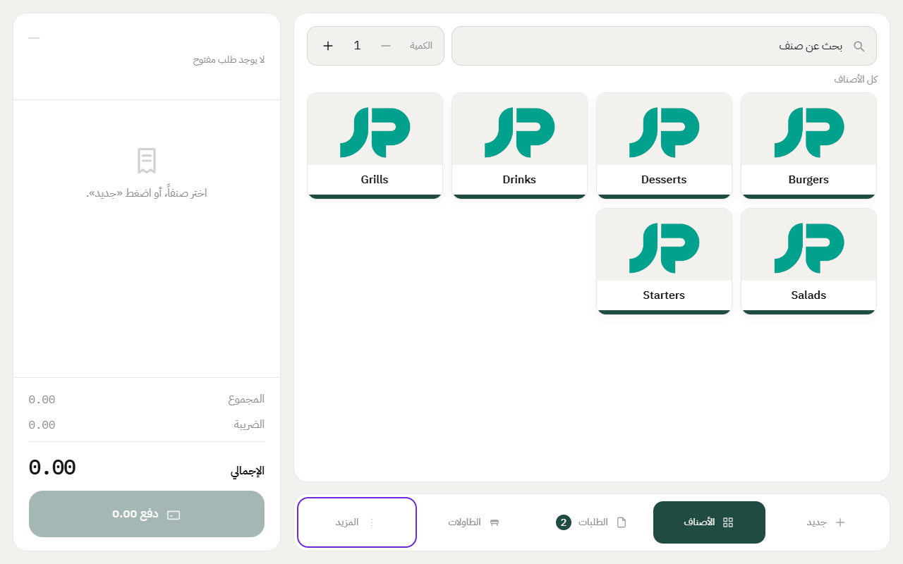
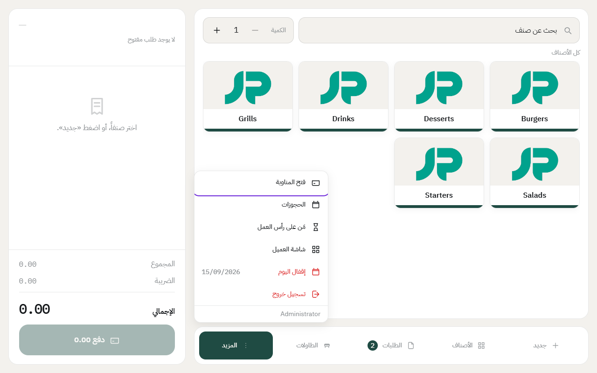
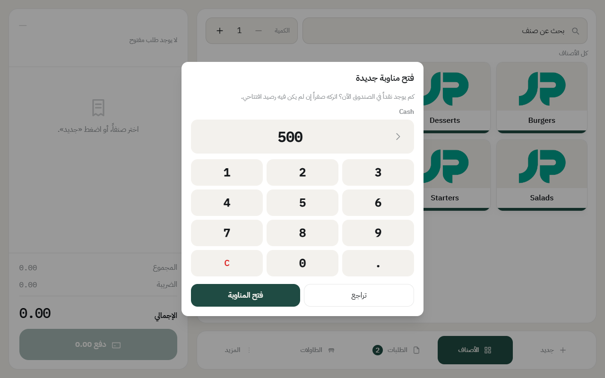
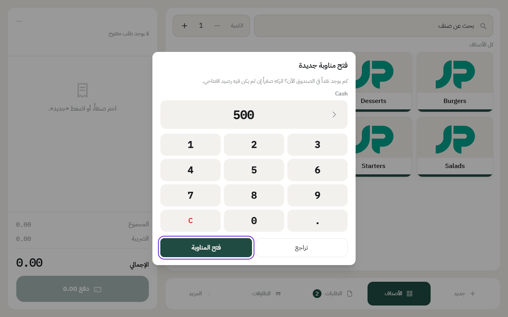

# فتح الدرج

قبل ما يبيع الكاشير، لازم يكون الدرج مفتوح. فتح الدرج معناه إن الكاشير يسجّل كم فيه فلوس في الصندوق أول الشفت، وعلى هذا المبلغ يحسب النظام وش المفروض يكون في الصندوق آخر الشفت.

وإذا كان يوم العمل مقفل، ينفتح مع الدرج تلقائياً.

## الخطوات

1. على جهاز الكاشير، ادخل برقمك السري.
2. إذا طلب منك النظام، سجّل **حضور**.
3. اضغط على **المزيد** في الشريط اللي تحت.

4. اضغط على **فتح الدرج**.

5. عدّ الفلوس اللي في الصندوق واكتب المبلغ. إذا الصندوق فاضي، خله صفر.

6. اضغط على **فتح الدرج**.

خلاص، الكاشير يقدر يبيع الحين.

## إذا الدرج مفتوح من قبل

- **إذا نوع الدرج في الفرع «درج مشترك»**: وزميلك فاتح الدرج على نفس الجهاز، ما تحتاج تفتح شي. ادخل برقمك وبيع على نفس الدرج، والتقرير يطلّع مبيعات كل واحد لحاله.
- **إذا نوع الدرج «لكل موظف درجه»**: لازم صاحب الدرج المفتوح يقفله أول، وبعدها تفتح درجك.

---

السابق: [فتح الكاشير من اختصار خاص](till-shortcut.md)

التالي: [الحضور والانصراف وتبديل الكاشير](attendance.md)

الرجوع لـ[صفحة البداية](README.md)
