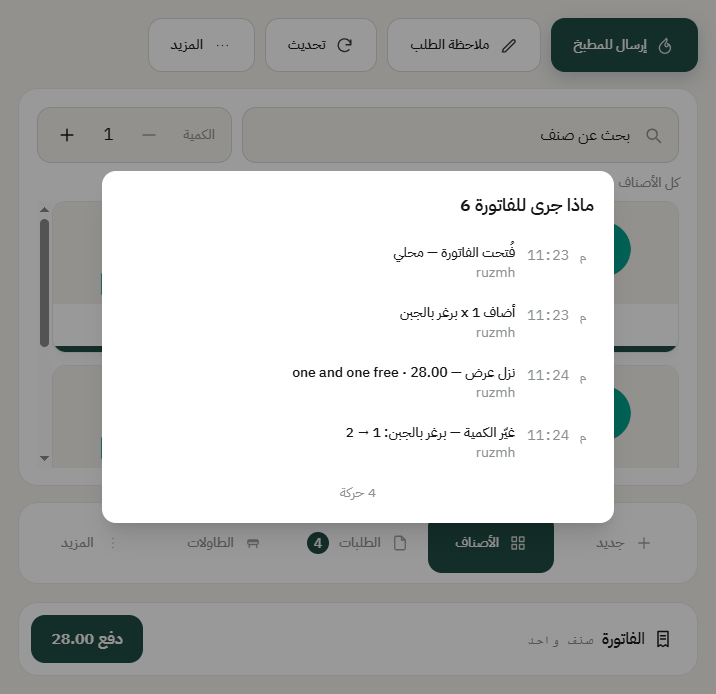

# سجل الطلب: مين سوّى وش ومتى

كل فاتورة تحمل سجلها. إذا صار خلاف — ليش المبلغ تغيّر، مين حذف الصنف، متى راح للمطبخ — الجواب هنا، مو في الذاكرة.

## فتح السجل

افتح الفاتورة، واضغط **المزيد**، بعدها **السجل**.

## وش تلقى فيه

كل سطر فيه ثلاثة أشياء: **الوقت**، و**وش صار**، و**مين سوّاه**. ومن الأمثلة:

- **فُتحت الفاتورة** — ومعها نوع الطلب.
- **أضاف صنف** — الكمية واسم الصنف.
- **غيّر الكمية** — من كم إلى كم.
- **ألغى صنفاً** — مع السبب اللي كُتب.
- **نزل عرض** — اسم العرض والمبلغ اللي نزل.
- **خصم** — نوعه ومبلغه، ومين وافق عليه إذا احتاج تفويض.
- **أُرسل للمطبخ** — ومعه المحطة.
- **دُفعت** — المبلغ وطريقة الدفع.
- **نُقلت أصناف** بين الفواتير، أو **دُمجت** فاتورة في ثانية.

وتحت تلقى عدد الحركات كلها.

## ليش هذا مهم

- **الخلافات تنحل بالورق مو بالكلام.** «الصنف انحذف» تصير: مين، ومتى، وليش.
- **الكاشير محمي مثل المدير.** السجل يقول إن الخصم وافق عليه فلان، فما يتحمّله الكاشير وحده.
- **ما ينمسح ولا يتعدّل.** حتى المدير ما يقدر يغيّر فيه.

## فرق السجل عن سجل العمليات

- **سجل الطلب** (هذي الصفحة): قصة فاتورة وحدة، يقرأها الكاشير من شاشته.
- **سجل العمليات** في المكتب: كل الإجراءات الحساسة في الفرع كله — الخصومات والإلغاءات والتفويضات وفتح الأدراج — وهذا للمدير. تلقاه في **نقاط البيع** ← **الموظفين والسجلات** ← **سجل العمليات**، وشرحه في [سجل العمليات](audit-log.md).

---

السابق: [إلغاء صنف أو إلغاء طلب](void-and-cancel.md)

التالي: [إرجاع طلب](return-order.md)

الرجوع لـ[صفحة البداية](README.md)
