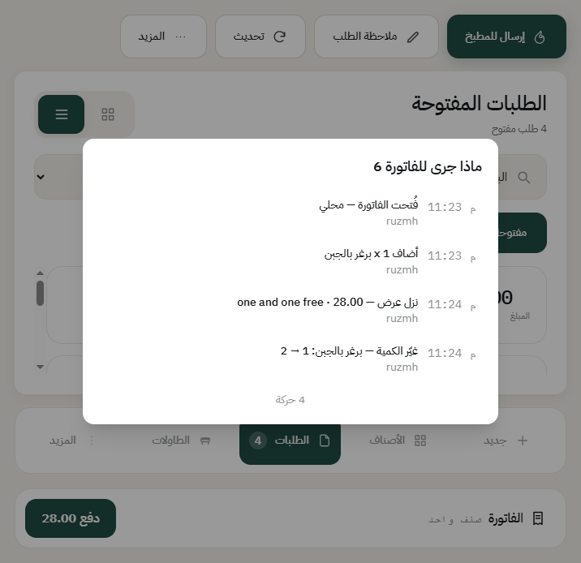
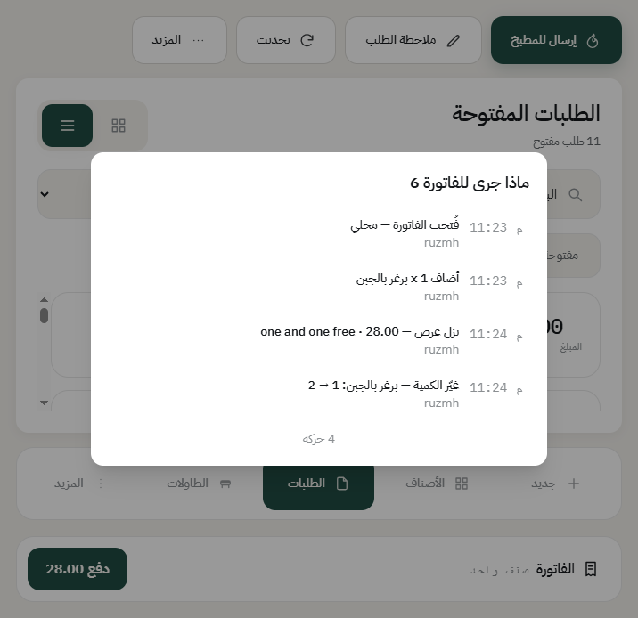

# قائمة الطلبات وتبويباتها

من الشريط اللي تحت، اضغط **الطلبات**، عشان تشوف فواتير الفرع كلها وتفتح أي وحدة منها.

## التبويبات

- **مفتوحة**: الفواتير اللي ما انحاسبت بعد. هذي اللي يشتغل عليها الكاشير طول اليوم.
- **مغلقة اليوم**: الفواتير المدفوعة في يوم العمل الحالي. منها تعيد طباعة فاتورة أو تبدأ مرتجع.

- **مرتجعات**: المرتجعات اللي صارت اليوم، وكل سطر يفتح لك الإشعار الدائن.

- **الكل**: الثلاثة مع بعض.

## الترتيب

فوق تلقى: **الأحدث أولاً**، و**الأقدم أولاً**، و**الأعلى مبلغاً**. «الأقدم أولاً» مفيد وقت الزحمة عشان ما تنسى طاولة قاعدة من زمان.

## وش في كل بطاقة

المبلغ، ورقم الطلب اليومي، وعدد الأصناف، ومكانه (طاولة كذا أو نوع الطلب)، وحالته.

**والرقم اللي على البطاقة رقم يومي قصير** يبدأ من ١ كل يوم، وهو اللي تنادي فيه الزبون. ورقم الفاتورة الطويل يبقى مختلف وما يتكرر أبداً. متى يرجع الرقم القصير لواحد؟ تحدده من إعداد الفرع، خانة **متى يرجع رقم الطلب إلى ١**.

## الفواتير المرحّلة من أيام سابقة

إذا كان فرعك يسمح بترحيل الفواتير المفتوحة لليوم اللي بعده، تلقى مفتاحاً داخل تبويب **مفتوحة** يعرض عددها، تضغطه فتظهر لك.

هذا يتحدد من إعداد الفرع، خانة **إنهاء الطلبات المفتوحة قبل إقفال اليوم**. شوف [إقفال اليوم](close-day.md).

---

السابق: [إرجاع طلب](return-order.md)

التالي: [تقرير الدرج (X) لمعرفة اللي في الصندوق](x-report.md)

الرجوع لـ[صفحة البداية](README.md)
