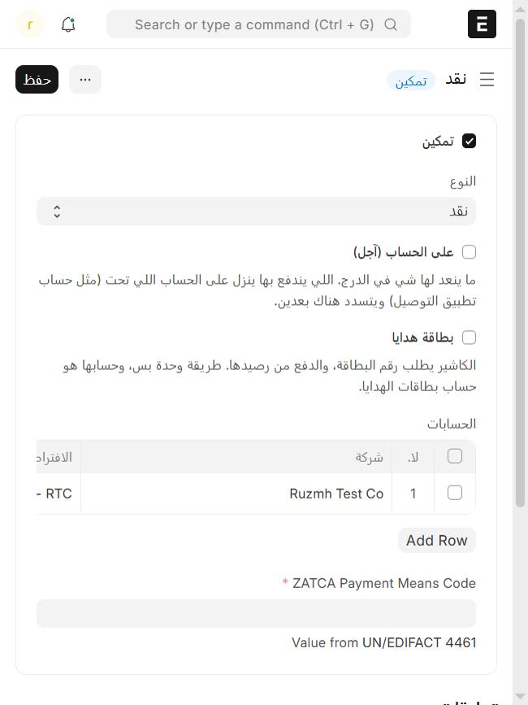

# طرق الدفع وحساباتها

طريقة الدفع (نقدي، شبكة، تحويل) لازم يتوفر فيها شرطين عشان الكاشير يقبلها:

1. **لها حساب محاسبي لشركتك**، عشان النظام يعرف وين يسجّل الفلوس.
2. **مضافة على جهاز الكاشير**، عشان تطلع في شاشة الدفع.

لو نقص واحد منهم، الكاشير يرفض الدفع بهذي الطريقة ويقول لك السبب.

## تربط طريقة الدفع بحساب

1. من المكتب، ابحث عن **طريقة الدفع** (Mode of Payment) وافتح الطريقة، مثل «شبكة».
2. في جدول **الحسابات**، أضف سطر: اختر **شركتك**، واختر **الحساب** اللي تنزل فيه فلوسها (مثلاً حساب البنك).
3. اضغط **حفظ**.

النقدي يجي جاهز بحساب الصندوق.

## تضيفها على جهاز الكاشير

1. من **نقاط البيع**، تحت **الأجهزة والفروع**، اضغط **أجهزة الكاشير** وافتح الجهاز.
2. في جدول **طرق الدفع**، أضف الطريقة.
3. اضغط **حفظ**.

الكاشير يشوفها بعد ما يسجّل خروج ودخول.

## خيار «على الحساب (آجل)»

هذا الخيار في بطاقة طريقة الدفع، ومعناه: **الفلوس ما دخلت الدرج**، وباقية مستحقة على طرف ثاني. تستخدمه لتطبيقات التوصيل، فالزبون دفع للتطبيق مو لك. شرحه في [تطبيقات التوصيل](delivery-apps.md).

لا تعلّمه على النقدي ولا الشبكة.

## بطاقة الهدايا

طريقة دفع خاصة، حسابها التزام مو صندوق. تتجهز لحالها، وشرحها في [بطاقة الهدايا](gift-cards.md).

---

السابق: [إضافة جهاز كاشير](add-device.md)

التالي: [إضافة الأصناف والأسعار](add-items-and-prices.md)

الرجوع لـ[صفحة البداية](README.md)
