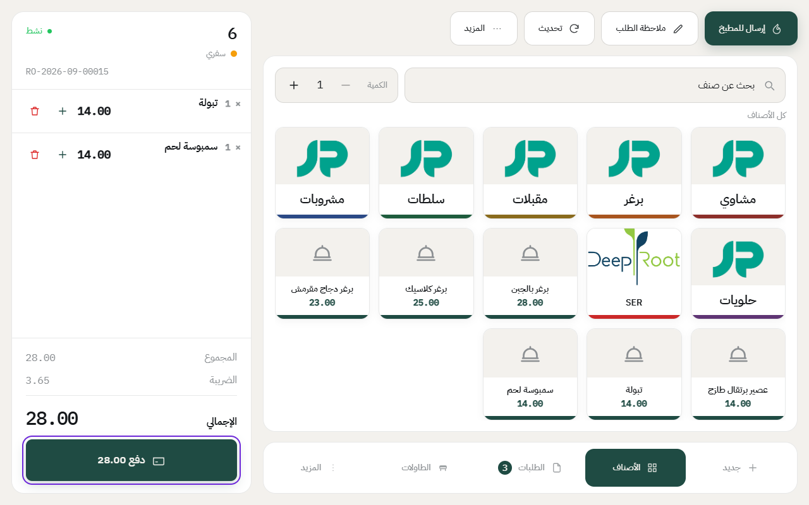
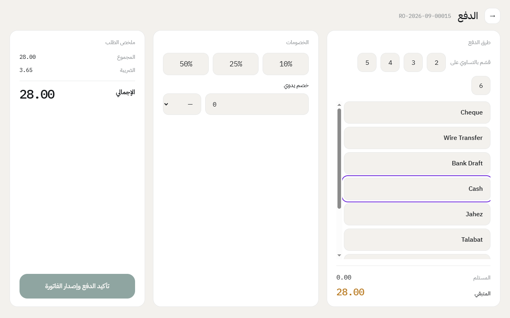
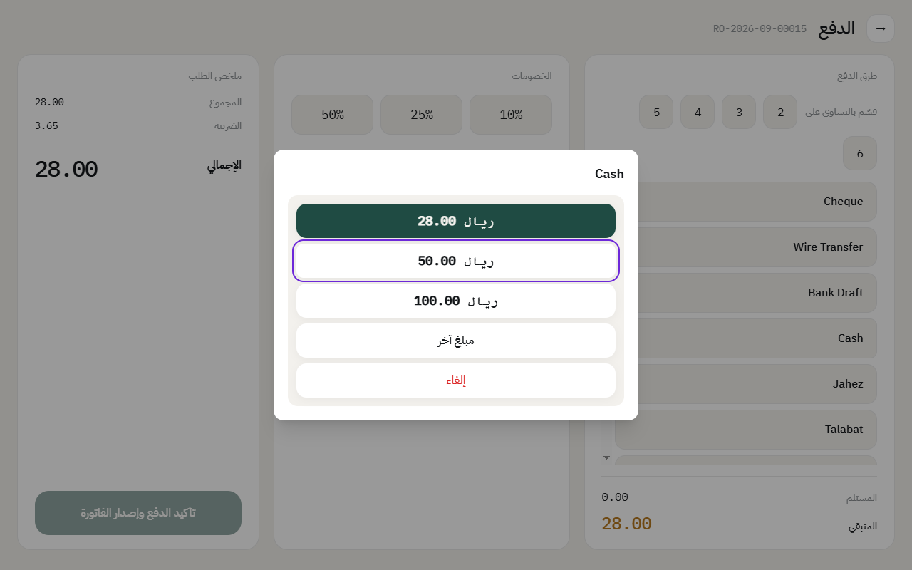
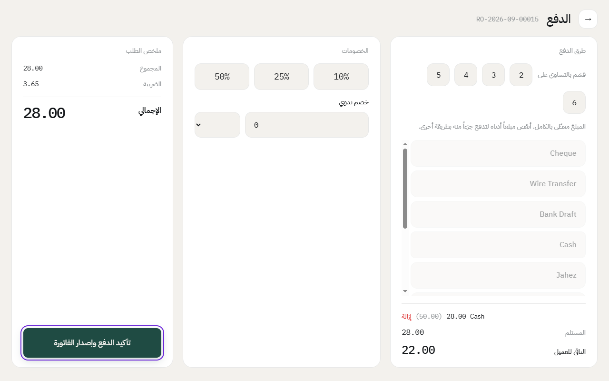

# الدفع وطباعة الفاتورة

لما يخلص الزبون، الكاشير يفتح شاشة الدفع، ويختار طريقة الدفع، ويأكد. النظام يصدر الفاتورة ويطبعها على طابعة الكاشير.

## الخطوات

1. في الطلب، اضغط على **دفع**.

2. اختر طريقة الدفع، مثل **نقد** أو **بطاقة**.

3. اختر المبلغ اللي استلمته من الزبون. للنقد يطلع لك المبلغ المطلوب ومبالغ جاهزة مثل 50 و100، أو اضغط **مبلغ آخر** واكتبه.

4. النظام يحسب **الباقي للعميل**. اضغط على **تأكيد الدفع وإصدار الفاتورة**.

بعد التأكيد:

- تنطبع فاتورة العميل على طابعة الكاشير.
- إذا الدفع نقد، ينفتح درج الفلوس.
- إذا الطلب على طاولة، تتحول الطاولة لحالة **تنظيف** لين تجهز للزبون اللي بعده. وأول ما تنظّف، اضغط عليها من شاشة الطاولات واختر **جاهزة** فترجع فاضية.

## الدفع بأكثر من طريقة

مثلاً جزء نقد وجزء بطاقة: اختر الطريقة الأولى وأنقص المبلغ، وبعدها اختر الطريقة الثانية للباقي. زر **إزالة** يشيل أي دفعة غلط.

## تقسيم الفاتورة بالتساوي

إذا المجموعة تبغى كل واحد يدفع نفس المبلغ، اضغط على العدد جنب **قسّم بالتساوي على**.

## الخصم

اضغط على نسبة جاهزة مثل **10%**، أو اكتب **خصم يدوي** بالنسبة أو بالريال. إذا الخصم أكبر من المسموح للكاشير، النظام يطلب رقم المدير السري للموافقة.

---

السابق: [ربط الطلب بعميل](customer.md)

التالي: [تقسيم فاتورة ودمج فاتورتين](split-and-join-bills.md)

الرجوع لـ[صفحة البداية](README.md)
