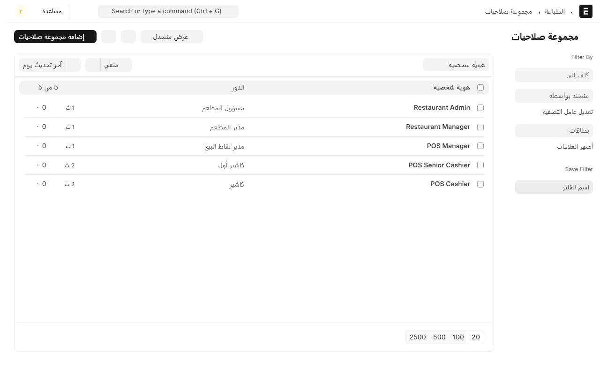
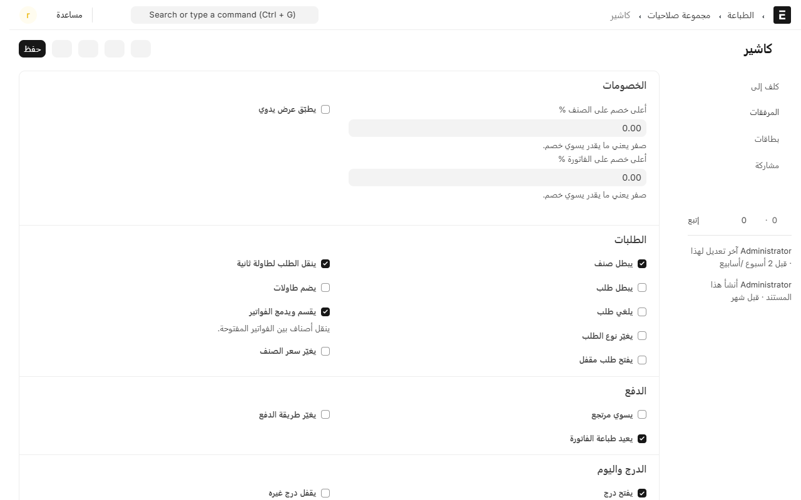
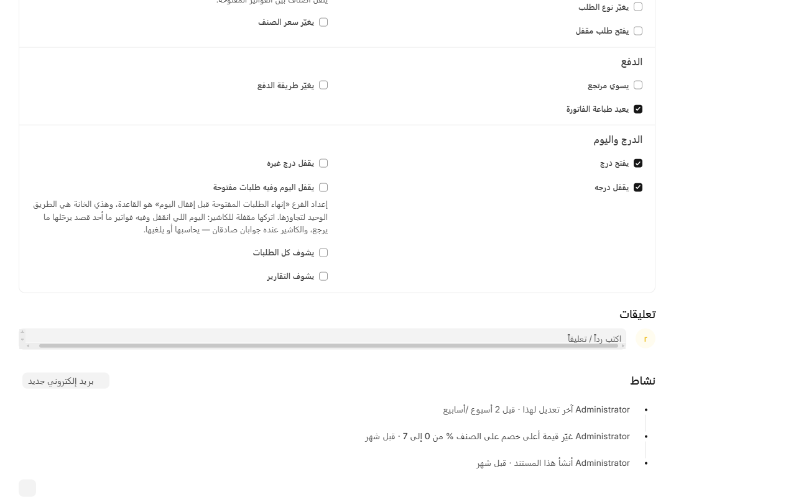

# الصلاحيات: مين يقدر يسوي وش

الصلاحيات في النظام مربوطة بـ**الدور**، مو بالموظف. يعني ما تضبط الصلاحيات لكل واحد لحاله؛ تضبطها مرة وحدة للدور، وكل موظف عليه ذاك الدور ياخذها.

## الأدوار الخمسة

| الدور | مين هو |
|---|---|
| **كاشير** | اللي يبيع على الجهاز. أقل صلاحية. |
| **كاشير أول** | كاشير أقدم، يقدر يوافق على أشياء بسيطة. |
| **مدير نقاط البيع** | مسؤول الوردية: يقفل أدراج غيره، يسوي مرتجعات، يوافق على الخصومات. |
| **مدير المطعم** | يدير الفرع كله: القائمة، الأسعار، الموظفين. |
| **مسؤول المطعم** | أعلى واحد. له كل شي. |

**والدور له ترتيب**، وهذا الترتيب مهم: ما تقدر تعدّل صلاحيات دور مساوي لك أو أعلى منك، وما تقدر تعطي صلاحية أنت ما عندك. يعني مدير نقاط البيع ما يقدر يرفع صلاحيات مدير المطعم، ولا يعطي كاشير خصم ‎50%‎ وهو حدّه ‎20%‎.

## وين تلقاها

من المكتب، افتح **نقاط البيع** ثم **الموظفين والسجلات**، واضغط **مجموعات الصلاحيات**.

تلقى خمسة سجلات، واحد لكل دور. افتح اللي تبي تعدّله.

## وش فيها

### الخصومات

- **أعلى خصم على الصنف %** و**أعلى خصم على الفاتورة %**: سقف الخصم اللي يقدر يسويه بنفسه. **وصفر يعني ما يقدر يخصم أبداً.**
- **يطبّق عرض يدوي**: يقدر يختار عرضاً من شاشة الدفع بدل ما ينطبق تلقائياً.

### الطلبات

- **يبطل صنف** و**يبطل طلب** و**يلغي طلب**: ثلاث صلاحيات منفصلة، فتقدر تسمح بإلغاء صنف وتمنع إلغاء الفاتورة كلها.
- **يغيّر نوع الطلب**: يحوّل الطلب من سفري لمحلي مثلاً.
- **يفتح طلب مقفل**: يرجع فاتورة انقفلت بدون دفع.
- **ينقل الطلب لطاولة ثانية** و**يضم طاولات**.
- **يقسم ويدمج الفواتير**: ينقل أصناف بين الفواتير المفتوحة.
- **يغيّر سعر الصنف**: خطيرة — تعني يكتب سعراً غير سعر القائمة. اتركها مقفلة للكاشير.

### الدفع

- **يسوي مرتجع**، و**يعيد طباعة الفاتورة**، و**يغيّر طريقة الدفع**.

### الدرج واليوم

- **يفتح درج** و**يقفل درجه**: هذي لازم تكون مفتوحة للكاشير وإلا ما يقدر يشتغل.
- **يقفل درج غيره**: للمدير، لما يمشي موظف وينسى يقفل.
- **يقفل اليوم وفيه طلبات مفتوحة**: اتركها مقفلة للكاشير. اليوم اللي انقفل ما يرجع.
- **يشوف كل الطلبات**: بدونها يشوف طلباته هو بس.
- **يشوف التقارير**.

## لما الموظف ما عنده الصلاحية

ما يختفي الزر دايماً؛ في الحالات الحساسة يطلب النظام **تفويض المدير**: تنفتح لوحة أرقام، والمدير يدخل رقمه السري، والإجراء يمشي **باسم الكاشير مع تسجيل اسم المدير اللي وافق**.

- التفويض **لمرة وحدة ولإجراء واحد**، وينتهي خلال دقيقة.
- كل تفويض ينكتب في سجل العمليات: مين طلبه، ومين وافق، ومتى، وعلى وش.
- **والمحاولة الفاشلة تنكتب كمان** — بدون رقم المدير طبعاً.

رقم المدير السري تحدده في بطاقة المستخدم. شوف [إضافة موظف ورقمه السري](add-staff.md).

## موظف له أكثر من دور

إذا أعطيت موظفاً دورين، صلاحياته تصير **مجموع الاثنين**: أي خانة مؤشّرة في أي دور تصير له، والسقف يكون الأعلى بين الدورين. فانتبه لا تعطي دوراً ثانياً «مؤقتاً» وتنساه.

## نصايح

- **ابدأ بالأقل.** افتح للكاشير اللي يحتاجه فعلاً اليوم، وزد بعدين لما يطلب. العكس أصعب.
- **الخصم صفر أحسن من خصم صغير.** إذا الخصم يحتاج موافقة على كل حال، خلّه صفر والمدير يوافق — يكون عندك سجل بكل خصم.
- **لا تعدّل الأدوار عشان موظف واحد.** إذا واحد يحتاج شي زيادة، حطّه على الدور الأعلى أو خلّ المدير يفوّضه.
- **راجع الصلاحيات كل فترة**، خاصة بعد ما يترك موظف أو يتغيّر دوره.

## وين تشوف النتيجة

كل تغيير في الصلاحيات أو في أدوار الموظفين ينكتب في **سجل العمليات** بنوعه، مع الاسم والوقت والقيمة قبل وبعد. شوف [سجل العمليات](audit-log.md).

---

السابق: [التأثير المحاسبي لبطاقات الهدايا](gift-card-accounting.md)

التالي: [سجل العمليات: كل إجراء حساس مكتوب](audit-log.md)

الرجوع لـ[صفحة البداية](README.md)
