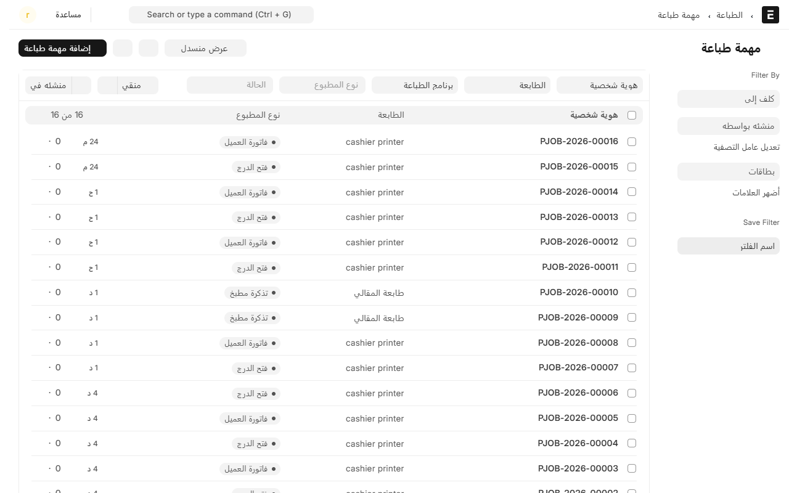
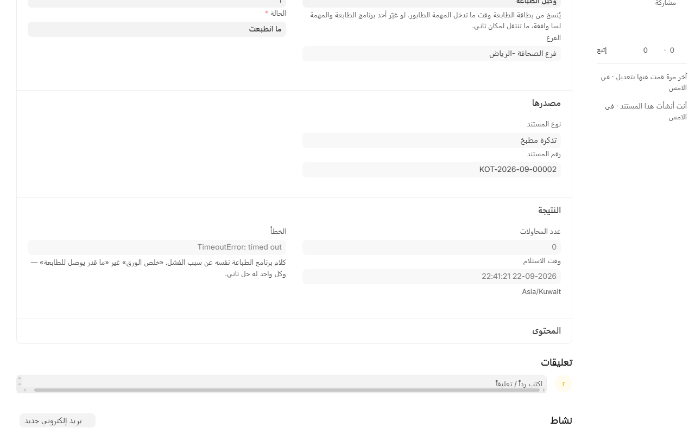

# الطباعة ما اشتغلت؟

هذي صفحة الأعطال. إذا الطابعة ما طلّعت ورقة — فاتورة عميل، أو تذكرة مطبخ، أو تقرير درج — امشِ على الخطوات بالترتيب، من الأسهل للأصعب.

## أول شي: الأشياء الغبية

قبل ما تفتح النظام، تأكد من هذي، لأنها سبب أغلب الحالات:

- الطابعة **مشغّلة** وضوءها ثابت مو وامض.
- **فيها ورق**، والغطاء مقفول صح.
- الكمبيوتر اللي عليه **برنامج الطباعة شغّال** ومو نايم.
- الطابعة موصولة: السلك في مكانه، أو الشبكة شغالة.

## ثانياً: برنامج الطباعة

النظام ما يوصل للطابعة بنفسه. البرنامج اللي على كمبيوتر داخل المطعم هو اللي يطبع، فإذا وقف، كل شي يوقف.

1. من المكتب، افتح **نقاط البيع** ← **الطباعة** ← **برنامج الطباعة**.
2. افتح البرنامج وشوف **آخر اتصال**.
   - **قبل ثواني أو دقيقة**: البرنامج شغّال، والمشكلة مو هنا. كمّل للخطوة الثالثة.
   - **قبل ساعة أو أكثر**: البرنامج مطفي، أو الكمبيوتر مطفي، أو ما عنده إنترنت. شغّله وارجع جرّب.

## ثالثاً: طابور الطباعة

كل مطبوع يصير **مهمة طباعة**، والطابور يقول لك وين وقف.

1. من المكتب، افتح **نقاط البيع** ← **الطباعة** ← **مهمة طباعة**.
2. رتّب بالأحدث، ودوّر على مطبوعك.

3. اقرأ **الحالة**:

| الحالة | معناها | وش تسوي |
|---|---|---|
| **في الطابور** | النظام جهّزها والبرنامج ما استلمها | البرنامج مطفي أو مقطوع — ارجع للخطوة الثانية |
| **عند البرنامج** | البرنامج استلمها ويطبعها الحين | انتظر ثواني وحدّث الصفحة |
| **انطبعت** | خرجت من الطابعة فعلاً | المشكلة في الورق أو الطابعة نفسها، مو في النظام |
| **ما انطبعت** | البرنامج جرّب وفشل | افتح المهمة واقرأ **الخطأ** |

4. افتح المهمة وشوف تفاصيلها: **الطابعة**، و**نوع المطبوع**، و**عدد المحاولات**، و**الخطأ**.

## رابعاً: اقرأ الخطأ

الخطأ يقول لك المشكلة بالضبط. وأشهرها:

- **ما قدر يوصل للطابعة**: عنوان IP غلط، أو الطابعة على شبكة ثانية، أو اسم الطابعة في ويندوز مكتوب غلط. راجع [إضافة طابعة](add-printer.md).
- **الطابعة مطفأة أو مقفولة**: شغّلها.
- **ما فيه برنامج طباعة على هذي الطابعة**: الطابعة مو مربوطة ببرنامج. افتح بطاقة الطابعة واختر **برنامج الطباعة**.

## حالات خاصة

### الفاتورة تطلع ناقصة من الجنب

الطابعة تطبع بعدد نقاط أقل من اللي يتوقعه النظام. افتح بطاقة الطابعة واكتب **512** في خانة **عرض الطباعة (بالنقاط)**، واطبع صفحة تجربة. شوف [إضافة طابعة](add-printer.md).

### العربي يطلع رموزاً أو مقلوباً

تأكد إن **وضع الطباعة** على **صورة**. النظام يرسم النص صورة عشان ما يعتمد على دعم الطابعة للعربي، وهذا الوضع الصحيح دايماً.

### تذكرة المطبخ ما وصلت

- **التذكرة راحت لمطبخ ثاني؟** راجع توجيه الصنف في [مراكز التحضير](production-centers.md).
- **ما طلعت أصلاً؟** افتح **تذاكر المطبخ** وشوف حالتها. شوف [مراجعة تذاكر المطبخ](kitchen-tickets.md).
- **والكاشير يشوف تنبيهاً على الطلب** إذا تذكرة ما انطبعت، فما تعتمد على المطبخ يبلّغك.

### الدرج ما ينفتح بعد الدفع

الدرج موصول بالطابعة، والنظام يرسل نبضة على منفذ معيّن. أغلب الأدراج على المنفذ **2**، وبعض أجهزة Star على **5**. افتح بطاقة الطابعة وغيّر **منفذ درج الفلوس** وجرّب.

### كل شي شغال بس ما يطبع من جهاز واحد

راجع **طابعة الكاشير** في بطاقة ذاك الجهاز. الجهاز اللي ما له طابعة ما يطبع فواتير. شوف [إضافة جهاز كاشير](add-device.md).

## إعادة الطباعة

- **فاتورة عميل**: من **الطلبات** ← تبويب **مغلقة اليوم**، افتح الفاتورة واضغط **إعادة الطباعة**. يحتاج صلاحية.
- **تذكرة مطبخ**: من **تذاكر المطبخ** في المكتب.

## آخر شي

إذا جرّبت كل هذا وما ضبط، اطبع **صفحة تجربة** من بطاقة الطابعة. إذا طلعت، فالطابعة والبرنامج سليمان والمشكلة في التوجيه أو الإعداد. وإذا ما طلعت، فالمشكلة بين البرنامج والطابعة، وتنحل من ويندوز أو من الشبكة.

---

السابق: [مراجعة تذاكر المطبخ](kitchen-tickets.md)

الرجوع لـ[صفحة البداية](README.md)
