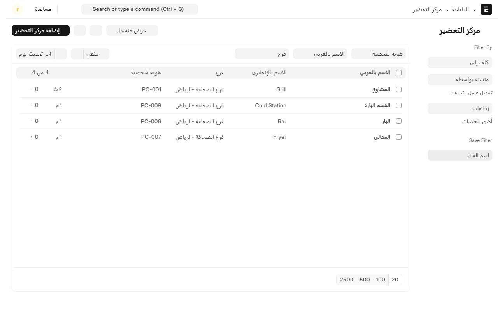
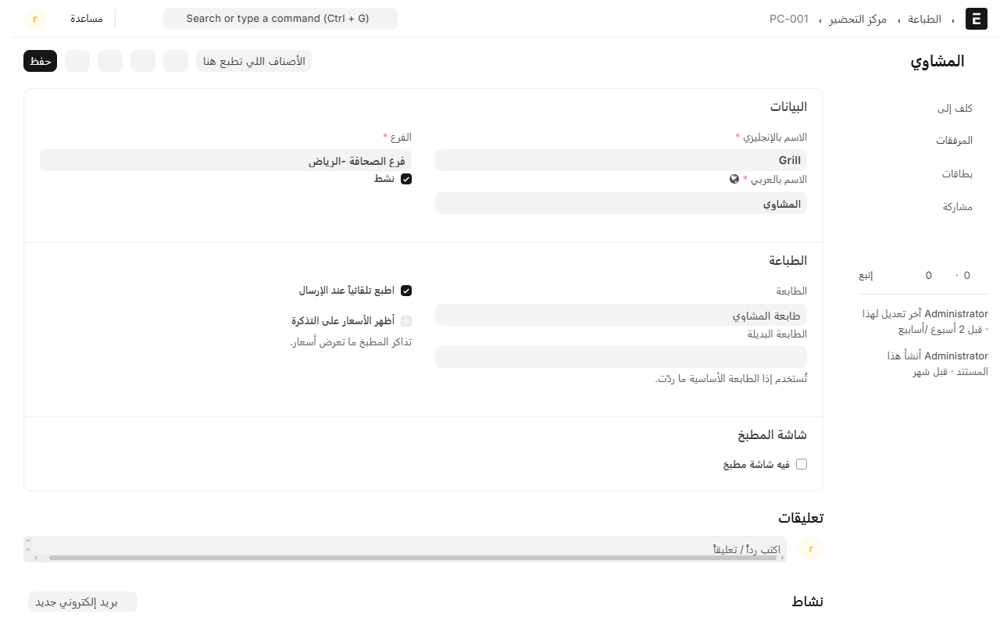
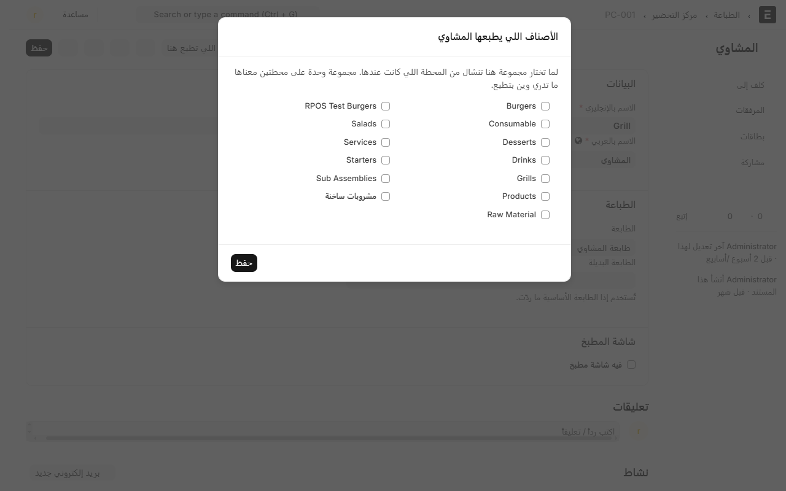
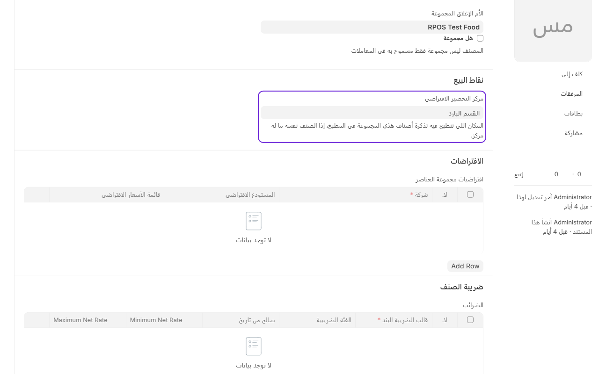

# مراكز التحضير: أي صنف يطبع في أي مطبخ

**مركز التحضير** هو محطة داخل المطبخ لها طابعتها: المشاوي، القسم البارد، البار، المقالي. ولما الكاشير يضغط **إرسال للمطبخ**، النظام يقسّم الطلب على المحطات ويطبع لكل وحدة تذكرة فيها أصنافها هي بس.

من غير هذي الخطوة كل شي بيطبع على طابعة الكاشير، والمشوي والعصير على ورقة وحدة.

## وين تلقاها

من المكتب، افتح **نقاط البيع** ثم **الطباعة**، وتحت **وين ينطبع كل شي** اضغط **مركز التحضير**.

## إضافة محطة

1. اضغط **إضافة مركز التحضير**.
2. اكتب **الاسم بالإنجليزي** و**الاسم بالعربي**، واختر **الفرع**.
3. اختر **الطابعة** — وهذي هي طابعة المطبخ، مو طابعة الكاشير. إضافة الطابعات مشروحة في [إضافة طابعة](add-printer.md).
4. اضغط **حفظ**.

### باقي الخانات

- **الطابعة البديلة**: إذا الطابعة الأساسية ما ردّت خلال خمس ثوانٍ، النظام يجرّب هذي. مفيدة لو عندك طابعتين جنب بعض في المطبخ. واتركها فاضية إذا ما عندك.
- **اطبع تلقائياً عند الإرسال**: مفعّلة يعني التذكرة تطلع لحالها أول ما الكاشير يرسل. خلّها مفعّلة — هذا الوضع الطبيعي.
- **أظهر الأسعار على التذكرة**: اتركها فاضية. تذاكر المطبخ ما تعرض أسعار، والطباخ ما يحتاجها.
- **شاشة المطبخ**: للمطابخ اللي تشتغل على شاشة بدل ورق. إذا ما عندك شاشة، اتركها.

## وش يطبع في كل محطة

من داخل صفحة المحطة، اضغط **الأصناف اللي تطبع هنا**.

تطلع لك مجموعات الأصناف كلها بمربعات. أشّر على اللي تبيها تطبع في هذي المحطة واضغط **حفظ**.

**انتبه:** المجموعة تروح لمحطة وحدة بس. إذا أشّرتها هنا وكانت عند محطة ثانية، تنشال من عندها — والنظام يكتب لك جنب اسمها إنها «الحين على» المحطة الفلانية عشان تعرف قبل لا تضغط.

هذي أسرع وأبسط طريقة، وهي اللي تكفي أغلب المطاعم.

## الطريق الثاني: مركز افتراضي على المجموعة أو على الصنف

بدل التأشير من المحطة، تقدر تحدد المحطة من جهة الصنف:

- **على مجموعة الأصناف**: افتح المجموعة، وفي قسم **نقاط البيع** تلقى **مركز التحضير الافتراضي**.

- **على الصنف نفسه**: نفس الخانة موجودة في بطاقة الصنف، وهي أقوى من مجموعته. استخدمها للاستثناءات، مثل صنف داخل «المشروبات» بس يتجهز في البار.

## لما تحتاج قاعدة أدق

فيه حالات ما تنحل بالطرق اللي فوق، مثل: نفس الصنف يطبع في مطبخ وقت الطلب المحلي وفي مطبخ ثاني وقت التوصيل. هنا تستخدم **قاعدة طباعة**، وتلقاها في نفس مساحة **الطباعة**.

في القاعدة تحدد:

- **على وش تنطبق**: الفرع، ونوع الطلب (أو فاضي = كل الأنواع)، والجهاز (أو فاضي = كل الأجهزة)، ومجموعة الأصناف أو صنف واحد.
- **وين يطبع**: مركز التحضير.
- **الأولوية**: رقم، والأصغر يُقرأ أولاً إذا تعارضت قاعدتان بنفس الدقة.

القواعد هذي ما تنمسح لما تعدّل من شاشة **الأصناف اللي تطبع هنا**، لأنها مكتوبة بقصد.

## الترتيب اللي يمشي عليه النظام

لما يوصل الصنف، النظام يسأل بالترتيب هذا ويوقف عند أول جواب:

1. قاعدة طباعة على **نوع الطلب + صنف معيّن**.
2. قاعدة طباعة على **نوع الطلب + مجموعة**.
3. قاعدة طباعة على **جهاز + صنف معيّن**.
4. قاعدة طباعة على **جهاز + مجموعة**.
5. **مركز التحضير الافتراضي** في بطاقة الصنف.
6. **مركز التحضير الافتراضي** في مجموعة الصنف (ولو كان في مجموعة أعلى منها).
7. ما لقى شي: **تطبع على طابعة الكاشير**.

يعني الأدق يفوز دايماً، والأولوية تفصل بين قاعدتين بنفس الدقة.

## تأكد إن التوجيه شغال

سجّل طلباً فيه صنف من كل مجموعة وأرسله للمطبخ، وشوف كل محطة طلع لها وش. وإذا شي طلع على طابعة الكاشير، معناه الصنف ما وصل لأي محطة — راجع مجموعته.

وتقدر تتابع كل تذكرة من **تذاكر المطبخ**، وفيها المحطة والطابعة وحالة الطباعة. شوف [مراجعة تذاكر المطبخ](kitchen-tickets.md).

---

السابق: [إضافة طابعة](add-printer.md)

التالي: [مجموعات الإضافات: خيارات الصنف](modifiers.md)

الرجوع لـ[صفحة البداية](README.md)
