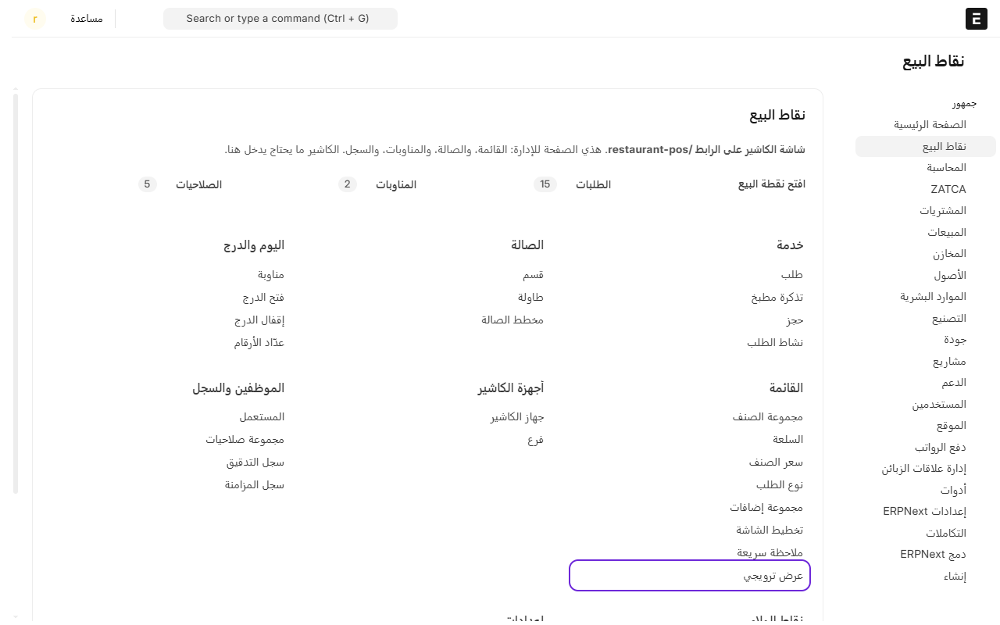
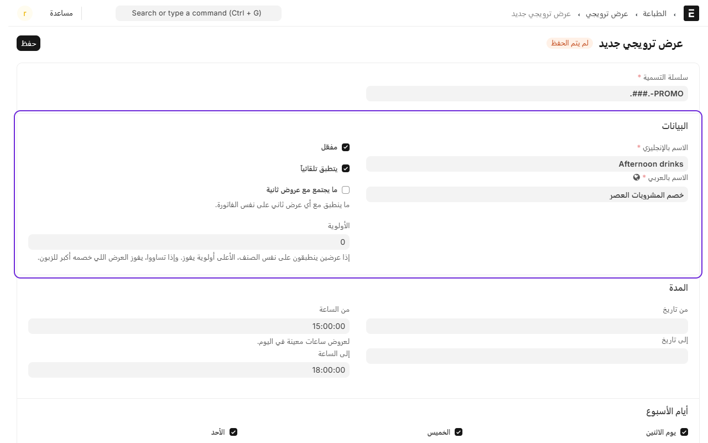
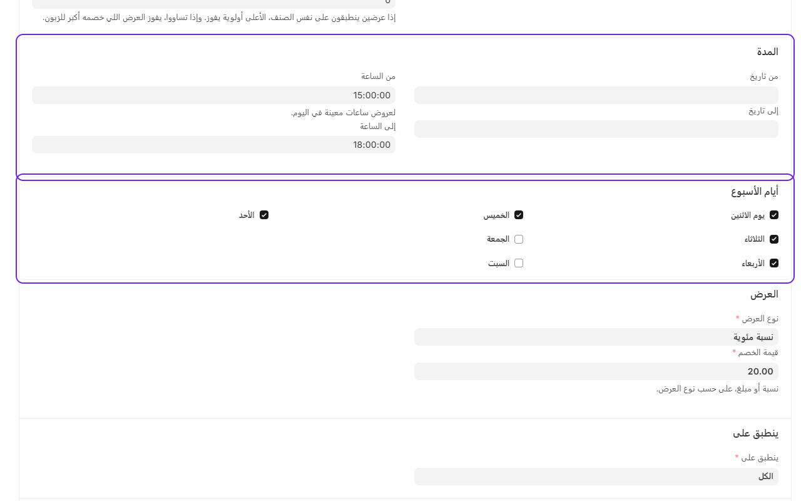
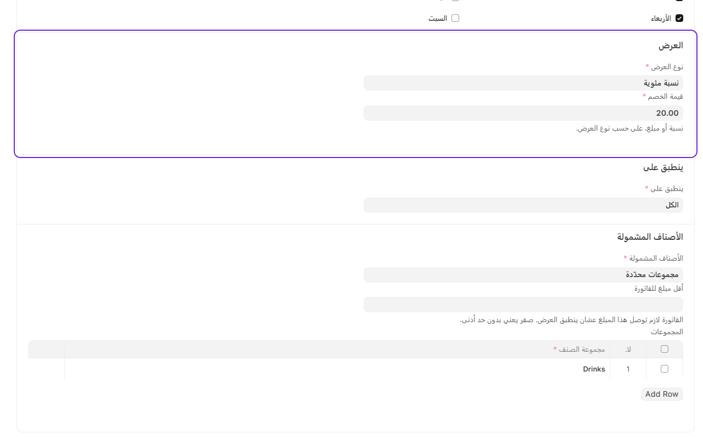
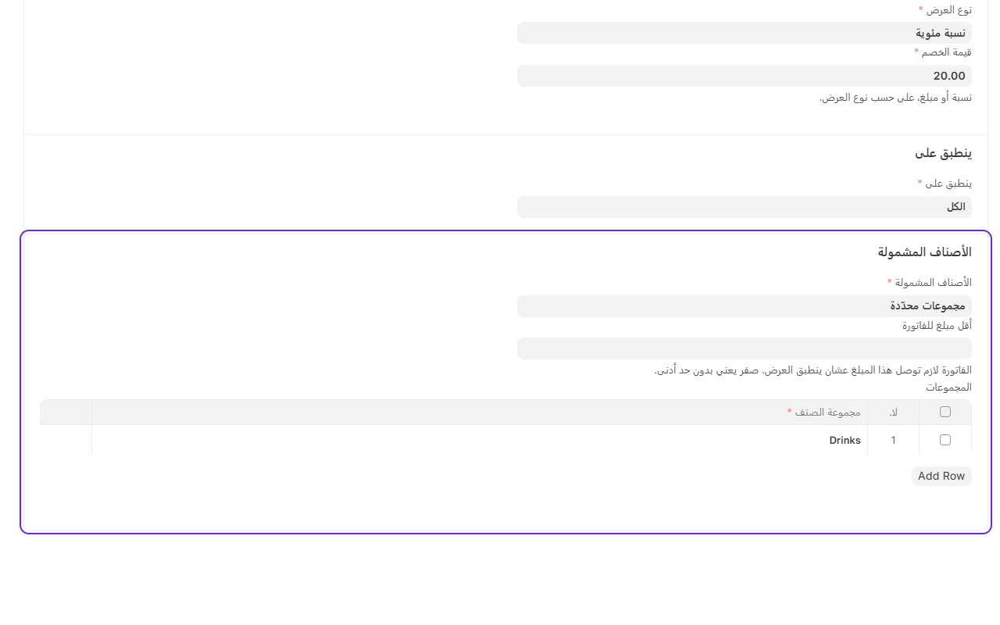

# إضافة عرض أو خصم

العروض تنطبق على الفاتورة تلقائياً وقت ما تتحقق شروطها، مثل خصم على المشروبات العصر، أو «اشترِ ٢ والثالث مجاناً». والكاشير ما يحتاج يسوي شي.

## مثال: خصم 20% على المشروبات من 3 إلى 6 العصر

1. من المكتب، ادخل على **نقاط البيع**.
2. تحت **القائمة**، اضغط على **العروض والخصومات**.

3. اضغط على **إضافة عرض**.
4. اكتب **الاسم بالإنجليزي** و**الاسم بالعربي**. الاسم العربي يطلع للكاشير وعلى فاتورة الزبون.
5. خل **مفعّل** و**يتطبق تلقائياً** معلّمين.

6. تحت **المدة**، اختر **من الساعة** 15:00 و**إلى الساعة** 18:00. وإذا العرض لفترة معينة، اختر **من تاريخ** و**إلى تاريخ**.
7. تحت **أيام الأسبوع**، علّم الأيام اللي يشتغل فيها العرض.

8. تحت **العرض**، اختر **نوع العرض**: **نسبة مئوية**، واكتب **قيمة الخصم**: 20.

9. تحت **الأصناف المشمولة**، اختر **مجموعات محدّدة**، وأضف مجموعة **المشروبات**.
10. اضغط على **حفظ**.

## أنواع العروض

- **نسبة مئوية**: خصم نسبة على الأصناف المشمولة.
- **مبلغ ثابت**: خصم مبلغ بالريال.
- **اشترِ كذا واحصل على كذا مجاناً**: مثلاً اشترِ ٢ وخذ ١. الأرخص هو اللي يصير مجاني، والعرض يتكرر: على ٦ أصناف يطلع ٢ مجاناً.
- **صنف مجاني**: الزبون ياخذ صنف معيّن أو أي صنف من مجموعة مجاناً، وما ينضاف لين الزبون يطلبه.

## ⚠️ «الأصناف المشمولة» معناها يتغيّر حسب نوع العرض

هذي أكثر خانة تلخبط، لأنها تسوي شيئين مختلفين:

| نوع العرض | «الأصناف المشمولة» تعني |
|---|---|
| **نسبة مئوية** | الأسطر اللي ينزل عليها الخصم |
| **مبلغ ثابت** | الأسطر اللي يتوزّع عليها الخصم |
| **اشترِ كذا وخذ كذا** | الأسطر اللي تُعدّ للعرض — **والمجاني يطلع منها** |
| **صنف مجاني** | **شرط التأهل بس** — والمجاني تختاره في خانة ثانية |

يعني في **صنف مجاني** الخانة هذي مو «وش ينخصم»، بل «**وش لازم يكون في الفاتورة**».

وعشان توضح الفكرة، الشاشة نفسها تكتب لك المعنى تحت الخانة أول ما تختار نوع العرض.

## مثال: اشترِ من المشاوي وخذ مشروباً مجاناً

هذي الحالة موجودة ومدعومة، وتنضبط كذا:

| الخانة | القيمة |
|---|---|
| **نوع العرض** | صنف مجاني |
| **الأصناف المشمولة** | مجموعات محدّدة ← **المشاوي** |
| **مجموعة الصنف المجاني** | **المشروبات** |
| **الكمية المجانية** | 1 |

**كيف تشتغل:** النظام يتحقق إن الفاتورة فيها مشوي — وإلا ما ينطبق العرض أصلاً. بعدها ينزّل سعر **أرخص مشروب** في الفاتورة.

**نقطتان مهمتان:**

- **الزبون هو اللي يختار المشروب — بأنه يطلبه.** العرض **ما يضيف سطراً** أبداً؛ لو أضاف، كان المطبخ بيحضّر شي ما أحد طلبه. فالكاشير يسجّل المشروب عادي، والعرض ينزّل سعره.
- **مشروب بلا مشوي = مشروب يدفع ثمنه.** الفاتورة لازم تتأهل أولاً.

ونفس الطريقة تنفع لأي مزيج: «اشترِ من البرجر وخذ حلا»، «اشترِ وجبة وخذ قهوة».

## خيارات ثانية

- **ينطبق على**: كل الطلبات، أو أنواع طلب معيّنة، أو فروع، أو أقسام، أو **مجموعات عملاء**.
- **أقل مبلغ للفاتورة**: العرض ما ينطبق إلا إذا الفاتورة وصلت هذا المبلغ.
- **ما يجتمع مع عروض ثانية** و**الأولوية**: إذا أكثر من عرض ينطبق على نفس الصنف، الأعلى أولوية يفوز.

## عرض يختاره الكاشير بنفسه

إذا شلت علامة **يتطبق تلقائياً**، العرض ما ينطبق لحاله. الكاشير يختاره من شاشة الدفع، وهذا يحتاج صلاحية «يطبّق عرض يدوي».

## خصم لمجموعة عملاء

تبي خصماً لموظفي شركة معيّنة؟ سوّ **مجموعة عملاء** باسمها وحط العملاء تحتها، وبعدها في العرض اختر **ينطبق على** ← **حسب مجموعة العملاء** وأضف المجموعة.

أول ما يربط الكاشير العميل بالفاتورة، الخصم ينزل لحاله.

**نقطتان:**

- **فاتورة بلا عميل ما تأخذ الخصم.** وهذا مقصود: العرض موجّه لأشخاص بأسمائهم، والزبون الماشي مو منهم.
- **المجموعات شجرة**: لو سميت الشركة الأم، تشمل فروعها كلها.

## عرض يحتاج كوبون

تقدر تعلّم أي عرض بـ**«يحتاج كوبون»**، فما ينطبق إلا على فاتورة فيها رمز كوبون يشير له. شوف [الكوبونات](coupons.md).

---

السابق: [سجل العمليات: كل إجراء حساس مكتوب](audit-log.md)

التالي: [الكوبونات: رمز يفتح عرضاً](coupons.md)

الرجوع لـ[صفحة البداية](README.md)
