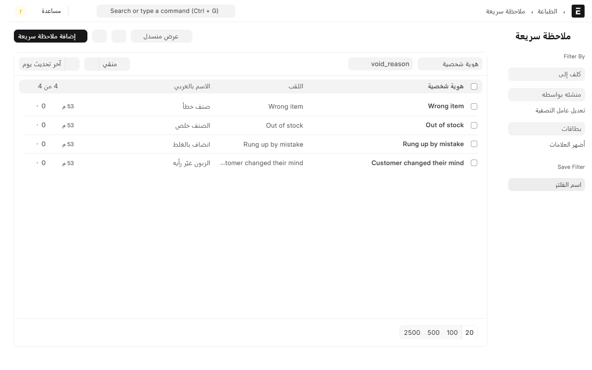
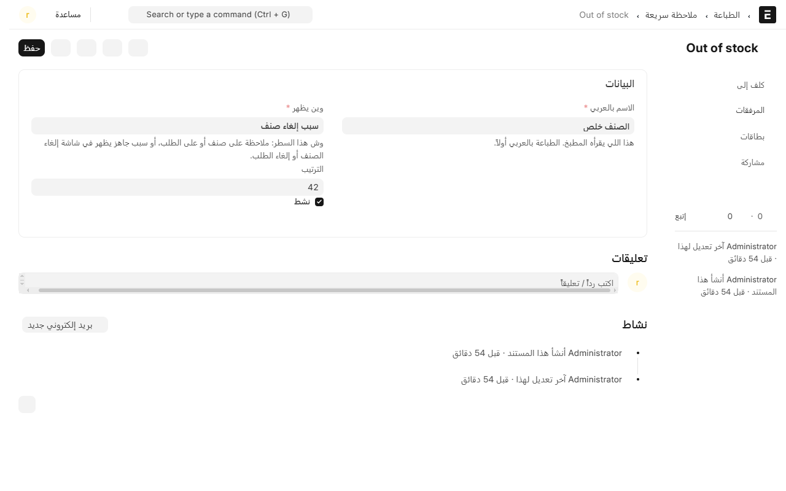

# الملاحظات السريعة والأسباب الجاهزة

هذي أزرار جاهزة يضغطها الكاشير بدل ما يكتب بيده. تستخدم في أربعة مواضع:

- **ملاحظة على صنف** — «بدون بصل»، «حار زيادة».
- **ملاحظة على الطلب كله** — «الطلب مستعجل»، «حساسية».
- **سبب إلغاء صنف** — «الصنف خلص»، «الزبون غيّر رأيه».
- **سبب إلغاء طلب** — «الزبون انسحب»، «الفاتورة انفتحت بالغلط».

ليش مهمة؟ لأن الكاشير وقت الزحمة ما يكتب، وإذا ما لقى زر جاهز بيكتب «..» أو أي شي عشان يعدّي الشاشة — وبعدين ما أحد يعرف ليش انلغى الصنف.

## وين تلقاها

من المكتب، افتح **نقاط البيع** ثم **القائمة**، واضغط **الملاحظات السريعة**.

النظام يجي معه مجموعة جاهزة من أول تثبيت، فتقدر تبدأ عليها وتعدّل.

## إضافة ملاحظة أو سبب

1. اضغط **إضافة ملاحظة سريعة**.
2. اكتب **الاسم بالإنجليزي** — وهذا هو اسم السجل عند النظام، فخلّه قصير وواضح.
3. اكتب **الاسم بالعربي** — وهذا اللي يشوفه الكاشير **واللي ينطبع في تذكرة المطبخ**، فاكتبه بالكلام اللي يفهمه المطبخ.
4. اختر **وين يظهر**، وعندك خمس حالات:
   - **ملاحظة على صنف**
   - **ملاحظة على الطلب**
   - **ملاحظة على الاثنين**
   - **سبب إلغاء صنف**
   - **سبب إلغاء طلب**
5. **الترتيب**: رقم، والأصغر يطلع أول. حط الأكثر استخداماً برقم صغير عشان يكون أول زر تحت إصبع الكاشير.
6. **نشط**: شيل التأشير عشان تخفيه عن الكاشير بدون ما تحذفه.

## وين تظهر على الكاشير

- **ملاحظة الصنف**: يضغط الكاشير على سطر الصنف، وتحت **ملاحظة خاصة** تطلع له الأزرار الجاهزة. شوف [تعديل الطلب](edit-order.md).
- **ملاحظة الطلب**: من الشريط فوق، زر **ملاحظة الطلب**.
- **أسباب الإلغاء**: تطلع لحالها في شاشة إلغاء الصنف أو إلغاء الطلب، وتقدر تضغط زر أو تكتب سبب ثاني. شوف [إلغاء صنف أو إلغاء طلب](void-and-cancel.md).

وفي كل الحالات الكتابة اليدوية تبقى موجودة — الأزرار تختصر، ما تمنع.

## نصايح

- **لا تكثّر الأزرار.** ستة أو سبعة لكل موضع كفاية؛ عشرين زر يعني الكاشير بيدوّر بدل ما يضغط، وترجع الكتابة أسرع.
- **خلّ الأسباب صادقة ومختلفة.** «الصنف خلص» و«صنف خطأ» جوابان مختلفان في التقرير؛ «خطأ» و«غلط» جواب واحد مكرر.
- **احذف القديم بدل ما تتركه.** الزر اللي ما أحد يستخدمه يزحم الشاشة. وإذا تبي تبقيه للسجل، شيل عنه **نشط**.
- **الاسم العربي ينطبع في المطبخ**، فاكتبه بلغة المطبخ لا بلغة المحاسبة.

## وين تقرأ النتيجة

كل ملاحظة وكل سبب ينكتب في [سجل الطلب](order-log.md)، وأسباب الإلغاء تنكتب كمان في **سجل العمليات** في المكتب مع اسم الموظف والوقت. وعدد الأصناف الملغاة يطلع في [تقرير الدرج](x-report.md).

---

السابق: [حجز طاولة](reservations.md)

التالي: [ترتيب شاشة الكاشير](screen-layout.md)

الرجوع لـ[صفحة البداية](README.md)
