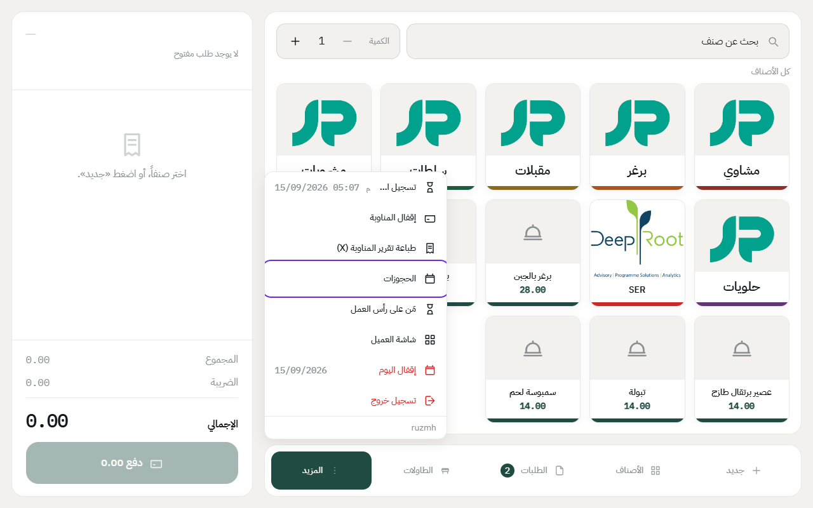
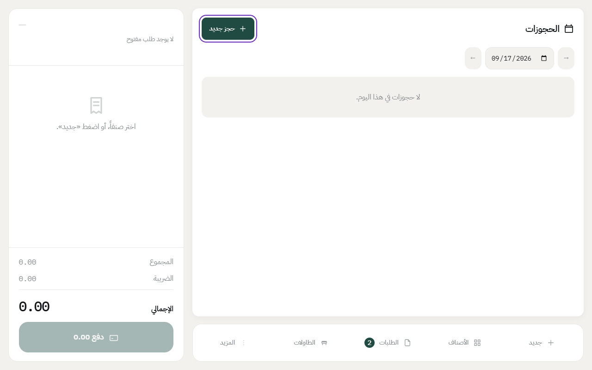
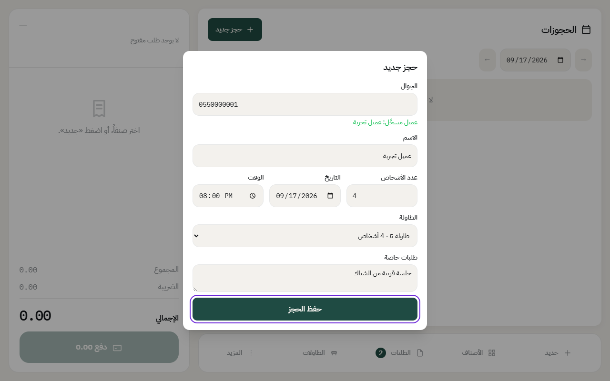

# حجز طاولة

الكاشير يقدر ياخذ حجز بالتلفون أو وقت ما يجي الزبون، ويحدد له طاولة ووقت. وقبل موعد الحجز، الطاولة تطلع محجوزة في شاشة الطاولات عشان ما ينجلس عليها أحد ثاني.

## إضافة حجز

1. اضغط على **المزيد**، بعدها **الحجوزات**.

2. اضغط على **حجز جديد**.

3. اكتب **الجوال**. إذا الزبون مسجّل من قبل، يطلع اسمه تحت الرقم.
4. اكتب **الاسم** و**عدد الأشخاص** و**التاريخ** و**الوقت**.
5. اختر **الطاولة**، أو خلها **بدون طاولة** وحددها بعدين.
6. إذا الزبون طلب شي، اكتبه في **طلبات خاصة**.
7. اضغط على **حفظ الحجز**.

## لما يوصل الزبون

1. افتح **الحجوزات**، وتلقى حجوزات اليوم مرتبة بالوقت.
2. اضغط **إجلاس** جنب الحجز. ينفتح طلب محلي على طاولته، وفيه اسمه.

وإذا ضغطت على طاولة محجوزة من شاشة الطاولات، النظام يسألك: **إجلاس صاحب الحجز** أو **إجلاس ضيف آخر هنا**.

## إذا ما جا الزبون

- بعد موعد الحجز بمدة التأخير (15 دقيقة في الإعداد الجاهز)، ترجع الطاولة متاحة لغيره.
- تقدر تضغط **لم يحضر**، أو **إلغاء الحجز** وتكتب السبب.
- وإذا ما سويت شي، الحجز يتسجل «لم يحضر» تلقائياً لما تقفل اليوم.

## الإعدادات

مدة جلسة الطاولة ومدة التأخير تتغير من إعداد الفرع، تحت **الحجوزات**. شوف [إضافة فرع](add-branch.md).

---

السابق: [سجل العمليات: كل إجراء حساس مكتوب](audit-log.md)

التالي: [تغيير ألوان شاشة الكاشير](theme.md)

الرجوع لـ[صفحة البداية](README.md)
