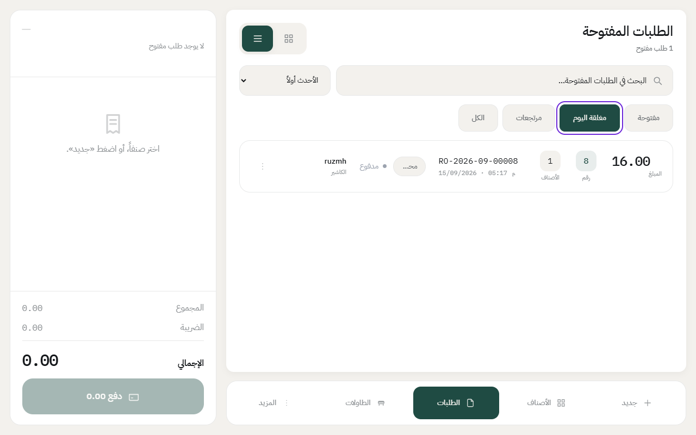
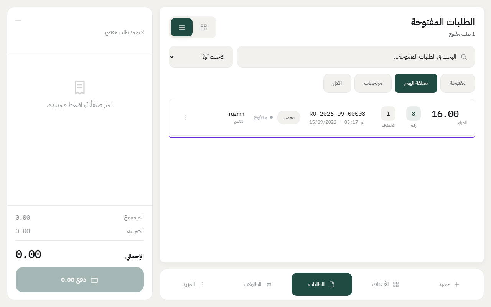
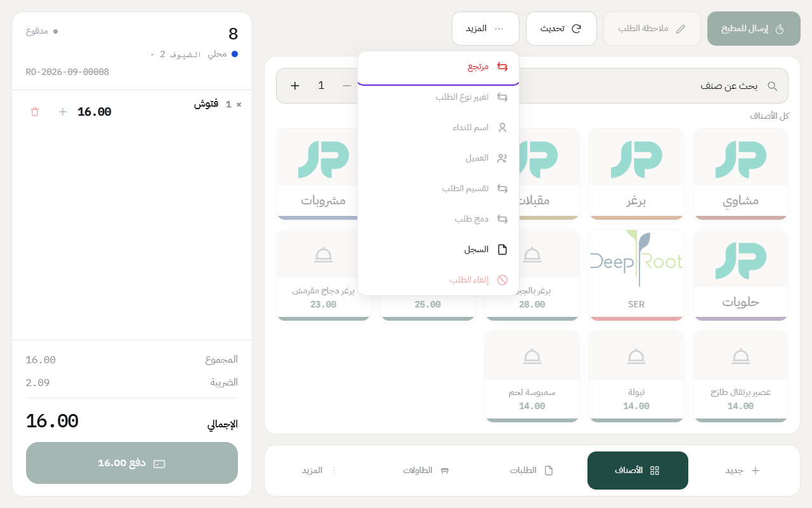
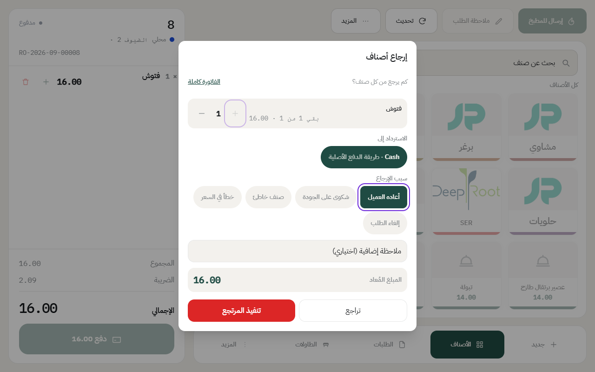
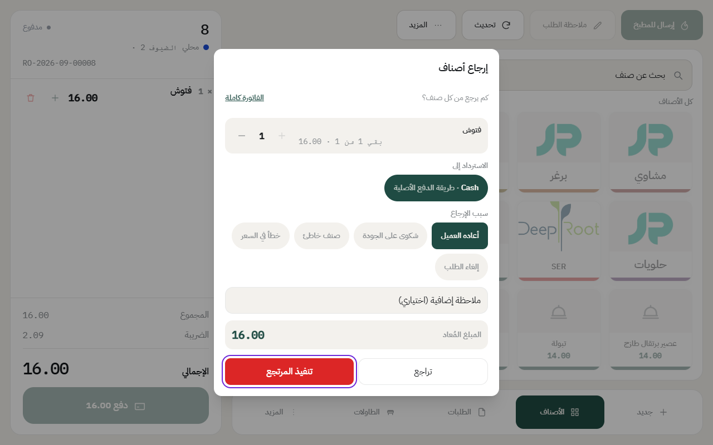

# إرجاع طلب

إذا الزبون رجّع صنف أو طلب كامل بعد ما دفع، الكاشير يسوي مرتجع. النظام يرجّع المبلغ بنفس طريقة الدفع اللي دفع فيها الزبون، ويطبع إشعار المرتجع.

المرتجع يحتاج صلاحية. الكاشير العادي ما يقدر يسويه، والكاشير الأول والمدير يقدرون.

## الخطوات

1. اضغط على **الطلبات** في الشريط اللي تحت، وافتح تبويب **مغلقة اليوم**.

2. اضغط على الطلب اللي تبغى ترجّع منه.

3. اضغط على **المزيد**، بعدها **مرتجع**.

4. حدد كم يرجع من كل صنف بزر **+**، أو اضغط **الفاتورة كاملة** إذا بيرجع الطلب كله.
5. اختر **سبب الإرجاع**، مثل «أعاده العميل».

6. تأكد من **المبلغ المُعاد**، واضغط على **تنفيذ المرتجع**.

المبلغ يرجع بطريقة الدفع الأصلية، مثلاً نقد من الدرج، والمرتجع يتسجل في تبويب **مرتجعات** وينحسب في تقرير الدرج.

## إذا الطلب من يوم سابق

تبويب **مغلقة اليوم** يعرض طلبات يوم العمل الحالي بس. للطلبات الأقدم، افتح تبويب **الكل** وابحث برقم الطلب.

---

السابق: [سجل الطلب: مين سوّى وش ومتى](order-log.md)

التالي: [قائمة الطلبات وتبويباتها](orders-list.md)

الرجوع لـ[صفحة البداية](README.md)
