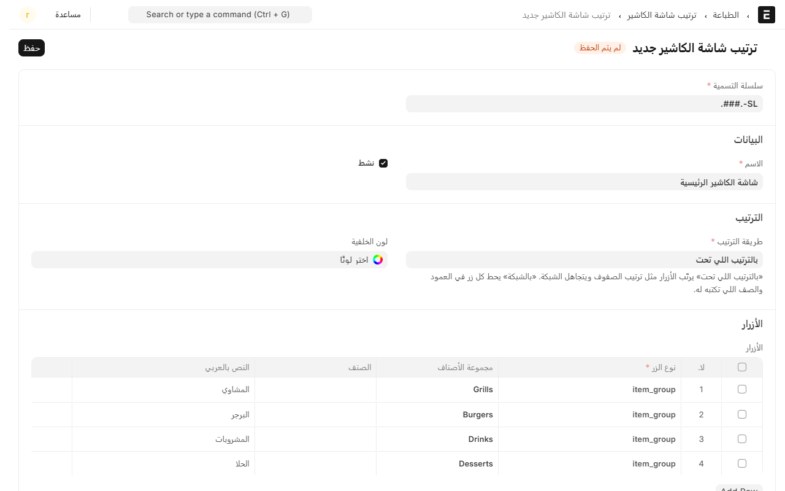
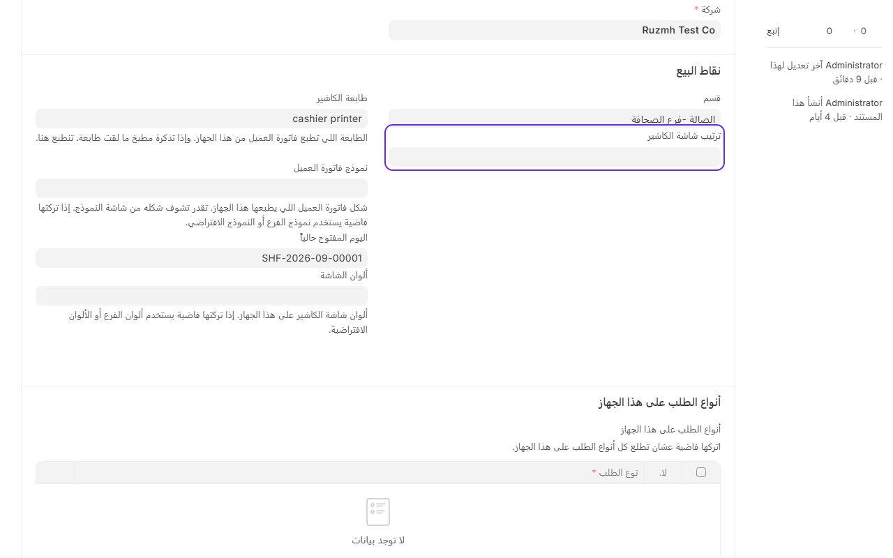

# ترتيب شاشة الكاشير

الشاشة تشتغل **بدون أي إعداد**: النظام يعرض مجموعات الأصناف كلها، وداخل كل مجموعة أصنافها. هذا يكفي أغلب المطاعم، وما تحتاج تقرا هذي الصفحة.

تحتاجها إذا بغيت تتحكم: **أي مجموعات تظهر، وبأي ترتيب، وبأي اسم ولون**.

## متى يستاهل

- عندك مجموعات كثيرة والكاشير يدوّر على المشاوي بين عشر مجموعات.
- في مجموعات ما تنباع على الكاشير (مواد خام، خدمات) وتبي تخفيها.
- تبي الأكثر مبيعاً أول شي تحت إصبع الكاشير.
- تبي أسماء عربية غير أسماء المجموعات في المخزن.

## إنشاء ترتيب

1. من المكتب، افتح **نقاط البيع** ثم **القائمة**، واضغط **ترتيب شاشة الكاشير**.
2. اضغط **إضافة**، واكتب **الاسم** — مثل «شاشة الكاشير الرئيسية».
3. خلّ **طريقة الترتيب** على **«بالترتيب اللي تحت»**. هذي الموصى بها: الأزرار تنرتب مثل ترتيب الصفوف بالضبط، والنظام يوزّعها على الشاشة لحاله.
4. في جدول **الأزرار**، أضف صفاً لكل زر:
   - **نوع الزر**: `item_group` لمجموعة، أو `item` لصنف واحد.
   - **مجموعة الأصناف** أو **الصنف**، حسب النوع.
   - **النص بالإنجليزي** و**النص بالعربي**: الاسم اللي يشوفه الكاشير. اتركهما فاضيين ياخذ اسم المجموعة.
   - **لون الخلفية** و**لون النص** و**الصورة**، إذا بغيت تميّزه.
5. **رتّب الصفوف بالسحب** — الصف الأول يطلع أول زر. حط الأكثر طلباً فوق.
6. احفظ.

## ربط الترتيب بالجهاز

الترتيب ما يشتغل لين تربطه بجهاز:

1. افتح **نقاط البيع** ← **الأجهزة والفروع** ← **أجهزة الكاشير**، واختر الجهاز.
2. تحت **نقاط البيع**، خانة **ترتيب شاشة الكاشير** — اختر الترتيب اللي سويته.
3. احفظ.

**وكل جهاز له ترتيبه.** جهاز السفري تقدر تخليه على أصناف السفري، وجهاز الصالة على القائمة كاملة. واللي تتركه فاضي يعرض المجموعات كلها تلقائياً.

## «بالشبكة» — ومتى ما تستخدمها

لو خليت **طريقة الترتيب** على **«بالشبكة»**، لازم تكتب لكل زر عموده وصفه وعرضه وطوله بيدك، وتحدد **عدد الأعمدة** و**عدد الصفوف**.

**ما ننصح بها.** تاخذ وقتاً طويلاً، وأي زر تضيفه بعدين يحتاج تعيد حساب الأرقام، والنتيجة على الشاشة ما تختلف كثير عن «بالترتيب اللي تحت». استخدمها بس إذا عندك شكل محدد لازم تلتزم به.

## نوعان من الأزرار ما يشتغلان بعد

في قائمة **نوع الزر** تلقى كمان `goto_screen` (ينقل لشاشة ثانية) و`action` (إجراء مثل خصم أو تقسيم). **هذان لسا ما اشتغلا** — الزر يطلع للكاشير مطفياً وما ينضغط. لا تستخدمهما الحين.

## أشياء تنتبه لها

- **الصنف اللي ما له سعر يطلع باهتاً وما ينباع**، حتى لو حطيته زراً هنا. شوف [إضافة الأصناف والأسعار](add-items-and-prices.md).
- **إخفاء مجموعة من الترتيب ما يحذفها** — تبقى في المخزن، بس ما تظهر على هذا الجهاز.
- **الكاشير ما يعدّل الترتيب**، وهذا مقصود. الشاشة تتغيّر من المكتب مرة عند التركيب، وبعدها ما تتحرك تحت يد الكاشير.
- **بعد ما تحفظ**، الكاشير لازم يحدّث أو يعيد تحميل شاشته عشان يشوف الترتيب الجديد.

---

السابق: [الملاحظات السريعة والأسباب الجاهزة](quick-notes.md)

التالي: [الصلاحيات: مين يقدر يسوي وش](permissions.md)

الرجوع لـ[صفحة البداية](README.md)
