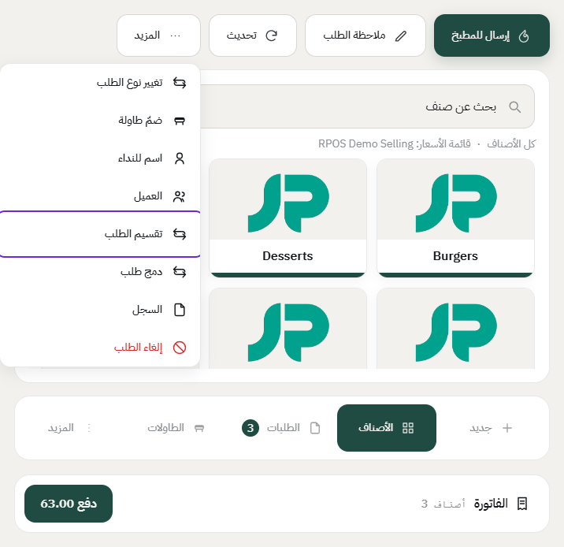
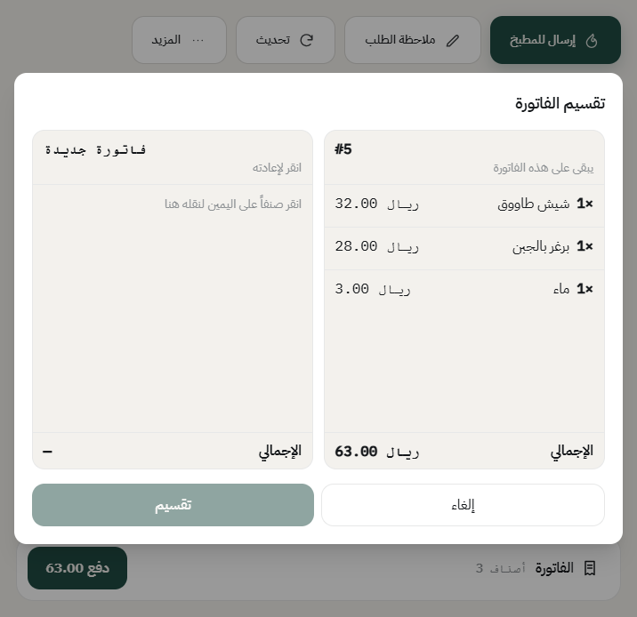
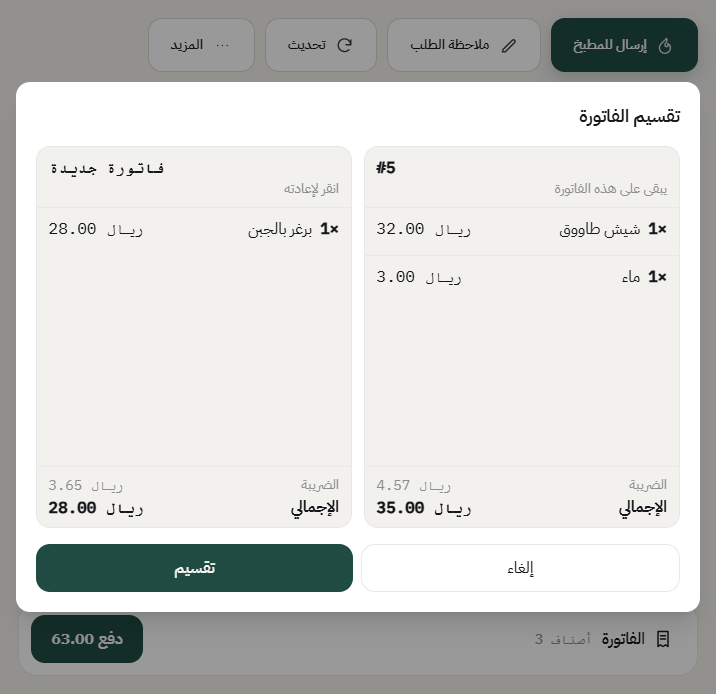
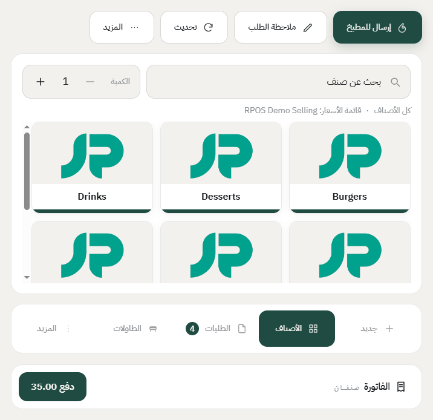
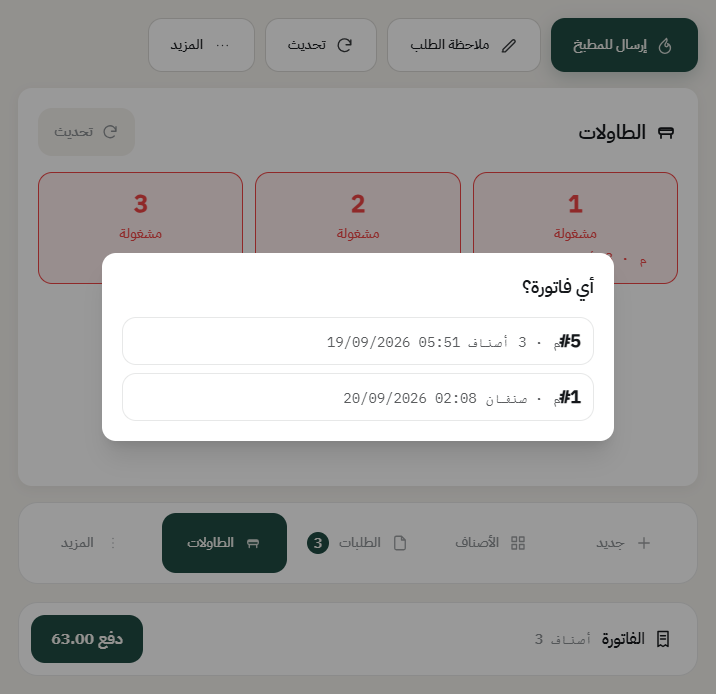
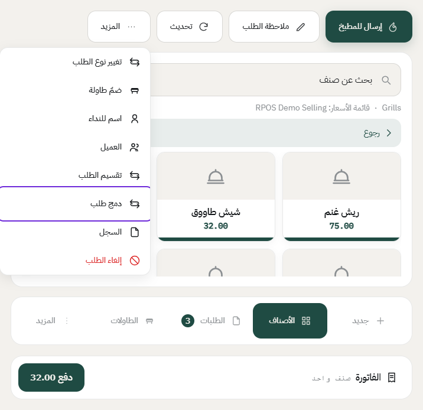
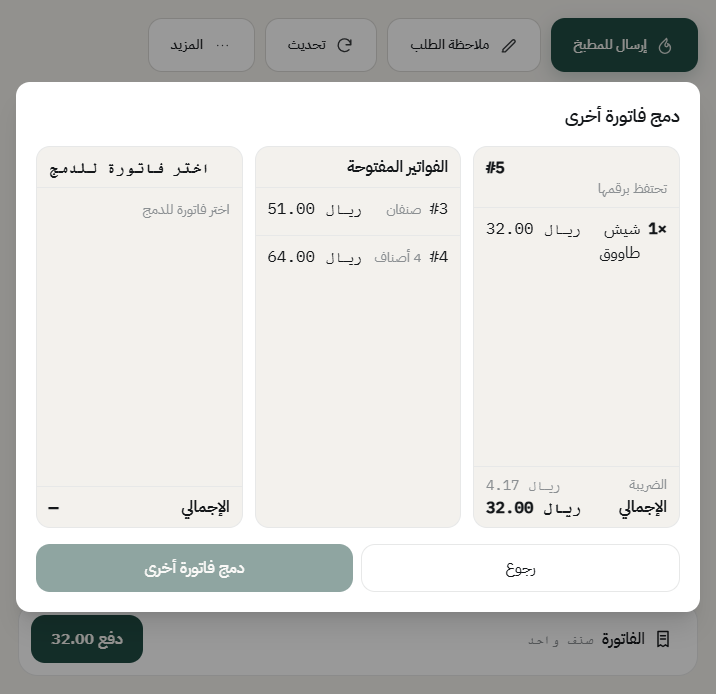
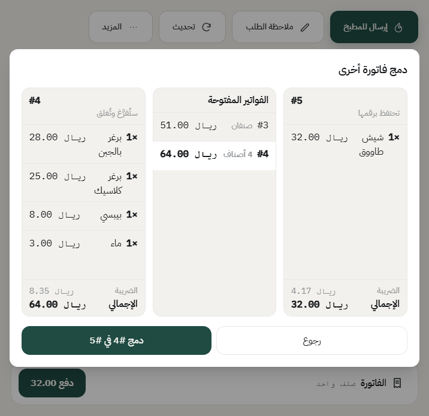
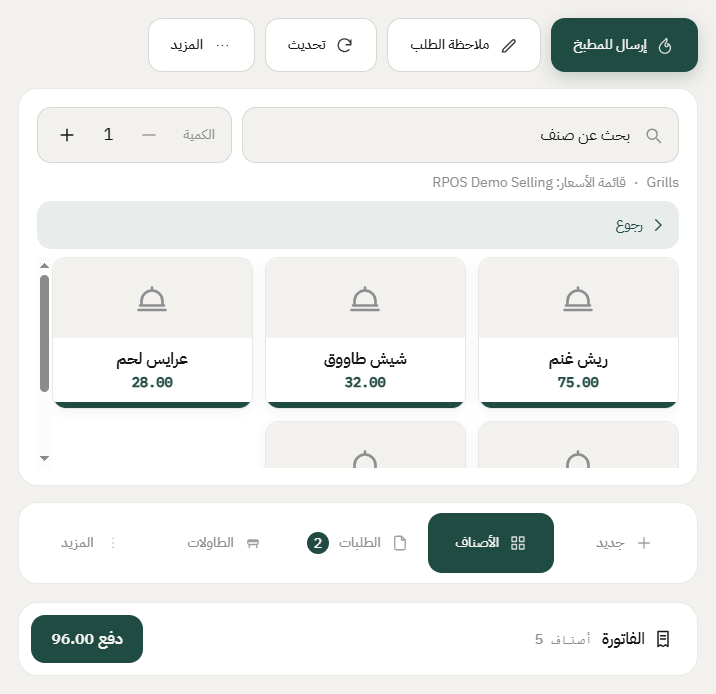

# تقسيم فاتورة ودمج فاتورتين

أحياناً الزبائن يبغون كل واحد يدفع طلبه لحاله، أو العكس: طلبين ويبغون يدفعون مرة وحدة. النظام يسوي الاثنين بنقل الأصناف بين الفواتير.

**الفرق بينها وبين «قسم بالتساوي»:** «قسم بالتساوي» في شاشة الدفع يقسم المبلغ على عدد الأشخاص بدون ما يغيّر الفاتورة، وتبقى فاتورة وحدة. أما التقسيم هنا فينشئ **فاتورة ثانية مستقلة** لها رقمها، وكل وحدة تنحاسب وتنطبع لحالها.

## تقسيم فاتورة

1. افتح الفاتورة، واضغط **المزيد**، بعدها **تقسيم الطلب**.

2. تطلع لك شاشة فيها جهتان: على اليمين الأصناف اللي تبقى في الفاتورة الحالية، وعلى الشمال **فاتورة جديدة** فاضية.

3. اضغط على الصنف اللي تبي تنقله، ينتقل للفاتورة الجديدة. واضغط عليه مرة ثانية لو بغيت ترجّعه.

   المبلغ والضريبة لكل جهة يتحدثون مع كل نقلة، فتعرف كم بيدفع كل طرف قبل ما تأكد.

4. اضغط **تقسيم**. تنفتح لك الفاتورة الجديدة برقمها، والفاتورة الأصلية تبقى بأصنافها الباقية.

5. الطاولة تصير عليها فاتورتان. أول ما تضغط عليها، النظام يسألك أي فاتورة تبي.

## شرط مهم للتقسيم على الطاولات

التقسيم يشتغل على طلب سفري أو توصيل بدون أي إعداد. أما الطلب الجالس على طاولة، فالنظام يسمح بتقسيمه فقط إذا كان الفرع يسمح بأكثر من فاتورة على الطاولة.

تفعّلها من المكتب: **نقاط البيع** ← **الأجهزة والفروع** ← **الفروع**، افتح الفرع، وعلّم **السماح بأكثر من فاتورة على الطاولة**.

وإذا كانت غير معلّمة، يطلع لك رفض يقول إن هذا الفرع يخلي فاتورة وحدة للطاولة.

## دمج فاتورتين

1. افتح الفاتورة اللي **تبيها تبقى**، واضغط **المزيد**، بعدها **دمج طلب**.

2. تطلع لك فاتورتك على اليمين، وتحتها قائمة **الفواتير المفتوحة**.

3. اضغط على الفاتورة اللي تبي تدمجها. النظام يعرض لك أصنافها ومبلغها، ويقول لك بوضوح إنها **ستُفرَّغ وتُغلق**.

4. اضغط **دمج**. كل الأصناف تنتقل لفاتورتك، والفاتورة الثانية تنقفل، وطاولاتها تنتقل معها.

## من يقدر يسوي هذا؟

الاثنان يحتاجان صلاحية **«يقسم ويدمج الفواتير»**. تعطيها للدور من **نقاط البيع** ← **الموظفين والسجلات** ← **مجموعات الصلاحيات**. وإذا الموظف ما عنده الصلاحية، الخياران ما يظهران له في قائمة **المزيد**.

وكل نقل أصناف بين الفواتير ينكتب في **سجل العمليات** وفي سجل الفاتورتين، فتعرف مين نقل وش ومتى.

---

السابق: [الدفع وطباعة الفاتورة](payment.md)

التالي: [ضمّ طاولات لفاتورة وحدة](join-tables.md)

الرجوع لـ[صفحة البداية](README.md)
