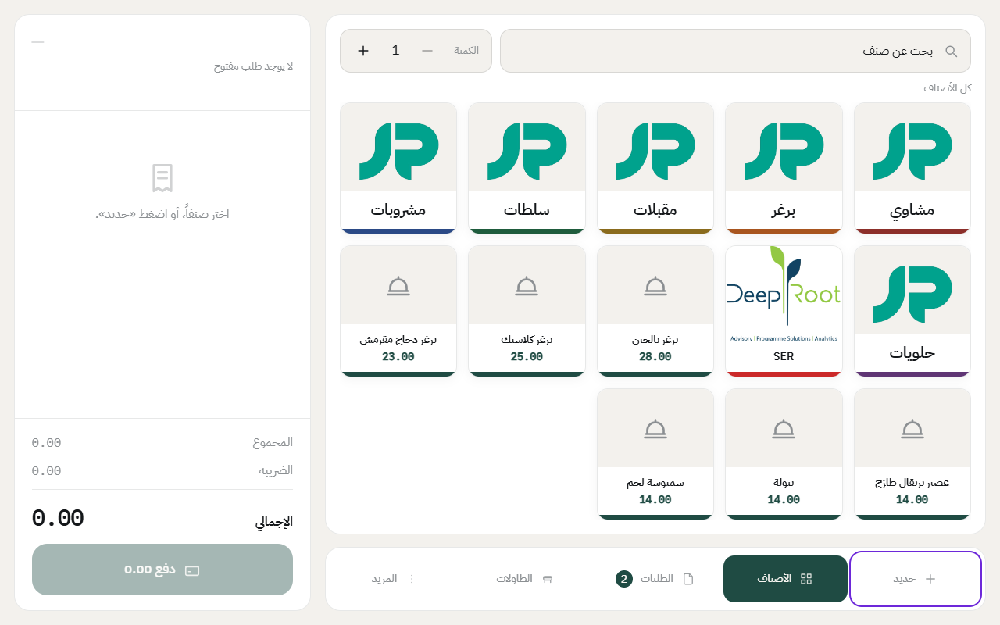
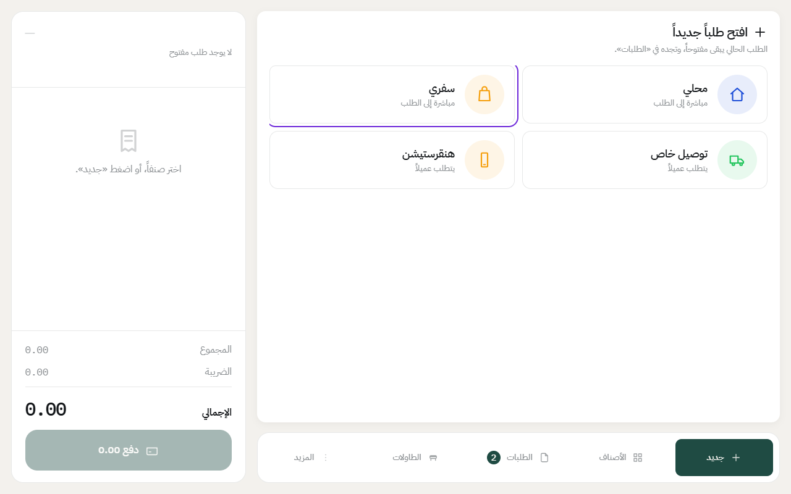
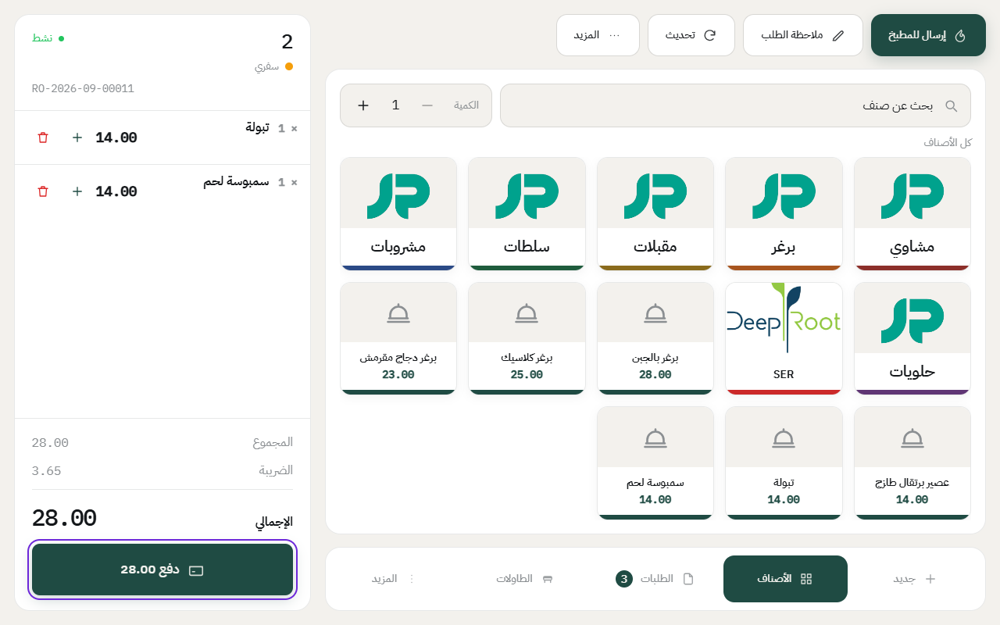
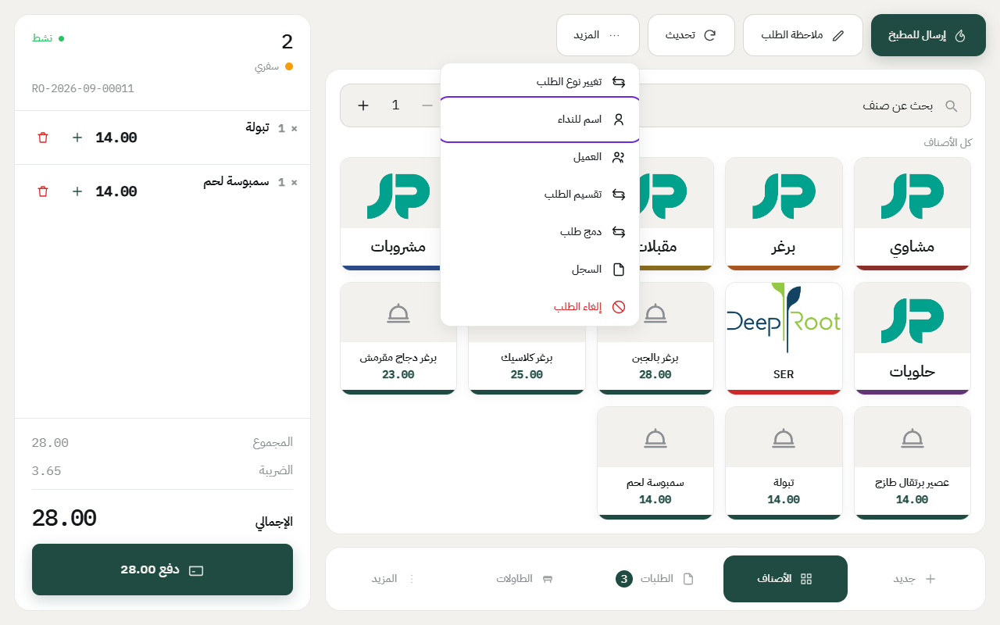

# إنشاء طلب سفري

الطلب السفري ما يحتاج طاولة. الكاشير يفتح الطلب، ويضيف الأصناف، والزبون يدفع على طول.

قبل ما تبدأ، لازم يكون [الدرج مفتوح](open-drawer.md).

## الخطوات

1. اضغط على **جديد** في الشريط اللي تحت.

2. اختر **سفري**.

3. أضف الأصناف بنفس طريقة [الطلب المحلي](dine-in-order.md): اضغط على المجموعة، وبعدها على الصنف.
4. اضغط على **دفع** وكمّل الدفع.

في الإعداد الجاهز، الطلب السفري ينطبع في المطبخ بعد ما يدفع الزبون، فما تحتاج تضغط **إرسال للمطبخ**. وإذا مطعمك مغيّر هذا الإعداد، تلقاه في [أنواع الطلب](add-order-types.md).

## اسم الزبون للنداء

إذا تبغى تنادي الزبون باسمه لما يجهز طلبه:

1. اضغط على **المزيد** فوق الأصناف.
2. اضغط على **اسم للنداء** واكتب الاسم.

---

السابق: [إنشاء طلب محلي على طاولة](dine-in-order.md)

التالي: [إنشاء طلب توصيل](delivery-order.md)

الرجوع لـ[صفحة البداية](README.md)
