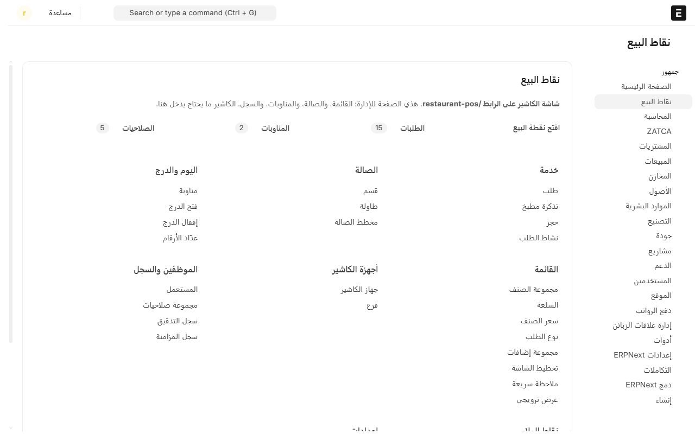
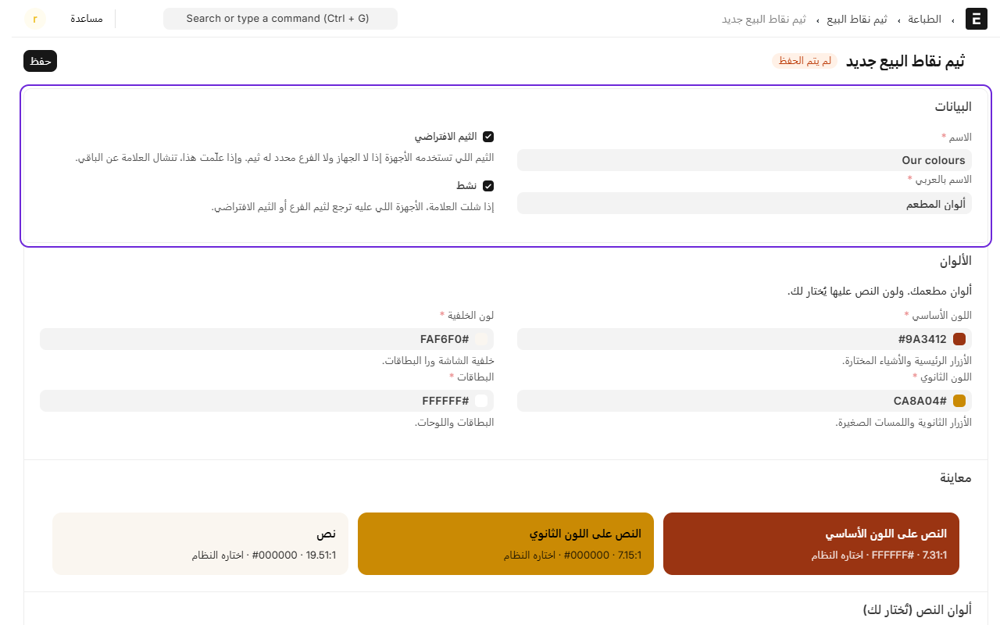
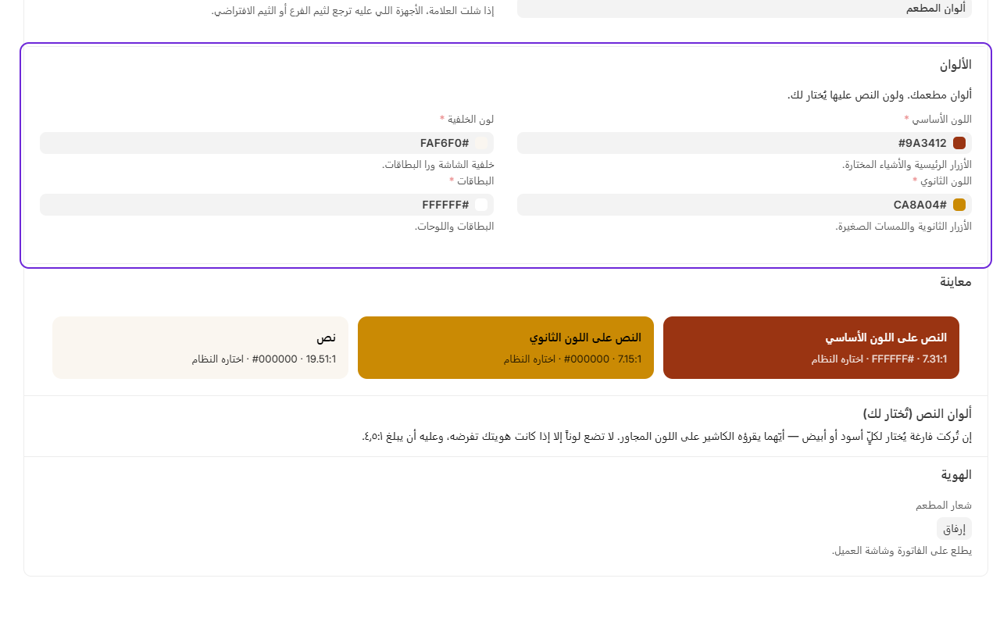
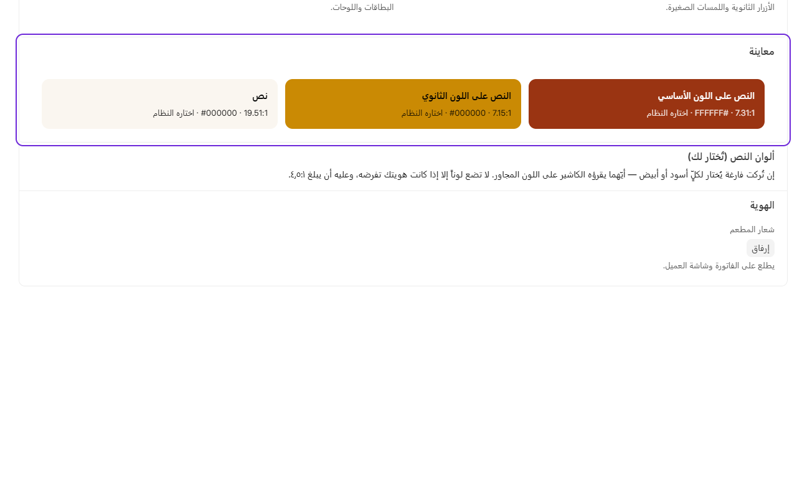

# تغيير ألوان شاشة الكاشير

تقدر تخلي شاشة الكاشير بألوان مطعمك، وتضيف شعار المطعم عشان يطلع على الفاتورة وشاشة العميل.

## الخطوات

1. من المكتب، ادخل على **نقاط البيع**.
2. تحت **إعدادات**، اضغط على **ألوان شاشة الكاشير**.

3. اضغط على **إضافة ألوان شاشة الكاشير**.
4. اكتب **الاسم** و**الاسم بالعربي**، مثل «ألوان المطعم».
5. علّم **الألوان الافتراضية** إذا تبغاه لكل الأجهزة.

6. تحت **الألوان**، اختر:
   - **اللون الأساسي**: لون الأزرار الرئيسية، مثل «دفع».
   - **اللون الثانوي**: للأزرار الثانوية واللمسات الصغيرة.
   - **لون الخلفية** و**البطاقات**.

7. شوف **المعاينة** تحت الألوان. لون النص فوق كل لون ينختار لك تلقائياً، أسود أو أبيض، على حسب اللي يتقرا أوضح.

8. تحت **هوية المطعم**، ارفع **شعار المطعم**.
9. اضغط على **حفظ**، وحدّث شاشة الكاشير عشان تشوف الألوان الجديدة.

إذا الألوان صعبة القراءة، النظام ما يحفظ الألوان ويقول لك وش تعدّل.

## ألوان لفرع أو جهاز معيّن

- **لفرع**: افتح الفرع، واختر الألوان تحت **المظهر**.
- **لجهاز**: افتح **جهاز الكاشير**، واختر الألوان في خانة **ألوان الشاشة**.

الجهاز ياخذ ألوانه هو أول، وإذا ما له ياخذ ألوان الفرع، وإذا ما له ياخذ الألوان الافتراضية.

---

السابق: [حجز طاولة](reservations.md)

التالي: [تشغيل شاشة العميل](customer-display.md)

الرجوع لـ[صفحة البداية](README.md)
