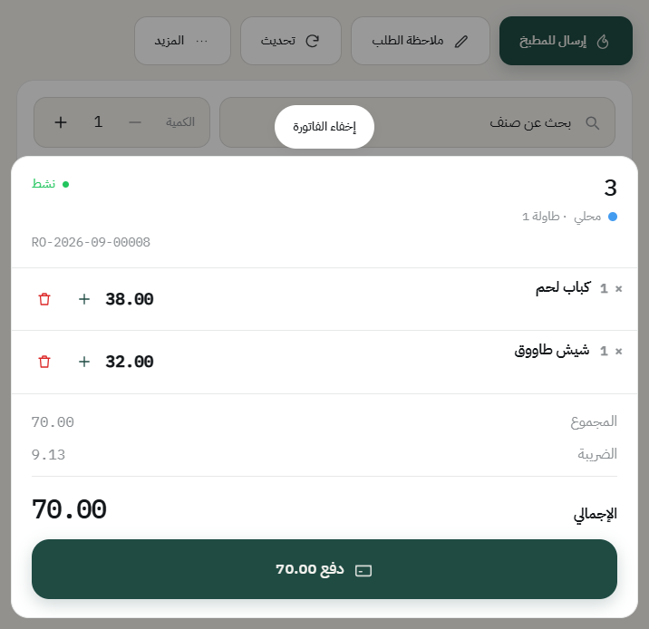
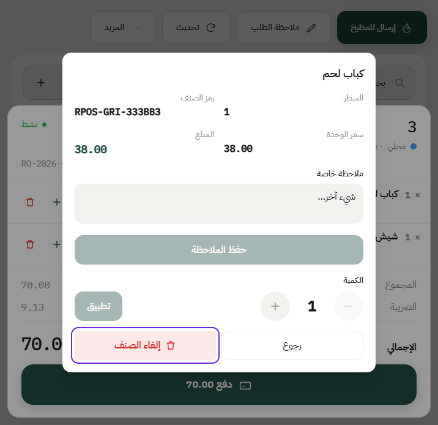
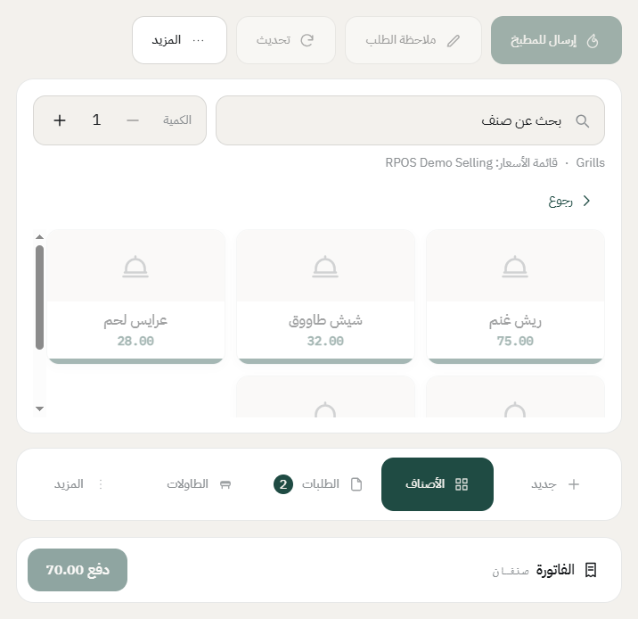
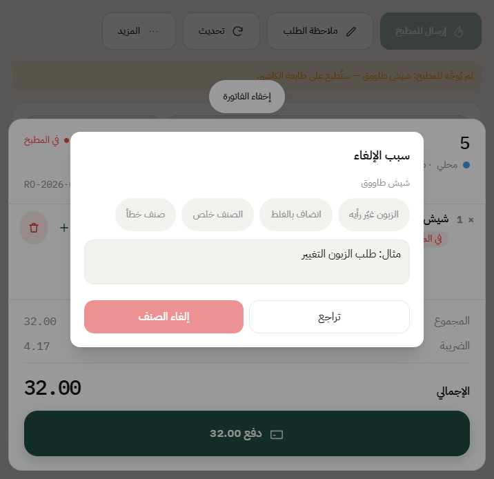
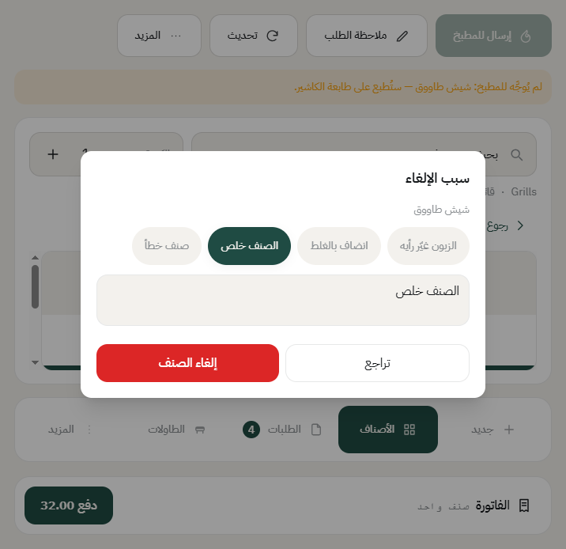
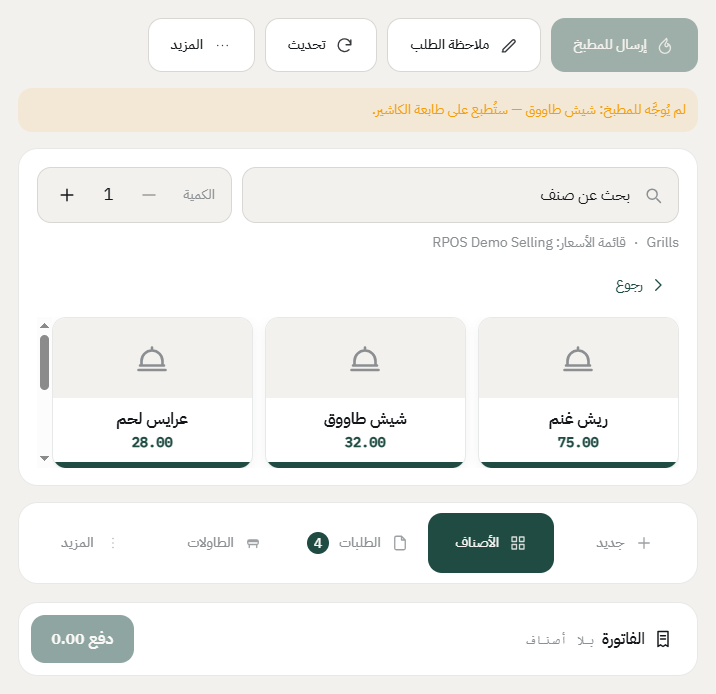
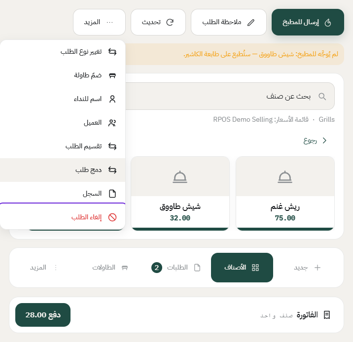
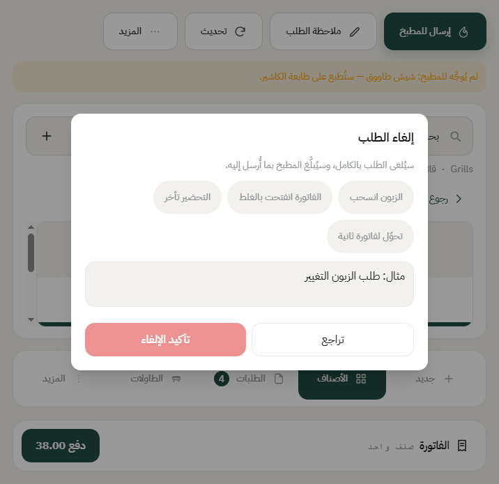
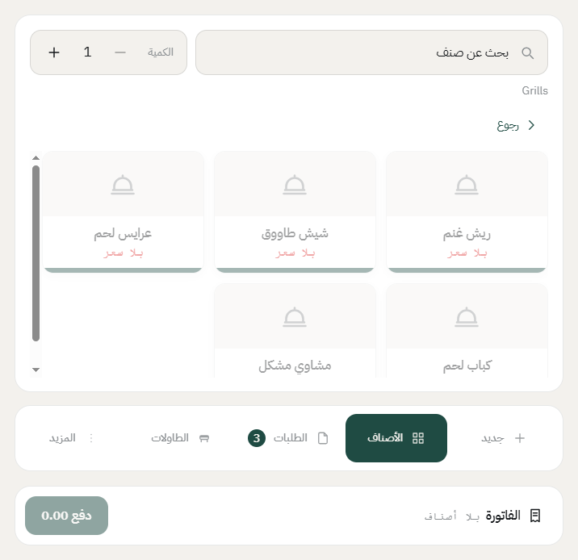

# إلغاء صنف أو إلغاء طلب

فيه فرق بين الاثنين: **إلغاء صنف** يشيل سطر واحد من الفاتورة، و**إلغاء الطلب** يلغي الفاتورة كلها. والنظام يفرّق بينهما، ويفرّق كمان بين الصنف اللي ما راح للمطبخ والصنف اللي راح.

## إلغاء صنف قبل ما يروح للمطبخ

هذا أبسط حالة: الصنف انضاف بالغلط وما انرسل بعد.

1. افتح الفاتورة، واضغط على سطر الصنف.

2. تفتح لك شاشة الصنف: رقم السطر، والسعر، والكمية، وخانة ملاحظة خاصة.

3. اضغط **إلغاء الصنف**. ينشال من الفاتورة على طول، والنظام ما يسألك عن سبب، لأن المطبخ ما شاف الصنف أصلاً.

## إلغاء صنف بعد ما راح للمطبخ

هنا النظام يشدّد، لأن المطبخ بدأ يجهّز.

1. اضغط على سطر الصنف، بتلقى تحته **في المطبخ**.
2. اضغط زر **الحذف** جنب السطر، أو **إلغاء الصنف** من شاشة الصنف.
3. النظام يطلب **سبب الإلغاء**، وما يكمل بدونه.

4. اختر سبب جاهز من الأزرار، مثل «الزبون غيّر رأيه» أو «الصنف خلص». وإذا السبب مو موجود، اكتبه بنفسك في الخانة.

5. اضغط **إلغاء الصنف**. يصير شيئان: السطر ينشال من الفاتورة، و**تنطبع تذكرة في المطبخ** تقول إن الصنف انلغى عشان يوقفون تحضيره.

## إلغاء الطلب كامل

1. افتح الفاتورة، واضغط **المزيد**، بعدها **إلغاء الطلب**.

2. النظام يقول لك إن الطلب بيتلغى بالكامل وإن المطبخ بيتبلّغ بما أُرسل له، ويطلب السبب.

3. اختر سبب جاهز أو اكتبه، واضغط **تأكيد الإلغاء**. الفاتورة تنقفل، والطاولة تتحرر، والمطبخ ياخذ تذكرة إلغاء إذا كان استلم شي.

## الأسباب الجاهزة

الأسباب اللي تظهر كأزرار تقدر تعدّلها بنفسك: من المكتب، **نقاط البيع** ← **القائمة** ← **الملاحظات السريعة**. الشرح كامل في [الملاحظات السريعة والأسباب الجاهزة](quick-notes.md).

كل سطر له اسم عربي وإنجليزي، ونوع تختاره: **سبب إلغاء صنف** أو **سبب إلغاء طلب** (أو ملاحظة على صنف أو على الطلب). واللي ما تبيه يظهر، شيل عنه علامة **مفعّل**.

## أشياء تنتبه لها

- **الفاتورة المدفوعة ما تنلغى.** بعد الدفع الطريق الوحيد هو [المرتجع](return-order.md)، لأن الفاتورة صارت مستنداً ضريبياً.
- **الصلاحيات**: «يبطل صنف» و«يلغي طلب» صلاحيتان منفصلتان في مجموعة الصلاحيات. والموظف اللي ما عنده الصلاحية ما يشوف الخيار.
- **كل إلغاء ينكتب**: في سجل الطلب نفسه، وفي **سجل العمليات** مع اسم الموظف والسبب والوقت. وتقرير الدرج يعرض عدد الأصناف الملغاة.

---

السابق: [ضمّ طاولات لفاتورة وحدة](join-tables.md)

التالي: [سجل الطلب: مين سوّى وش ومتى](order-log.md)

الرجوع لـ[صفحة البداية](README.md)
