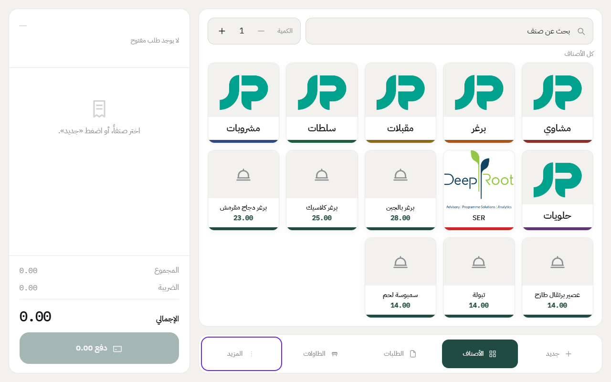
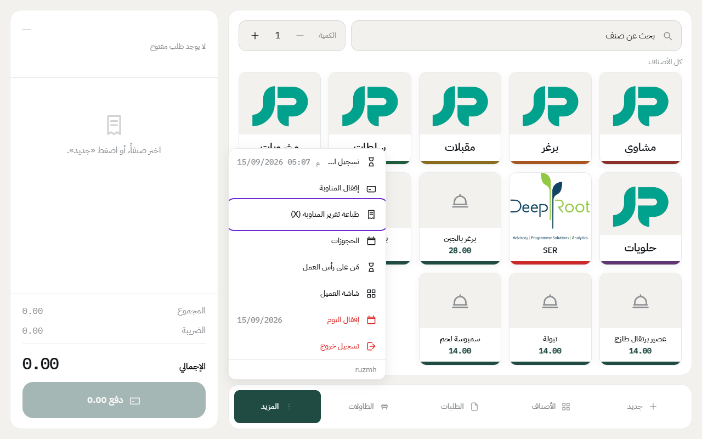
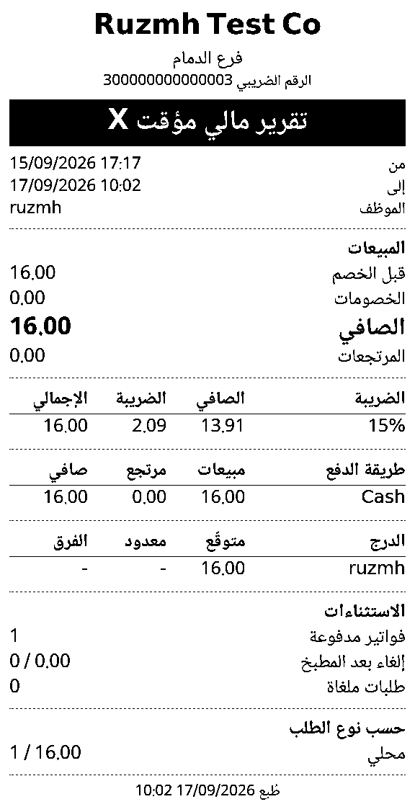

# تقرير الدرج (X)

تقرير X يوريك وش صار في الدرج لين هذي اللحظة: كم بعت، وكم رجعت، وكم المفروض يكون في الصندوق. **وما يقفل الدرج**، تقدر تطبعه كل ما احتجته وتكمل بيع.

متى تحتاجه؟ مثلاً لو الكاشير بيطلع خمس دقايق ويبغى يعرف كم في الصندوق قبل ما يسلّمه، أو المدير يبغى يشيك على المبيعات نص الشفت.

## الخطوات

1. اضغط على **المزيد** في الشريط اللي تحت.

2. اضغط على **تقرير الدرج (X)**.

يطلع لك التقرير **على الشاشة** على طول: الفواتير المدفوعة، والتحصيل، والخصومات، والأصناف الملغاة، والمتوقع في الصندوق، وتفصيل كل طريقة دفع وكل نوع طلب.

وإذا بغيت نسخة ورقية، اضغط **طباعة تقرير الدرج (X)** من نفس الشاشة، وينطبع على طابعة الكاشير.

**والدرج ما ينفتح لما تشوف التقرير.** ينفتح بس وقت العدّ عند إقفال الدرج، فتقدر تشيك على الأرقام قدام الزبائن بدون ما ينفتح الصندوق.

## وش فيه التقرير

- **المبيعات**: قبل الخصم، والخصومات، والصافي، والمرتجعات.
- **الضريبة**: الصافي والضريبة والإجمالي لكل نسبة.
- **طريقة الدفع**: كم انباع وكم ارتجع لكل طريقة، مثل النقد والشبكة.
- **الدرج**: كم **المتوقع** يكون في الصندوق. خانة **معدود** و**الفرق** تنعبى لما تقفل الدرج.
- **الاستثناءات**: عدد الفواتير، والإلغاءات، والطلبات الملغاة.
  - **إلغاء بعد المطبخ**: صنف انسحب والمطبخ شايفه — عدده ومبلغه. هذا أكل انطبخ أو راح ينطبخ.
  - **إلغاء قبل المطبخ**: صنف انشال من الفاتورة قبل ما يوصل المطبخ. **ما فيه خسارة ولا فلوس تحرّكت** — ما ينجمع مع اللي فوقه. موجود لأنه **يقول لك عن نمط**: كاشير يبني ويمسح عشرين فاتورة في اليوم، إما محتاج تدريب أو محتاج متابعة.
- **أكثر الأصناف مبيعاً**: خمسة أصناف، **مرتّبة بالمبلغ** لا بالعدد — والكمية جنبها. عشرين صنف بخمسة ريال ليلة، وواحد بمئة ليلة ثانية.
- **حسب نوع الطلب**: محلي، سفري، توصيل.

إذا الدرج مشترك وأكثر من موظف باع عليه، يطلع لكل موظف سطر بمبيعاته.

## الفرق بين X وZ

- **X**: تقرير مؤقت، تطبعه وقت ما تبغى، والدرج يبقى مفتوح.
- **Z**: التقرير النهائي، ينطبع تلقائياً لما [تقفل الدرج](close-drawer.md)، وفيه المبلغ اللي عديته والفرق.

**ولكل Z رقم متسلسل** يطلع جنب الحرف في الأعلى: `Z1`، `Z2`، `Z3`… الرقم يُعطى لحظة إقفال اليوم، **ومستقل لكل فرع**.

وفايدته للمحاسب والمراجع: الأرقام لازم تمشي بالتسلسل بلا نقص. **رقم ناقص معناه يوم مفقود**، ورقم متكرر معناه يومان ما ينفرزون. وعشان كذا الرقم ما يُعطى إلا لما يُقفل اليوم فعلاً — فتقرير X ما له رقم، لأن اليوم لسّه شغّال.

وللتفصيل على فترة أطول — بالتكلفة والربح ونسبة كل صنف — فيه تقرير **مبيعات الأصناف** في المكتب (نقاط البيع ← التقارير). وهذي الخمسة نظرة سريعة على المناوبة نفسها.

---

السابق: [قائمة الطلبات وتبويباتها](orders-list.md)

التالي: [إقفال الدرج وتسليمه للموظف اللي بعدك](close-drawer.md)

الرجوع لـ[صفحة البداية](README.md)
